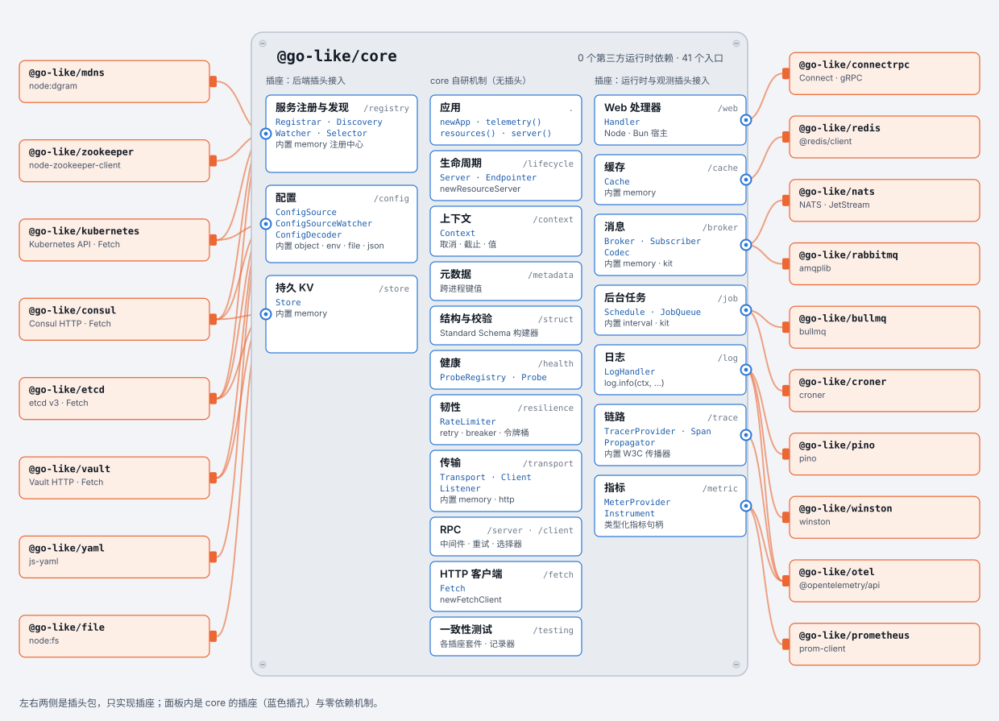
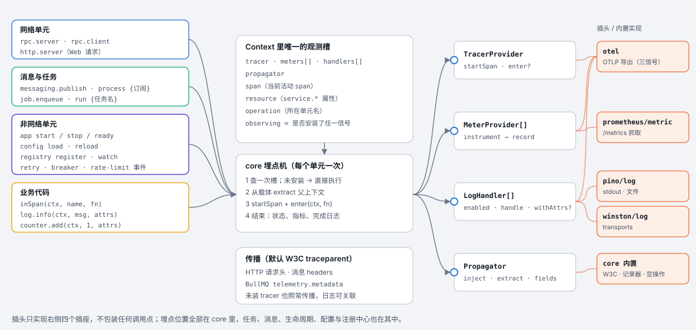
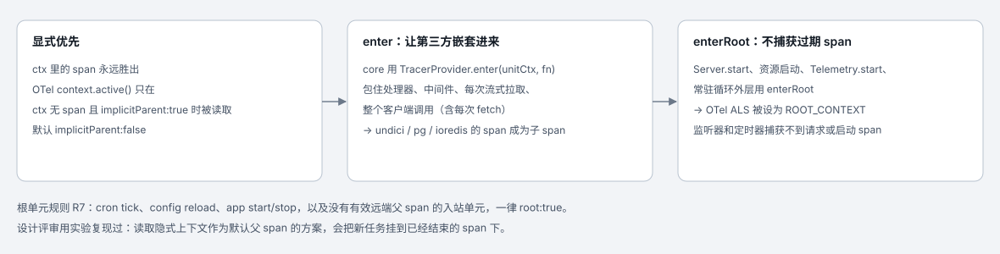
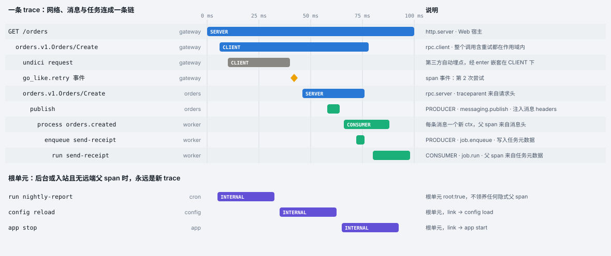
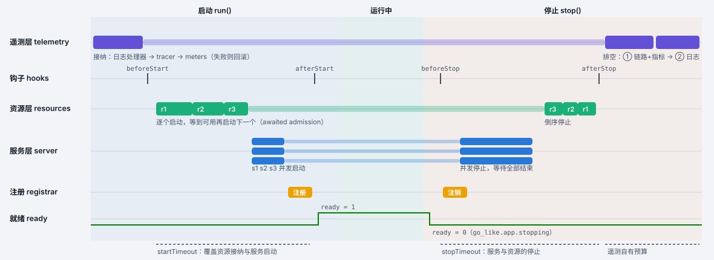

# 插座与插头：@go-like/core 架构设计（2026-11）

研究时间：2026-11-16。仓库基线：`main` 64492e7。状态：设计提案，尚未实现；文中的 API 不代表当前公共接口。配套文档：[使用示例](usage.md)、[Public API 参考](api-reference.md)、[决策记录](decisions.md)。本设计沿用[架构探索（2026-11）](../../reports/architecture-exploration-2026-11/README.md)线 A 审查得出的必做项（单一 core 实例、模块本地的身份品牌、单次多入口构建、不设根桶文件），并修订[包拓扑与协议边界](../package-topology.md)的部分决定（第 11 章逐条列出）。

---

## 0. 阅读说明

### 0.1 状态

- **设计提案，尚未实现。** 本设计没有改动仓库的源码、`package.json`、测试或文档；全部 API 以可编译的 TypeScript 声明树的形式存在，文中的 API 不代表当前公共接口。
- **基线。** 现行 API 清单基于 `main` `64492e7`：45 个 workspace 包、72 个导出入口、689 个公开符号。所有包均未发布到 npm，因此迁移不保留兼容垫片。
- **方法。** 三份竞争的观测方案经两次独立评审打分后合成一份观测设计；另有五个领域设计（内核、RPC 与 Web、发现与配置、数据与任务、打包）；五次跨领域评审；一份整合决策记录（[决策记录](decisions.md)，编号 [D1](decisions.md)-[D52](decisions.md) 与 OQ1-OQ14）；一棵类型检查通过的声明树。
- **证据形式。** 各领域的公开 API 以可编译的 TypeScript 声明表示，分别用 TypeScript 5.9.3 与仓库自带的 7.1.0-beta 类型检查通过；最终声明树按决策记录改写并整体检查。运行时行为只有少数模型和实验验证过（第 13 章）。凡称“已验证”的，均可在第 13 章找到方法与结果；凡称“推断”的，没有执行过。

### 0.2 与现行 API 的关系

- 新架构把今天的 45 个包收敛为 20 个包：一个零第三方依赖的 `@go-like/core`（41 个公开入口），加 18 个运行时插头包和 1 个构建期代码生成器（共 34 个公开入口）。
- 今天的 689 个符号全部有去处：保留并迁移、改名、合并、被替代、转为内部或删除，第 10 章给出统计和映射规则。
- 本文只命名函数和类型并说明它们做什么，不重复完整签名。完整声明、插座标记、相对现行 API 的状态与被替代的旧符号见 [Public API 参考](api-reference.md)；可编译的使用示例见[使用示例](usage.md)。

### 0.3 文档之间的优先级

| 优先级 | 文档                         | 作用                                                                                                                                                 |
| ------ | ---------------------------- | ---------------------------------------------------------------------------------------------------------------------------------------------------- |
| 1      | [decisions.md](decisions.md) | 约束性决策记录 D1-D52 与待维护者确认的问题 OQ1-OQ14。与任何设计文档冲突时以它为准；本文第 3.3、3.4 节的包表与入口表和第 10.3 节的 codemod 表依它整理 |
| 2      | README.md（本文）            | 由决策记录与各领域设计整理而成，不引入新决定。本文与决策记录冲突时以决策记录为准，并视为本文的勘误                                                   |

[Public API 参考](api-reference.md)由类型检查通过的声明树生成。它与本文正文对同一签名的描述不一致时，以声明树为签名依据，以决策记录为决定依据。

### 0.4 术语

| 中文         | 英文                     | 含义                                                                                                   |
| ------------ | ------------------------ | ------------------------------------------------------------------------------------------------------ |
| 插座         | socket                   | core 定义、由插头或应用实现的接口或类型（例如 `Registry`、`LogHandler`）。core 按结构接受实现          |
| 插头         | plug                     | 只负责填充插座的包，每个包对应一个第三方生态（Consul、pino、BullMQ 等）                                |
| 机制         | machinery                | 只基于插座运行的 core 逻辑：生命周期编排、RPC 调用管线、选择器、重试、配置合并与重载、watch 循环、埋点 |
| 参考实现     | reference implementation | 不需要外部系统的实现：内存、进程内、空实现、W3C 传播器                                                 |
| 运行时绑定   | binding                  | 只在 `.../node`、`.../bun` 子路径下出现、使用 `node:*` 或 `Bun` 的代码                                 |
| 插头作者 SDK | `/provider`              | 只给插头作者使用的辅助函数，例如错误工厂、watch 外壳、埋点工具包（kit）                                |
| 一致性测试   | conformance suite        | 以 `<concept>Conformance(subject)` 形式发布、由插头作者在自己的测试中运行的用例集                      |
| 通道         | lane                     | P 为可移植（Node、Bun、可达处含浏览器），N 为 Node 绑定，B 为 Bun 绑定                                 |
| 工作单元     | unit of work             | 一次被埋点的操作：一次 RPC、一次 Web 请求、一次消息投递、一次任务运行、一次应用启动等                  |
| 层           | tier                     | App 生命周期中的三个固定分组：telemetry、resources、server                                             |
| 准入         | admission                | 参与者 `start` 被接纳、所有权从应用转给 App 的时刻                                                     |
| 所有者排空   | owner drain              | 参与者 `stop` 启动的唯一一次清理过程                                                                   |
| 终态         | terminal                 | 原生对象自身结束（连接关闭、订阅终止）的事件                                                           |

### 0.5 默认值标记

决策记录为每个待定问题给出了推荐默认值（第 12 章）。本文按默认值书写，并在相关位置标注“（待维护者确认，OQn）”。

---

## 1. 结论摘要

### 1.1 目标是否达成

**达成，前提是采纳[决策记录](decisions.md)的 52 条决定并由维护者确认 14 个待定问题。** 设计目标是 Go 框架式的插座/插头架构：一个零第三方运行时依赖的 `@go-like/core` 自行实现每个概念的插座、机制和参考实现，每个第三方集成都是只填充插座的插头；观测（trace、metric、log）是 core 的基座，OTel、pino、winston、Prometheus 等插头为它提供后端，并且覆盖非网络工作单元。设计在这几点上都给出了完整方案：

- core 的 41 个入口不含任何第三方运行时导入，也不含第三方类型引用（Standard Schema 接口以内部声明方式内置）。
- 每个第三方集成都是一个按生态命名的插头包，只实现 core 插座；插头之间互不导入，也不导入 core 的非公开文件。
- 观测由 core 拥有：core 在固定位置为 RPC、Web、消息发布与逐条投递、任务运行与入队、应用生命周期、配置加载与重载、注册与注册中心 watch、韧性事件建立工作单元；四个观测插头只填充 `TracerProvider`、`MeterProvider`、`LogHandler`、`Propagator` 插座，不包装任何调用点。
- 生命周期新增有序的三层（telemetry、resources、server），资源层等待准入，解决了今天“队列与使用它的 worker 并发启停”的竞态。

### 1.2 关键数字

| 项目                  | 今天                                                                     | 新架构                                                                                          |
| --------------------- | ------------------------------------------------------------------------ | ----------------------------------------------------------------------------------------------- |
| 包数量                | 45                                                                       | 20：`@go-like/core` + 18 个运行时插头 + `@go-like/protoc-gen-like`                              |
| 公开入口              | 72                                                                       | 75：core 41 + 插头与生成器 34                                                                   |
| core 第三方运行时依赖 | 将并入 core 的包声明了 `@types/node`、`@standard-schema/spec`、`js-yaml` | 0（`@types/node` 仅为 devDependency，`js-yaml` 移到插头）                                       |
| 公开符号去向          | 689                                                                      | 全部有去处：迁移 529、改名 12、合并 35、被替代 39、转内部 38、删除 36                           |
| 现有入口的 codemod    | —                                                                        | 72 行一一对应（第 10.3 节）                                                                     |
| 决定                  | —                                                                        | 52 条（[D1](decisions.md)-[D52](decisions.md)），待维护者确认 10 个（OQ5-OQ14；OQ1-OQ4 已批准） |

### 1.3 主要变化

1. **一个 core 包，按子路径进入概念。** 根入口只是 App API（`newApp` 及其选项）；`context`、`metadata`、`struct`、`health`、`resilience`、`transport`、`server`、`client`、`web`、`registry`、`config`、`fetch`、`cache`、`store`、`broker`、`job` 与观测的 `telemetry`、`log`、`trace`、`metric` 都是 `@go-like/core/<concept>`。没有根桶文件（barrel）。
2. **生命周期参与者插座移到 `@go-like/core/lifecycle`**（D1）。`Server`、`Endpointer` 不再从根入口导出，因此没有任何插座子路径导入根入口。
3. **三层生命周期。** `telemetry(tel)` 最先准入、最后排空；`resources(...)` 逐个按声明顺序启动并等待准入、按逆序停止；`server(...)` 保持今天的并发启停（[D3](decisions.md)）。`newResourceServer` 是把应用自有原生资源接入资源层的唯一适配器（[D4](decisions.md)）。
4. **就绪是 App 事实。** `readyProbe(registry)` 把 App 的就绪窗口投射到探针注册表，`createHealthHandler` 输出 `/livez`、`/readyz`；RPC 监听器的 `/healthz` 保留为监听器存活检查（[D7](decisions.md)）。
5. **观测基座。** 四个同步插座、一个私有 Context 槽、七条派生规则、固定位置的工作单元、按语义约定 1.45.0 命名的常量、编译期类型化的指标标签；没有全局注册，没有安装任何东西时只多一次 Context 查找（[D36](decisions.md) 重新表述）。
6. **共享机制进 core。** 注册中心与配置插头共用的 watch 循环、心跳、身份锁、Fetch 客户端等在 core（`/registry/provider`、`/config/provider`、`/fetch`），插头不再复制 watcher 状态机、退避循环和 Fetch 执行器。
7. **新任务概念。** `Schedule`（纯时间表）与 `JobQueue`（持久队列）两个插座，core 的 `newScheduleServer` 负责计时、不重叠、手动触发与诚实排空；croner、BullMQ 变为插头。
8. **插头按生态打包。** 同一后端的注册、配置、存储合为一个包的多个子路径，共享一个协议客户端（[D26](decisions.md)）；插头的运行时绑定统一为 `<socket>/node`（[D27](decisions.md)）；文件存储成为插头 `@go-like/file`（[D30](decisions.md)）；Connect/gRPC 插头为 `@go-like/connectrpc`（[D23](decisions.md)）。
9. **一致性测试公开。** 所有用例集从一个入口 `@go-like/core/testing` 导出，命名统一为 `<concept>Conformance(subject)`，用例类型统一为 `ConformanceCase`（[D32](decisions.md)，待维护者确认，OQ10）。
10. **单实例检测。** core 在模块求值时检测同一 realm 中是否加载了第二份 core，发现即以 `GO_LIKE_CORE_DUPLICATE_INSTANCE` 抛错（[D6](decisions.md)）。

### 1.4 尚未完成的部分

- 所有决定的并集已经合成为一棵声明树（20 个包、75 个入口、787 个导出），TS 5.9.3 与 7.1.0-beta 均零诊断通过类型检查，依赖规则全部通过（第 13.1 节）。它是声明，不是实现；[D49](decisions.md) 仍把“真实代码上的并集类型检查”定为迁移第 0 步的硬性关卡。
- 写使用示例时发现 4 个小的 API 缺口（第 13.4 节），需要在实现前补上或写明。
- 运行时行为大多未验证：真实 `app.ts` 的等待准入、端点先绑定场景、各插头的“启动前停止”、OTel 桥接修复、重复 `traceparent` 的端到端测试都需要在实现阶段完成。
- 公开面、资源层等待准入、npm 包名与插头依赖规则（OQ1-OQ4）已于 2026-11-16 批准；其余 10 个待定问题中，core 对等依赖策略（OQ5）的撤回成本最高（第 12 章）。

---

## 2. 设计准则

### 2.1 目标

设计目标来自维护者的要求：

- 遵循 Go 微服务框架（go-micro、go-kratos、go-zero）的模式：框架先自研核心概念——生命周期、传输、配置、服务发现与注册、日志、元数据、追踪与指标、存储、缓存、消息代理——具体实现放在其他包。core 设计插座，其他包是插头。
- `@go-like/core` **零第三方运行时依赖**。
- OpenTelemetry 是插头。core 提供让 OTel 接入的基座；OTel 覆盖 trace、log 和 metric；工作**并不总是网络调用链**。

### 2.2 插座与插头

**插座**是 core 声明的接口或类型，插头或应用实现它，core 按结构接受实现（不要求继承、不使用类）。每个插座在声明中说明所有权（谁关闭什么）与终止语义（何时算结束、失败如何传递）。例如：

- `Registry`（`Registrar` + `Discovery`）：插头实现，内核在准入后调用 `register`、在停止时调用 `deregister`。
- `LogHandler`：插头实现 `enabled`、`handle`，可选 `withAttrs` 与 `lifecycle`；core 把日志记录扇出给每个已安装的处理器。
- `Schedule`：纯函数式时间表 `next(afterMs)`，没有计时器，没有 I/O。

**插头**是只填充插座的包。规则：

| 规则           | 内容                                                                                                                                                                               | 依据                                     |
| -------------- | ---------------------------------------------------------------------------------------------------------------------------------------------------------------------------------- | ---------------------------------------- |
| 命名           | 包按所适配的外部生态命名；填充的每个插座是一个子路径，名称与 core 的概念子路径一致（`./registry`、`./config`、`./store`、`./cache`、`./broker`、`./job`、`./log`、`./metric`）     | 本节准则                                 |
| 根入口         | 只有当根入口就是插座本身（`@go-like/otel`、`@go-like/connectrpc`），或者承载该插头唯一的共享协议客户端（consul、etcd、vault、kubernetes）时才有根入口                              | [D26](decisions.md)                      |
| 运行时绑定     | 插头的运行时绑定是 `<socket>/node`：`@go-like/zookeeper/registry/node`、`@go-like/mdns/registry/node`、`@go-like/file/store/node`；Connect 插头的绑定是 `@go-like/connectrpc/node` | [D27](decisions.md)、[D23](decisions.md) |
| 依赖 core      | `peerDependencies["@go-like/core"]` 为锁步的精确版本，`devDependencies["@go-like/core"]` 为 `"workspace:*"`，永不放在 `dependencies`                                               | [D44](decisions.md)                      |
| 第三方依赖种类 | 需要模块身份一致的为 peer；只接收应用对象且运行时仅做类型导入的为可选 peer；插头自己构造并封装的为精确版本的常规依赖                                                               | [D43](decisions.md)（维护者已确认，OQ4） |
| 导入方向       | 只导入 core 的公开子路径和自身文件；不导入其他插头、不导入 `@go-like/core/src/...` 或任何非公开文件                                                                                | 本节准则                                 |
| 不包装         | 插头实现插座，不重新实现 core 机制，不包装 core 调用点；观测插头不装饰客户端、中间件、处理器或 broker                                                                              | 本节准则                                 |
| 可调用 SDK     | 插头调用 core 公开的 `/provider` 工具包（例如 broker 的 `deliver`/`publish`、任务的 `runJob`/`dispatchJob`/`enqueue`）不算包装调用点；工具包契约是插座契约的一部分                 | [D33](decisions.md)                      |
| 构建期工具     | `protoc-gen-like` 不是运行时插头，不对等依赖 core                                                                                                                                  | 本节准则                                 |

### 2.3 什么进 core、什么做插头

core 只能包含四类代码，全部零第三方运行时依赖：

1. **插座**：定义概念或扩展点的接口、类型与契约。
2. **机制**：只基于插座运行的逻辑。
3. **不需要外部系统的参考实现**：空实现、内存实现、进程内实现，W3C trace-context 传播器。
4. **core 自身机制运行服务所必需的运行时宿主绑定**，只放在 `.../node`、`.../bun` 子路径下：HTTP 监听宿主、HTTP 传输监听器、进程信号、读取配置文件。根入口与插座入口从不导入 `node:*`，也不引用 `Bun`。

其余一律是插头：与外部系统通信的（Consul、etcd、Kubernetes API、Vault、Redis、RabbitMQ、NATS、ZooKeeper、多播 DNS 对端、观测后端），包装第三方库的（pino、winston、prom-client、OpenTelemetry、croner、bullmq、Connect-ES、js-yaml），或者另一种协议（gRPC/Connect）。第三方类型引用同样不允许出现在 core 中；Standard Schema 这类为复制而设计的小规范，由 core 内置接口。

判定流程与例子：

| 判断问题                                                  | 是 →                                                   | 例子                                                                                                                                                         |
| --------------------------------------------------------- | ------------------------------------------------------ | ------------------------------------------------------------------------------------------------------------------------------------------------------------ |
| 它是否与进程外的系统通信，或导入第三方库？                | 插头                                                   | Redis 缓存 → `@go-like/redis/cache`；YAML 解码 → `@go-like/yaml/config`；pino → `@go-like/pino/log`                                                          |
| 它是否只是接口、类型或契约？                              | core 插座                                              | `Cache`、`Store`、`Broker`、`TracerProvider`、`Fetch`                                                                                                        |
| 它是否只操作插座、没有外部依赖？                          | core 机制                                              | 生命周期编排、RPC 管线、选择器、`retry`、配置合并与重载、`newSnapshotWatcher`、`newScheduleServer`、埋点                                                     |
| 它是否不需要外部系统、且有当前使用者？                    | core 参考实现，路径 `/<concept>/memory` 或折入概念入口 | `newMemoryTransport`、`newMemoryRegistry`、`newMemoryCache`、`newMemoryStore`、`newMemoryBroker`；W3C 传播器折入 `/trace`；`newIntervalSchedule` 折入 `/job` |
| 它是否使用 `node:*`/`Bun`，且是 core 自身机制运行所必需？ | core 运行时绑定 `/node` 或 `/bun`                      | `@go-like/core/node`（信号）、`/transport/http/node`、`/web/node`、`/web/bun`、`/config/node`（配置文件读取）                                                |
| 它使用 `node:*`，但 core 机制并不需要？                   | 插头                                                   | 文件存储：持久化、锁与崩溃语义超出“无外部系统”，core 没有任何代码读取文件存储 → `@go-like/file/store` 与 `/store/node`（[D30](decisions.md)）                |
| 它只是某个示例里的应用胶水？                              | 应用代码                                               | NATS 连接适配器：用 `newResourceServer({ terminal, close })` 在应用里写，不新增插头（[D4](decisions.md)）                                                    |
| 它有没有当前使用者？                                      | 没有则不加                                             | 基于 Redis 的分布式限流器、断路器工厂、公开控制台日志处理器、`./log/console`、`./transport/testing`、`./lifecycle/testing` 都不加；以后添加是非破坏性的      |

新增公开面的统一规则：每个新插座或新入口必须指名仓库中一个当前使用者（设计准则：没有只为假设的未来扩展而新增的公共概念）；入口一旦发布就是 semver 承诺，以后新增是非破坏性的，删除则是破坏性的（[D41](decisions.md)）。

两个特别说明：

- **HTTP 传输在 core 中。** 它的客户端是 Web 标准 Fetch，监听器是运行时宿主绑定；线协议（`POST /{service}/{endpoint}`、JSON、SSE、`Go-Like-Timeout-Ms`、`Go-Like-Metadata`、`ServiceError` JSON）本来就由 core 的 server 与 client 定义，HTTP 传输就像 Go 的 `net/http` 一样是运行时的职责。它不会成为静默默认值：`newServer` 仍要求 `transport(...)`，`newClient` 仍要求 `withTransport(...)`。
- **`fetch` 是新概念。** 它只承载“后端插头注入的 Fetch 能力”（`Fetch` 插座）和调用它的客户端机制，取代今天 10 个插头各自声明的 Fetch 类型，不含 Web 处理器、路由或 RPC 传输。

### 2.4 与 go-micro、kratos、go-zero 的对照

对照以三个框架的源码为参照，上游依据见[架构探索（2026-11）](../../reports/architecture-exploration-2026-11/README.md)的“上游依据”：

| 概念                | go-micro                                      | kratos                                              | go-zero                              | go-like 新架构                                                                                | 结论                                                                 |
| ------------------- | --------------------------------------------- | --------------------------------------------------- | ------------------------------------ | --------------------------------------------------------------------------------------------- | -------------------------------------------------------------------- |
| App 入口            | `micro.NewService(opts)`                      | `kratos.New(Name, Version, Server, Registrar, ...)` | 无 App，`ServiceGroup`               | `newApp(...AppOption)`，含 `name`、`version`、`server`、`registrar`、`stopTimeout`            | 保留 kratos 形态                                                     |
| 生命周期参与者      | `Server.Start/Stop`                           | `transport.Server{Start(ctx),Stop(ctx)}`            | `Service{Start,Stop}`                | `lifecycle.Server{start(ctx),stop(ctx)}`                                                      | 保留                                                                 |
| 启停顺序            | 钩子后 `Listen`、`Broker.Connect`、`Register` | 服务器并发启动，启动后注册                          | 按加入顺序逆序停止                   | telemetry、resources、server 三层，资源等待准入                                               | 新增，超出三者                                                       |
| 注册中心            | 单一 `Registry` 含 `ListServices`             | `Registrar`/`Discovery`/`Watcher`                   | etcd 具体实现                        | `Registrar`/`Discovery`/`Watcher`/`Registry`                                                  | 保留 kratos 形态；不提供 `ListServices`                              |
| 选择器              | `Select→Next`、`Mark`、`Reset`                | `Selector`/`Balancer`/`DoneFunc`                    | p2c_ewma                             | 同步 `Selector.select` + `SelectionDone`；RR、random、WRR、P2C、EWMA                          | 保留                                                                 |
| 传输                | `Dial`/`Listen` 插座                          | 核心内置 http、grpc 服务器                          | rest/zrpc                            | Fetch 形状的 `Transport`，保留 go-micro 的 `init/options/string`                              | 保留 go-micro 形态                                                   |
| 客户端/服务端中间件 | 接口加 wrapper                                | 统一 `middleware.Middleware` 横跨 http/grpc         | 固定拦截器链                         | `Middleware` 与 `ClientMiddleware` 分开；Connect 在 core 中间件之外                           | 部分保留；跨协议统一中间件未做（OQ11）                               |
| 消息代理            | `Broker` 插座含 `Connect/Disconnect`          | 核心无                                              | 只有队列抽象                         | `Broker{publish,subscribe,string}`；连接由应用作为资源持有                                    | 保留，生命周期移出插座                                               |
| 消息确认            | —                                             | —                                                   | —                                    | 只在原生对象上（`event.native`），[ADR 0007](../../adr/0007-broker-event-native-semantics.md) | 刻意不做可移植 ack/nack                                              |
| 配置                | `Load/Sync/Watch` 源                          | `Load/Scan/Value/Watch/Close`                       | 结构体 `conf.Load`                   | `load/scan/value/watch/close` + Source/Watcher                                                | 保留 kratos 形态                                                     |
| 存储/缓存           | 插座                                          | 无                                                  | 具体实现                             | `Store`、`Cache` 插座，无生命周期                                                             | 保留                                                                 |
| 日志                | `Logger` 接口                                 | v3 使用 slog                                        | `logx`/`logc` 带 ctx                 | 类 slog 的 `LogHandler` + Context 优先的 `log.*`                                              | 保留 slog/logc 风格                                                  |
| 追踪/指标           | 可选 wrapper                                  | contrib otel 中间件                                 | 默认开启的链                         | 常开的 core 工作单元 + 显式提供者                                                             | 新的组合：go-zero 的覆盖面 + kratos 的显式注入；失去按操作关闭的粒度 |
| 元数据              | metadata                                      | server/client metadata ctx                          | contextx                             | server/client metadata ctx + 显式白名单传播                                                   | 保留                                                                 |
| 错误                | `errors.Error{id,code,detail,status}`         | `Status{code,reason,message,metadata}`              | `errorx`                             | `ServiceError{code,status,metadata}`                                                          | 保留，但没有 `reason` 与 gRPC 映射（OQ11）                           |
| 健康                | `health/`                                     | —                                                   | 内部                                 | `ProbeRegistry`、`createHealthHandler`、`readyProbe`                                          | 保留并增强                                                           |
| 任务/定时           | —                                             | —                                                   | —                                    | `Schedule`、`JobQueue`、调度服务器                                                            | 新增（设计准则要求）                                                 |
| 全局默认值          | 大量 `Default*` 变量                          | 全局选择器、编解码器注册表、slog 默认               | proc、prometheus、trace 一次性初始化 | 无                                                                                            | 比三者都严格                                                         |
| 插头打包            | 在核心模块中                                  | contrib 模块                                        | 在核心中                             | 每个生态一个 npm 包                                                                           | 保留 kratos contrib 形态                                             |

**刻意没做的事**（[D52](decisions.md)，core README 将列成表）：

| 概念                           | 不在 core 的理由                                                         |
| ------------------------------ | ------------------------------------------------------------------------ |
| 认证（auth）                   | 没有当前使用者；只提供 mTLS 对端身份（`TransportInfo.peerIdentity()`）   |
| 错误 `reason` 与 gRPC 状态映射 | 待维护者决定（OQ11）                                                     |
| 断路器工厂与分布式限流         | 没有当前使用者；`RateLimiter` 插座已允许异步，以后可加                   |
| 自适应过载保护（shedding）     | 没有当前使用者                                                           |
| 默认信号处理                   | 信号处理必须显式传入 `signal()`，core 不隐式挂进程钩子                   |
| RPC 编解码插座                 | RPC 按决定只用 JSON（[D17](decisions.md)）；protobuf 由 Connect 插头覆盖 |
| 路由器                         | [ADR 0001](../../adr/0001-kernel-public-api.md) 决定不提供               |

**保留的 Go 风格约束：** Context 优先的显式所有权；不是 DI 容器，没有服务定位器，没有全局默认实例；注册中心需要传两次（`registrar(registry)` 与 `withDiscovery(registry)`），这与 kratos 相同，是“无服务定位器”的直接结果。

### 2.5 相对设计准则的修订

下列条目相对最初的设计准则有修订，在这里集中记录：

| 准则位置                    | 原要点                                               | 修订                                                                                                                                                                  | 决定                                     |
| --------------------------- | ---------------------------------------------------- | --------------------------------------------------------------------------------------------------------------------------------------------------------------------- | ---------------------------------------- |
| 插头规则：第三方依赖        | 插头的第三方依赖一律为常规依赖                       | 改为按“是否需要模块身份一致”划分 peer、可选 peer、常规依赖                                                                                                            | D43（维护者已确认，OQ4）                 |
| 插头规则：入口              | 插头只列出插座子路径                                 | 允许根入口承载该插头唯一的共享协议客户端与错误族                                                                                                                      | D26                                      |
| 生命周期：层的顺序          | 资源层在服务器之前启动、之后停止                     | 明确为“等待准入”：资源 `start` 在可用时 resolve，内核逐个等待                                                                                                         | [D3](decisions.md)（维护者已确认，OQ2）  |
| 公开面：testing 与 provider | 每个概念一个 `/testing`；插头作者 SDK 放 `/provider` | 只有一个 `./testing`；`/provider` 只在概念同时有面向使用者的 API 时设立（`/fetch`、`/cache` 无 `/provider`）；纯函数或默认的参考实现折入概念入口（`w3c`、`interval`） | D41（维护者已确认，OQ1）                 |
| 概念清单                    | core 子路径的概念清单                                | 清单保持，另新增 `fetch` 概念（第 4.9 节）                                                                                                                            | 见第 4.9 节                              |
| 身份品牌                    | 身份品牌不使用 `Symbol.for`                          | 不修订；单实例检测器使用 `globalThis[Symbol.for("go-like.core.instances")]` 作为会合点，它不是身份品牌，从不用于判断身份                                              | [D6](decisions.md)（待维护者确认，OQ14） |

---

## 3. 总体架构

### 3.1 文字版总图

```text
应用 main.ts（组合根）
  │  构造插头对象（传入应用自己创建的原生对象：OTel SDK、pino logger、NATS 连接、BullMQ Queue……）
  │  newTelemetry({...})、newConfig(...)、newServer(...)、newClient(...)
  ▼
@go-like/core 根入口：newApp(...AppOption)
  ├─ telemetry(tel)      ── 观测层：最先准入，最后两阶段排空（trace+metric，然后 log）
  ├─ resources(...)      ── 资源层：按声明顺序逐个启动并等待准入，逆序停止
  ├─ server(...)         ── 服务器层：并发启动，并发停止
  ├─ registrar(r)        ── 服务器层全部准入后注册，停止时先注销
  ├─ readyProbe(probes)  ── 就绪窗口投射到 ProbeRegistry
  └─ hooks / budgets     ── beforeStart、afterStart、beforeStop、afterStop；startTimeout、stopTimeout
        │
        ▼
概念子路径（插座 + 机制 + 参考实现）
  context · metadata · struct · health · resilience · lifecycle
  transport · server · client · web · registry · config · fetch
  cache · store · broker · job
        │                         ▲
        │ 每个工作单元由 core 在     │ 插头只填充插座、调用 /provider SDK
        │ 固定位置埋点              │
        ▼                         │
观测基座：telemetry · log · trace · metric（插座：LogHandler、TracerProvider/Span、
          Propagator、MeterProvider/Instrument、TelemetryLifecycle）
          单一私有 Context 槽；W3C 传播器为默认值；无全局注册
        ▲
        │ 填充观测插座
插头：@go-like/otel · @go-like/pino/log · @go-like/winston/log · @go-like/prometheus/metric
      @go-like/consul|etcd|vault|kubernetes|zookeeper|mdns|yaml   （registry、config、store 插座）
      @go-like/nats|rabbitmq   （broker 插座） @go-like/redis（cache） @go-like/file（store）
      @go-like/bullmq|croner   （job 插座）    @go-like/connectrpc（web Handler、lifecycle Server/Endpointer）
构建期：@go-like/protoc-gen-like（生成代码导入 @go-like/core/context 与 @go-like/connectrpc）
```



_core 插座面板：左右两侧的插头包填充插座，中间是只由 core 实现的机制，core 自身零第三方运行时依赖。_

三条贯穿全局的规则：

1. **Context 优先。** 每个 I/O 操作第一个参数是 `ctx: Context`；Context 携带取消、截止时间、AppInfo、观测状态（含当前 span）与请求元数据。
2. **显式组装。** 没有全局默认实例，没有全局注册；所有实现由应用构造并传入（选项、构造函数参数或 `withTelemetry`）。
3. **一个规范路径。** 每件事只有一种推荐做法：订阅用 `newBrokerServer`，定时用 `newScheduleServer`，消费队列用 `JobQueue.worker`，接入原生资源用 `newResourceServer`，就绪用 `readyProbe` 加 `createHealthHandler`。

### 3.2 core 内部的导入层级

按值导入的方向由 `test/portable-lane.test.ts` 强制（[D12](decisions.md)、[D47](decisions.md)）：

| 层级 | 文件夹                                                                                                                                       | 可按值导入 |
| ---- | -------------------------------------------------------------------------------------------------------------------------------------------- | ---------- |
| 0    | `internal/`、`context/`                                                                                                                      | 层级 0     |
| 1    | `metadata/`、`struct/`、`telemetry/`、`log/`、`trace/`、`metric/`                                                                            | 层级 0-1   |
| 2    | `transport/`（插座与线协议）、`resilience/`、`health/`、`registry/`、`config/`、`fetch/`、`cache/`、`store/`、`broker/`、`job/`、`resident/` | 层级 0-2   |
| 3    | `transport/memory/`、`transport/http/`、`server/`、`client/`、`web/`、各 `memory` 与 `testing` 模块                                          | 层级 0-3   |
| 4    | `index.ts`、`app/`、每个 `node`/`bun` 绑定                                                                                                   | 层级 0-4   |

`telemetry` 与 `log`、`metric`、`trace` 之间允许一个只含类型导入的环；任何值级别的环都使测试失败（D47）。层级 4 以下没有文件导入根入口或 `app/`。

### 3.3 20 个包

依赖种类遵循 [D43](decisions.md)（维护者已确认，OQ4）：“peer”为带插头测试版本 caret 范围的 `peerDependencies`，另有精确版本的 dev 依赖；“可选 peer”为 `peerDependenciesMeta.optional`；“常规”为精确版本的 `dependencies`。每个插头都以精确锁步版本对等依赖 `@go-like/core`；`protoc-gen-like` 不依赖 core。

| #   | 包                         | 公开入口                                 | 填充的插座                                                                                                                                                                       | 第三方依赖（种类）                                                                              | 通道                   | 取代                                                                                                                                                                                                                                                                                |
| --- | -------------------------- | ---------------------------------------- | -------------------------------------------------------------------------------------------------------------------------------------------------------------------------------- | ----------------------------------------------------------------------------------------------- | ---------------------- | ----------------------------------------------------------------------------------------------------------------------------------------------------------------------------------------------------------------------------------------------------------------------------------- |
| 1   | `@go-like/core`            | 41 个（3.4 节）                          | 全部 core 插座、机制、参考实现、绑定                                                                                                                                             | 无                                                                                              | P/N/B                  | 21 个包：`broker`、`broker-memory`、`cache`、`cache-memory`、`client`、`config`（不含 `./yaml`）、`context`、`core`、`event`、`health`、`metadata`、`registry`、`resilience`、`server`、`store`、`store-memory`、`struct`、`transport`、`transport-http`、`transport-memory`、`web` |
| 2   | `@go-like/otel`            | `.`                                      | `TracerProvider`（含 `enter`）、`Span`、`MeterProvider`、`Instrument`、`LogHandler`、`Propagator`、`TelemetryLifecycle`                                                          | `@opentelemetry/api`（peer）                                                                    | P                      | `@go-like/otel`                                                                                                                                                                                                                                                                     |
| 3   | `@go-like/pino`            | `./log`                                  | `LogHandler`（含 `withAttrs`、`lifecycle`）                                                                                                                                      | `pino`（peer）                                                                                  | N,B                    | `@go-like/pino`                                                                                                                                                                                                                                                                     |
| 4   | `@go-like/winston`         | `./log`                                  | `LogHandler`（含 `withAttrs`、`lifecycle`）                                                                                                                                      | `winston`（可选 peer，运行时只做类型导入）                                                      | N,B                    | `@go-like/winston`                                                                                                                                                                                                                                                                  |
| 5   | `@go-like/prometheus`      | `./metric`                               | `MeterProvider`、`Instrument`、`TelemetryLifecycle`；抓取用 Web `Handler`（文档化的命名例外）                                                                                    | `prom-client`（peer）                                                                           | N,B                    | `@go-like/prometheus`                                                                                                                                                                                                                                                               |
| 6   | `@go-like/consul`          | `.`、`./registry`、`./config`、`./store` | 根：消费 `Fetch` 的共享客户端（不是插座）；`Registry`；`ConfigSource`/`ConfigSourceWatcher`；`Store`                                                                             | 无                                                                                              | P                      | `registry-consul`、`config-consul`、`store-consul`                                                                                                                                                                                                                                  |
| 7   | `@go-like/etcd`            | `.`、`./registry`、`./config`、`./store` | 同 consul                                                                                                                                                                        | 无                                                                                              | P                      | `registry-etcd`、`config-etcd`、`store-etcd`                                                                                                                                                                                                                                        |
| 8   | `@go-like/vault`           | `.`、`./config`、`./store`               | 根客户端；`ConfigSource`；`Store`                                                                                                                                                | 无                                                                                              | P                      | `config-vault`、`store-vault`                                                                                                                                                                                                                                                       |
| 9   | `@go-like/kubernetes`      | `.`、`./registry`、`./config`            | 根客户端；`Registry`；`ConfigSource`                                                                                                                                             | 无                                                                                              | P                      | `registry-kubernetes`、`config-kubernetes`                                                                                                                                                                                                                                          |
| 10  | `@go-like/zookeeper`       | `./registry`、`./registry/node`          | 基于插头自有 `ZookeeperClientFactory` 的 `Registry`（可移植）；Node 客户端工厂                                                                                                   | `node-zookeeper-client`（常规，只被 `./registry/node` 导入）                                    | P；`/node` 为 N        | `registry-zookeeper`                                                                                                                                                                                                                                                                |
| 11  | `@go-like/mdns`            | `./registry`、`./registry/node`          | 基于插头自有 `MDNSHost` 的 `Registry`；`node:dgram` 宿主                                                                                                                         | 无                                                                                              | P；`/node` 为 N        | `registry-mdns`                                                                                                                                                                                                                                                                     |
| 12  | `@go-like/yaml`            | `./config`                               | `ConfigDecoder`                                                                                                                                                                  | `js-yaml`（常规）                                                                               | P                      | `@go-like/config/yaml` 子路径                                                                                                                                                                                                                                                       |
| 13  | `@go-like/nats`            | `./broker`、`./jetstream`                | `Broker`、`Subscriber`（NATS core；JetStream）                                                                                                                                   | `@nats-io/transport-node`（常规）；`@nats-io/jetstream`（可选 peer）                            | N,B                    | `nats`（4 个入口）                                                                                                                                                                                                                                                                  |
| 14  | `@go-like/rabbitmq`        | `./broker`                               | `Broker`、`Subscriber`                                                                                                                                                           | `amqplib`（可选 peer）                                                                          | N,B                    | `broker-rabbitmq`                                                                                                                                                                                                                                                                   |
| 15  | `@go-like/redis`           | `./cache`                                | `Cache`；资源层 `Server`                                                                                                                                                         | `@redis/client`（常规）                                                                         | N,B                    | `cache-redis`                                                                                                                                                                                                                                                                       |
| 16  | `@go-like/bullmq`          | `./job`                                  | `JobQueue`；`Server`（队列资源、worker）                                                                                                                                         | `bullmq`（peer）                                                                                | N,B                    | `bullmq`                                                                                                                                                                                                                                                                            |
| 17  | `@go-like/croner`          | `./job`                                  | `Schedule`                                                                                                                                                                       | `croner`（常规）                                                                                | P                      | `croner`                                                                                                                                                                                                                                                                            |
| 18  | `@go-like/file`            | `./store`、`./store/node`                | `Store`；资源层 `Server`；插头自有 `FileStoreHost`；Node 宿主                                                                                                                    | 无                                                                                              | P；`/node` 为 N        | `store-file`                                                                                                                                                                                                                                                                        |
| 19  | `@go-like/connectrpc`      | `.`、`./node`                            | `.`：Web `Handler`（Connect、gRPC-Web）、客户端拦截器、生成代码胶水；`./node`：生命周期 `Server` 与 `Endpointer`（托管 gRPC 服务器）、消费 `Discovery`/`Selector` 的 gRPC 客户端 | `@connectrpc/connect`（peer）、`@bufbuild/protobuf`（peer）、`@connectrpc/connect-node`（常规） | `.` 为 P；`/node` 为 N | `transport-grpc-buf`                                                                                                                                                                                                                                                                |
| 20  | `@go-like/protoc-gen-like` | `.`（含 `bin`）                          | 构建工具，无插座                                                                                                                                                                 | `@bufbuild/protoplugin`（常规）；不依赖 core                                                    | 构建期                 | `protoc-gen-like`                                                                                                                                                                                                                                                                   |

入口合计：core 41；otel、pino、winston、prometheus 各 1（4）；consul、etcd 各 4（8）；vault、kubernetes 各 3（6）；zookeeper、mdns、nats、file、connectrpc 各 2（10）；yaml、rabbitmq、redis、bullmq、croner、protoc-gen-like 各 1（6）。插头与生成器 34，总计 75。

### 3.4 core 的 41 个入口

“角色”取值：app（根 App API）、socket（插座）、machinery（机制）、reference（参考实现）、binding（运行时绑定）、sdk（插头作者 SDK）、testing（一致性测试）。“[SOCKET]”列出该入口声明的插座。

**应用与生命周期**

| #   | 入口                      | 角色             | 通道 | 用途（关键导出）                                                                                                                                                                                                                                                                                    |
| --- | ------------------------- | ---------------- | ---- | --------------------------------------------------------------------------------------------------------------------------------------------------------------------------------------------------------------------------------------------------------------------------------------------------- |
| 1   | `@go-like/core`           | app              | P    | App API：`newApp`、`App`、`AppInfo`、`AppHook`、`AppOption`、`AppNotReadyError`，身份选项（`context`、`id`、`name`、`version`、`metadata`、`endpoint`），层选项 `telemetry`、`resources`、`server`，`registrar`、`readyProbe`，预算与钩子，`newContext`/`fromContext`。不导出 `Server`/`Endpointer` |
| 2   | `@go-like/core/node`      | binding          | N,B  | `signal(...)`、`ProcessSignal`                                                                                                                                                                                                                                                                      |
| 3   | `@go-like/core/lifecycle` | socket+machinery | P    | [SOCKET] `Server`、`Endpointer`；`newResourceServer`、`ResourceServerOptions`、`ResourceServerError`                                                                                                                                                                                                |

**基础概念**

| #   | 入口                       | 角色             | 通道 | 用途                                                                                                                          |
| --- | -------------------------- | ---------------- | ---- | ----------------------------------------------------------------------------------------------------------------------------- |
| 4   | `@go-like/core/context`    | socket+machinery | P    | [SOCKET] `Context`；`background`、`todo`、各种派生函数、`waitForContext`                                                      |
| 5   | `@go-like/core/metadata`   | machinery        | P    | 元数据模型与 Context 辅助函数                                                                                                 |
| 6   | `@go-like/core/struct`     | machinery        | P    | 构建器（每个结果都是 Standard Schema）、`StructError`、`isStructError`、`Infer`、`encodeJson`、`decodeJson`、新增 `jsonCodec` |
| 7   | `@go-like/core/health`     | socket+machinery | P    | [SOCKET] `ProbeRegistry`、`Probe`；`newProbeRegistry`                                                                         |
| 8   | `@go-like/core/resilience` | socket+machinery | P    | [SOCKET] 可异步的 `RateLimiter`；`retry`、`Backoff`、`exponentialBackoff`、`newCircuitBreaker`、`newTokenBucketLimiter`       |

**观测**

| #   | 入口                               | 角色             | 通道 | 用途                                                                                                                            |
| --- | ---------------------------------- | ---------------- | ---- | ------------------------------------------------------------------------------------------------------------------------------- |
| 9   | `@go-like/core/telemetry`          | socket+machinery | P    | [SOCKET] `TelemetryLifecycle`；`Telemetry`、`newTelemetry`、`withTelemetry`，语义约定常量                                       |
| 10  | `@go-like/core/telemetry/provider` | sdk              | P    | `beginUnit`、`observing`、`logEvent`、`logCorrelation`、`resourceFromContext`、`withRemoteSpanContext`、`isValidSpanContext` 等 |
| 11  | `@go-like/core/log`                | socket+machinery | P    | [SOCKET] `LogHandler`；`log.*` 前端                                                                                             |
| 12  | `@go-like/core/trace`              | socket+machinery | P    | [SOCKET] `TracerProvider`、`Span`、`Propagator`；`inSpan`、`spanFromContext`、`newTraceContextPropagator`                       |
| 13  | `@go-like/core/metric`             | socket+machinery | P    | [SOCKET] `MeterProvider`、`Instrument`；类型化的指标句柄                                                                        |
| 14  | `@go-like/core/testing`            | testing          | P    | `newTelemetryRecorder`、统一的 `ConformanceCase`、各概念的 `<concept>Conformance(subject)`                                      |

**RPC 与 Web**

| #   | 入口                                | 角色             | 通道 | 用途                                                                                                                                                |
| --- | ----------------------------------- | ---------------- | ---- | --------------------------------------------------------------------------------------------------------------------------------------------------- |
| 15  | `@go-like/core/transport`           | socket+machinery | P    | [SOCKET] `Transport`、`Client`、`Listener`、`TransportHandler`、`TransportInfo`；选项、错误、`ServiceError`、契约 DSL、带品牌的 `ServiceCallOption` |
| 16  | `@go-like/core/transport/provider`  | sdk              | P    | 四个错误工厂、`newServerContext`、`observeResponseBody`                                                                                             |
| 17  | `@go-like/core/transport/memory`    | reference        | P    | `newMemoryTransport`                                                                                                                                |
| 18  | `@go-like/core/transport/http`      | reference        | P    | Fetch 拨号器 `newHTTPTransport`                                                                                                                     |
| 19  | `@go-like/core/transport/http/node` | binding          | N    | `newNodeHTTPTransport`（在 Bun 下也是监听器）                                                                                                       |
| 20  | `@go-like/core/server`              | machinery        | P    | `newServer`、服务器选项与中间件、`rateLimitMiddleware`                                                                                              |
| 21  | `@go-like/core/client`              | machinery        | P    | `newClient`、客户端与调用选项、`circuitBreakerMiddleware`                                                                                           |
| 22  | `@go-like/core/web`                 | socket+machinery | P    | [SOCKET] `Handler`；`contextHandler`、`requestContext`、`createHealthHandler`                                                                       |
| 23  | `@go-like/core/web/node`            | binding          | N    | Node Web 宿主 `newNodeServer`                                                                                                                       |
| 24  | `@go-like/core/web/bun`             | binding          | B    | Bun Web 宿主 `newBunServer`                                                                                                                         |

**发现、配置与 fetch**

| #   | 入口                              | 角色             | 通道 | 用途                                                                                                                                                                                                                           |
| --- | --------------------------------- | ---------------- | ---- | ------------------------------------------------------------------------------------------------------------------------------------------------------------------------------------------------------------------------------ |
| 25  | `@go-like/core/registry`          | socket+machinery | P    | [SOCKET] `Registrar`、`Discovery`、`Watcher`、`Registry`、`Selector`、`Filter`；选择器、过滤器、快照、`newDiscoveryResolver`、新增 `selectEndpoint`                                                                            |
| 26  | `@go-like/core/registry/provider` | sdk              | P    | `newSnapshotWatcher`、`newIdentityLocks`、`startHeartbeat`、`sha256Base32`、错误工厂                                                                                                                                           |
| 27  | `@go-like/core/registry/memory`   | reference        | P    | `newMemoryRegistry`                                                                                                                                                                                                            |
| 28  | `@go-like/core/config`            | socket+machinery | P    | [SOCKET] `ConfigSource`、`ConfigSourceWatcher`、`ConfigDecoder`、`ConfigResolver`、`FileCapability`、`FileWatcher`；`newConfig`、选项、`objectSource`、`envSource`、`fileSource`、`jsonDecoder`；类型再导出 `StandardSchemaV1` |
| 29  | `@go-like/core/config/provider`   | sdk              | P    | `newSourceWatcher`、`newConfigSourceMissingError`、`admitConfigObject`                                                                                                                                                         |
| 30  | `@go-like/core/config/node`       | binding          | N    | `newNodeFileCapability`                                                                                                                                                                                                        |
| 31  | `@go-like/core/fetch`             | socket+machinery | P    | [SOCKET] `Fetch`；`newFetchClient`、`FetchClient`、`FrameReader`、`parseOrigin`、`headerValue`、`isRetryableStatus`                                                                                                            |

**数据、消息与任务**

| #   | 入口                            | 角色             | 通道 | 用途                                                                                                                |
| --- | ------------------------------- | ---------------- | ---- | ------------------------------------------------------------------------------------------------------------------- |
| 32  | `@go-like/core/cache`           | socket           | P    | [SOCKET] `Cache`；`expiresIn`、`putOptions`                                                                         |
| 33  | `@go-like/core/cache/memory`    | reference        | P    | `newMemoryCache`                                                                                                    |
| 34  | `@go-like/core/store`           | socket           | P    | [SOCKET] `Store`；选项函数、`StoreConflictError`                                                                    |
| 35  | `@go-like/core/store/provider`  | sdk              | P    | 选项解析器、冲突错误工厂、快照                                                                                      |
| 36  | `@go-like/core/store/memory`    | reference        | P    | `newMemoryStore`                                                                                                    |
| 37  | `@go-like/core/broker`          | socket+machinery | P    | [SOCKET] `Broker`、`Subscriber`、`Codec`；`newBrokerServer`、`eventBroker`                                          |
| 38  | `@go-like/core/broker/provider` | sdk              | P    | 工具包 `deliver`、`publish`；`registerSubscriberTerminal`、`brokerTopic`、`snapshotBrokerMessage`、`newBrokerEvent` |
| 39  | `@go-like/core/broker/memory`   | reference        | P    | `newMemoryBroker`                                                                                                   |
| 40  | `@go-like/core/job`             | socket+machinery | P    | [SOCKET] `Schedule`、`JobQueue`；`newScheduleServer`、`newIntervalSchedule`、任务错误                               |
| 41  | `@go-like/core/job/provider`    | sdk              | P    | 工具包 `runJob`、`enqueue`、`dispatchJob`；选项解析器、错误工厂                                                     |

按角色计数：app 1；binding 5（`./node`、`./transport/http/node`、`./web/node`、`./web/bun`、`./config/node`）；`/provider` SDK 7（telemetry、transport、registry、config、store、broker、job）；testing 1；参考实现 6（`transport/memory`、`transport/http`、`registry/memory`、`cache/memory`、`store/memory`、`broker/memory`）；其余 21 个为概念入口（插座和/或机制）。

与先前方案的差异（[D41](decisions.md)）：从 57 个入口的并集中删除 17 个、新增 1 个（`./testing`）。被折叠的子路径：`./struct/codec` → `/struct`；`./trace/w3c` → `/trace`；`./web/health` → `/web`；`./config/env`、`./config/file` → `/config`；`./fetch/provider` → `/fetch`；`./cache/provider` → `/cache`；`./event` → `/broker`；`./job/interval` → `/job`；六个 `/<concept>/testing` → `./testing`。从公开面移除：`./schema`（一个内部声明，由 `/config` 类型再导出）、`./job/memory`（转内部）、`./struct/runtime`（转内部）、`./client/discovery`（移到 `/registry`）、`./store/file*`（插头 `@go-like/file`）。跨领域评审提出的“把六个 `/memory` 参考实现折入概念入口”被否决：设计准则规定参考实现命名为 `/<concept>/<impl>`（第 2.3 节），`research/designs/package-topology.md:15` 否决把默认实现聚合进契约入口，而且插头导入概念入口时会在不打包的运行时中加载内存实现代码。

---

## 4. 各概念设计

每节按同一结构写：插座及其契约要点；core 自带的机制与参考实现；对应插头；所有权与终止语义；与旧包的关系。签名见第 8 章与 [Public API 参考](api-reference.md)。

### 4.1 App 与生命周期（`@go-like/core`、`/lifecycle`、`/node`）

**插座。**

- `Server`（`/lifecycle`）：`start(ctx)`、`stop(ctx)`。准入后由 App 拥有；`stop` 启动至多一次所有者排空，`ctx` 只约束调用方自己的等待；在 `server(...)` 中 `start` 可以一直挂起到原生终态，在 `resources(...)` 中 `start` 必须在准入并可用时 resolve（[D3](decisions.md)）。准入后的 reject 是非预期终态，会使 App 失败。
- `Endpointer`（`/lifecycle`）：服务器层参与者的可选能力。`protocol()` 同步返回协议标识，同一个 App 的所有 `Endpointer` 必须一致；`endpoint(ctx)` 返回实际地址，可以与 `start` 共享绑定。
- 根入口不声明插座。`AppOption` 是带品牌的不透明值，只有 core 能创建；`newApp` 对其他值抛 `TypeError`。插头接入生命周期只通过公开插座：`Server`（任一层）、`TelemetryLifecycle`、`Registrar`、`ProbeRegistry`，或经由 `context(ctx)`/`App.stop()` 停止 App；信号安装器保持 core 内部，不成为公共运行时宿主 SPI。

**机制。**

- `newApp(...options)` 按参数顺序应用选项，校验层列表（同一参与者对象在 `resources(...)` 与 `server(...)` 中至多出现一次），注册就绪探针，派生各层 Context。
- 选项：身份 `context`、`id`、`name`、`version`、`metadata`、`endpoint`；层 `telemetry`、`resources`、`server`；`registrar`、`readyProbe`；预算 `registrarTimeout`（默认 10 000 ms）、`startTimeout`、`stopTimeout`（默认 0 表示不限）；钩子 `beforeStart`、`afterStart`、`beforeStop`、`afterStop`；AppInfo 载体 `newContext`/`fromContext`（为 kratos 对齐保留，[D13](decisions.md)）。
- `server(...)` 与 `resources(...)` 的参数类型是 `Server & NotTelemetry`：把 `Telemetry` 传给它们是编译错误，运行时品牌检查同时保留（[D11](decisions.md)）。
- `newResourceServer({ open?, terminal?, close })`（`/lifecycle`）把应用构造的原生资源接为一次性 `Server`：`start` 在 `open` 完成后 resolve（没有 `open` 时立即 resolve）；`terminal`（例如 NATS 的 `connection.closed()`）登记在 core 私有的 `WeakMap` 中，内核在准入后监视它，若它在停止请求之前结束，就以 `tier: "resource"` 记录参与者失败（Error 值或 reject 时携带该错误，正常 resolve 时为 `GO_LIKE_RESOURCE_CLOSED`）；`close` 是唯一一次所有者排空，以 `withoutCancel(第一次 stop 的 ctx)` 调用；`open` 失败时从不调用 `close`，因为所有权尚未转移；core 从不强制升级。第二次 `start` 以 `GO_LIKE_RESOURCE_ALREADY_STARTED` reject。
- `readyProbe(registry, name?)` 在 `registry` 中注册一个就绪探针（默认名 `"app"`），只在启动阶段结束到收到停止请求之间通过；窗口外抛 `AppNotReadyError`（`code: "GO_LIKE_APP_NOT_READY"`，`phase` 为 `created`、`starting`、`stopping`、`stopped`）。它与 `go_like.app.ready` 指标在同一时刻翻转。
- `signal(...signals)`（`/node`）在第一个信号到来时停止 App（默认 `SIGTERM`、`SIGQUIT`、`SIGINT`），设置 `process.exitCode = 128 + signo`。参数类型是 core 自有的 `ProcessSignal` 联合类型（37 个名称，与 `@types/node` 26.6.6 双向一致，由漂移测试保证），不再引用 `NodeJS.Signals`。
- **单实例检测**（[D6](decisions.md)）：每个持有品牌的 core 模块导入 `internal/instance.ts` 的 `coreInstance`；模块求值时把 `{ version, url }` 写入 realm 全局槽 `globalThis[Symbol.for("go-like.core.instances")]`，遇到 `url` 或 `version` 不同的记录即抛出 `name: "CoreInstanceError"`、`code: "GO_LIKE_CORE_DUPLICATE_INSTANCE"` 的 `Error`，消息同时给出两个地址、两个版本和修复方法。相同记录（热重载、测试运行器重置模块表）不报错；另一个 realm（`node:vm`、worker）不冲突；没有关闭开关。它覆盖从不调用 `newApp` 的脚本，也能发现相同版本的第二条路径。错误类型不导出：在模块求值时抛出的错误没有可供分支的调用方。Bun 静默安装不匹配 peer 导致的“单副本版本偏差”被接受，依靠锁步版本、npm ERESOLVE 和文档（待维护者确认，OQ5）。

**参考实现。** 没有单独的参考实现；生命周期机制本身就在根入口。

**对应插头。** 实现 `Server` 的插头：`@go-like/redis/cache`（资源）、`@go-like/bullmq/job`（队列资源与 worker）、`@go-like/file/store`（资源）、`@go-like/connectrpc/node`（服务器层，带 `Endpointer`）。观测插头不实现 `Server`，而是实现 `TelemetryLifecycle`；`@go-like/pino` 与 `@go-like/winston` 去掉对 `Server` 的导入（[D1](decisions.md)）。

**所有权与终止。** 遵守 [ADR 0003](../../adr/0003-resident-adapter-ownership.md)（`research/adr/0003-resident-adapter-ownership.md:33-43`）：准入后所有权转移；只有一个所有者排空；调用方的 ctx 只约束自己的等待；超时不是原生终态；core 不定义通用的强制关闭。分层顺序、预算、回滚与失败报告见第 6 章。

**与旧包的关系。** `@go-like/core` 根入口今天的 24 个导出中，22 个留在根入口，`Server`、`Endpointer` 移到 `/lifecycle`；`AppOption` 从 `(config: AppConfig) => void` 变为不透明品牌值；`./lifecycle` 原有的 `waitForContext` 移到 `/context`；`./node` 的 `signal` 行为不变。新增：`resources`、`readyProbe`、`AppNotReadyError`、`telemetry`、`newResourceServer`、`ResourceServerOptions`、`ResourceServerError`、`ProcessSignal`。`core` 不再依赖 `@go-like/context`、`@go-like/registry`，`@types/node` 降为 devDependency。

### 4.2 Context 与 metadata（`/context`、`/metadata`）

**插座。** `Context` 是 Go `context.Context` 的形状：`deadline()`、`done()`（`AbortSignal` 或 `null`）、`err()`、`value(key)`。任何具备这四个方法的对象都可以作为父 Context；可选的自有 `afterFunc` 方法会被尊重。

**机制与参考实现。**

- 根 Context：`background()`、`todo()`（冻结对象）。
- 派生：`withCancel`、`withCancelCause`、`cause`、`withDeadline`、`withDeadlineCause`、`withTimeout`、`withTimeoutCause`、`withValue`（按 `===` 比较 key）、`withoutCancel`（隐藏取消与截止时间，保留值）、`afterFunc`（取消后执行一次）。
- 哨兵：`canceled`、`deadlineExceeded`，按身份比较。
- `waitForContext(ctx, operation)` 从 `@go-like/core/lifecycle` 移来，算法不变：随 `operation` 结算，或在 `ctx` 先结束时以 `cause(ctx) ?? ctx.err() ?? canceled` reject，但从不取消 `operation` 本身。今天有 41 个文件、30 个包导入它，另有三个私有重实现将改为使用它。
- 元数据（`/metadata`）：小写归一的多值映射，快照冻结并带品牌。不可变操作 `newMetadata`、`clone`、`get`、`values`、`keys`、`append`、`set`、`remove`、`merge`；出站载体 `newClientContext`、`fromClientContext`、`appendToClientContext`、`mergeToClientContext`；入站载体 `newServerContext`、`fromServerContext`；显式白名单复制 `propagateToClientContext(ctx, { exact?, prefix? })`，没有隐式传播规则。

**对应插头。** 没有插头；自定义 Context 按结构支持。

**所有权与终止。** 派生的调用方拥有 `CancelFunc`；`err()` 一旦非空便不再变化；取消函数幂等；`afterFunc` 回调只执行一次。Context 节点表等品牌保持模块本地，从不使用 `Symbol.for`。

**与旧包的关系。** `@go-like/context` 的 20 个符号与 `@go-like/metadata` 的 20 个符号原样迁入。观测不再搭载在元数据里：trace context 走真正的 `traceparent`/`tracestate` 头（第 5.7 节），元数据因此失去它唯一的观测用途。`/metadata` 的 `newServerContext` 与 `/transport/provider` 的 `newServerContext` 同名，保留（[D50](decisions.md)），冲突时用命名空间导入。

### 4.3 struct 与 schema（`/struct`；Standard Schema 内置于内部）

**定位。** `struct` 是 core RPC 契约的具体 schema 语言，类似 Go 的 `encoding/json` 结构体标签之于 `net/rpc/jsonrpc`。它不是可插拔的 schema 插座：线编解码需要按别名编码和字段存在性规则，这是 Standard Schema（只定义 `validate`）没有的（[D15](decisions.md)，待维护者确认，OQ12）。

**Standard Schema。** `StandardSchemaV1` 与 `StandardTypedV1` 只声明一次，仅类型，位于 `packages/core/src/internal/standard-schema.ts`，附 MIT 声明；struct 与 config 通过相对路径导入它。唯一的公开导入路径是 `@go-like/core/config` 的类型再导出；`./schema` 子路径不存在（[D14](decisions.md)）。config 不再依赖 `@standard-schema/spec`。core 内置的副本与上游 1.1.0 可双向赋值，zod 4.6.7 的 schema 满足它（已验证）。

**机制。**

- 构建器门面 `struct`：`any`、`array`、`arrayBuffer`、`bigint`、`blob`、`boolean`、`date`、`discriminatedUnion`、`enum`、`file`、`intersection`、`literal`、`null`、`number`、`object`、`or`、`parse`、`record`、`string`、`tuple`、`unknown`，成员不变。
- **每个构建结果都是 Standard Schema**：`~standard` 放在所有构建结果共享的 `StructMethods` 接口和 `ObjectStruct` 上，所以数组、记录、元组、联合与判别联合也携带它（D15）。`validate` 按线别名解码（`decodeJson` 语义），失败时把 `StructError.issues` 映射为 `issues`。因此 struct schema 可以直接用在 config 的 `schema(...)` 中，替代示例里手写的 30 行校验器。
- `StructError` 从类改为接口加 `isStructError`（跨 realm 安全的品牌检查），新增 `code: "GO_LIKE_STRUCT_INVALID"`；`issues` 只读；`format()`、`flatten()` 不变。
- `encodeJson`、`decodeJson`（原 `./struct/codec`）并入 `/struct`（[D16](decisions.md)）。
- 新增 `jsonCodec(struct)` 返回 `JsonCodec<T>`：`mediaType: "application/json"`，`encode` 为 UTF-8 编码的 `JSON.stringify(encodeJson(struct, value))`，`decode` 为对严格 UTF-8 解码后的 JSON 做 `decodeJson`，失败抛 `StructError`。它在结构上就是 `/broker` 的 `Codec<T>`，因此 `/struct` 不导入 `/broker`（[D17](decisions.md)）。当前使用者：`examples/notification-delivery/src/events.ts:19-51` 手写了 JSON 编解码器与 17 行校验器。

**内部。** `./struct/runtime` 的 8 个符号和 `decodeJsonTree`、`encodeParsedJson`、`encodeValidatedJson` 转为 core 内部（`struct/runtime.ts`、`struct/wire.ts`），由 transport 按相对路径导入；`parseStructTuple` 就是 `struct.parse`。

**对应插头。** 无。zod、valibot 等原生实现 Standard Schema，不需要 go-like 适配包。

**与旧包的关系。** `@go-like/struct` 根入口 14 个符号迁入并扩展；`./codec` 5 个中 2 个公开、3 个转内部；`./runtime` 8 个转内部。`instanceof StructError` 不再可用，改用 `isStructError`（只影响 transport 的测试和一个示例）。

### 4.4 health（`/health`；HTTP 投射在 `/web`）

**插座。** `Probe = (ctx) => void | Promise<void>`，抛出或 reject 即失败；`ProbeRegistry` 有 `register(kind, name, probe, options?)`（返回幂等的注销函数）和 `check(ctx, kind)`。

**机制与参考实现。** `newProbeRegistry()`：探针默认超时 1 000 ms，公开名称受限，重名拒绝，按注册顺序并发检查；空的 live 通过，空的 ready 失败（fail closed），所有 ready 探针都必须通过。

**就绪的位置**（[D7](decisions.md)）：探针在 `/health`；App 自身的就绪事实是根入口的 `readyProbe`；HTTP 投射 `createHealthHandler(registry, { livePath?, readyPath? })` 在 `/web`，只接受 GET/HEAD，返回 JSON `{status, checks}` 与 200/503，响应被标记以免写完成日志。RPC 服务器的 `GET|HEAD /healthz` 保留为“监听器接受了请求”的存活回答，从不埋点；没有 `App.ready()` 访问器，也没有 `no_ready_probes` 日志事件。

**所有权。** 注册表由应用拥有；App 只注册和注销自己的探针；每次检查受其超时 Context 约束。

**与旧包的关系。** `@go-like/health` 的 7 个符号原样迁入；`@go-like/web/health` 的 2 个符号并入 `/web`。

### 4.5 resilience（`/resilience`）

**插座。** `RateLimiter.allow(ctx)` 可以返回 `RateLimitDecision` 或它的 `Promise`，使基于远端存储的限流器成为可能；`snapshot()` 从插座移到新类型 `TokenBucketLimiter`（同步 `allow` 加 `snapshot`）。

**机制。**

- `retry(ctx, operation, { authorization, maxAttempts, shouldRetry, backoff? })`：必须显式授权（`"idempotent"` 或 `"caller-approved"`，[ADR 0005](../../adr/0005-operation-resilience.md)），尝试次数有界，延迟可被 Context 中断；从第 2 次尝试起记录 `retry.scheduled` 事件。
- `exponentialBackoff({ initialDelayMs, multiplier?, maxDelayMs? })`：纯函数延迟策略。
- `newCircuitBreaker({ failureThreshold, resetTimeoutMs, isFailure?, name? })`：状态机不变；每次状态转换都记录一次（含延迟发现的 open → half-open，最多晚一次调用）；新增可选 `name`，作为有界的 `go_like.circuit_breaker.name`。`CircuitBreaker` 被归类为机制而不是插座，因为没有 API 接受外来的断路器实现。
- `newTokenBucketLimiter(options)` 返回 `TokenBucketLimiter`，保持非阻塞、无计时器。
- 中间件位于 RPC 一侧：`rateLimitMiddleware(limiter)`（`/server`）不再检查 `snapshot`，await `allow`，拒绝前记录 `rate_limit.rejected`；`circuitBreakerMiddleware(options)`（`/client`）每个操作一个断路器，以操作名命名（第 5.4 节的韧性归属规则）。

**对应插头。** 无；没有当前使用者需要分布式限流或共享断路器（D13）。

**所有权。** 限流器由应用拥有，中间件借用它；断路器由调用方拥有，`circuitBreakerMiddleware` 拥有自己的按操作映射；都没有计时器。

**与旧包的关系。** `@go-like/resilience` 的 21 个符号迁入；`RateLimiter` 签名变化（同步调用 `.allowed` 的两个示例改为把变量声明为 `TokenBucketLimiter`，或 await 结果）；新增 `TokenBucketLimiter`、`CircuitBreakerOptions.name`。

### 4.6 transport、server、client、web

#### 4.6.1 transport（`/transport`、`/transport/provider`、`/transport/memory`、`/transport/http`、`/transport/http/node`）

**插座。**

- `Transport`：`kind()`（现在必需，`^[a-z0-9][a-z0-9+._-]*$`）、`init(...options)`、`options()`、`dial(ctx, address, ...options)`、`listen(ctx, address, ...options)`、`string()`。保留 go-micro 的 `init/options/string` 形状。
- `Client`：`fetch(ctx, request)`（不消费响应体）、`close(ctx)`。
- `Listener`：`addr()`（URL 寻址的传输返回绝对根 URL，例如 `http://127.0.0.1:43123`，[D24](decisions.md)）、`close(ctx)`、一次性的 `serve(ctx, handler)`。`serve` 必须为每个请求派生一个可取消 Context，并在交付的响应体第一次到达终态时才取消它（null 响应体在交付时即终态）。
- `TransportHandler = (ctx, request) => Response | Promise<Response>`。
- `TransportInfo`：`kind()`、`endpoint()`、`operation()`、`requestHeaders()`、`replyHeaders()`、`peerIdentity()`（mTLS URI SAN，或 `null`）。

**用户 API。** 选项 `timeout`、`secure`、`tlsConfig`、`withTimeout`、`withConnClose`（`Options.logger` 删除）；可移植 TLS 数据类型；错误接口 `TransportClosedError`、`TransportStateError`、`UnsupportedTransportCapabilityError`、`TransportProtocolError`（从 `/provider` 移来，调用方据 `code` 判断）；`ServiceError`、`serviceError`、`isServiceError`；读取器 `fromClientContext`、`fromServerContext`；契约 DSL `endpoint`、`defineService`、`ServiceHandler`、`ServiceClient` 及其结构接缝 `ServiceServer`、`ServiceConnection`（使 `/transport` 不导入 `/server`、`/client`）。

**按调用选项的品牌**（[D22](decisions.md)）：`ServiceCallOption` 带一个唯一 symbol 品牌，`/client` 声明 `CallOption = ServiceCallOption & ((options: CallOptions) => CallOptions)`，只有 `withFilter`、`withRetry` 能产生它。此前任意函数都能当作按调用选项传入（已验证的类型漏洞），现在 `withEndpoint(...)` 或服务器选项作为按调用选项会被编译器拒绝。

**插头作者 SDK（`/transport/provider`，[D21](decisions.md)）。** 四个错误工厂、`newServerContext(ctx, info)`（发布一次请求的服务端 `TransportInfo`），以及精简后的 `observeResponseBody(response, onEnd, { signal? })` 与 `ResponseBodyEnd`、`ResponseBodyEndReason`、`ObserveResponseBodyOptions`。线编解码（`ServiceError` 响应编解码、`Go-Like-Metadata` 编解码、JSON 体、SSE）和两个头名称常量转为 core 内部，`observeCall` 删除，由内部 `endAtBodyEnd` 接替。实现 `Transport` 的检查清单是 17 个内部一致性用例（不发布，D24）。

**参考实现与绑定。**

- `newMemoryTransport()`：进程内，每个实例拥有私有地址空间（`memory://host/path`），拒绝 TLS。
- `newHTTPTransport(...options)`：Fetch 拨号器（默认执行器为构造时捕获的 `globalThis.fetch`，可用 `executor(...)` 替换；`maxMessageBytes` 默认 4 MiB）。`listen` 以 `UnsupportedTransportCapabilityError("HTTP listen requires a runtime host")` reject。它面向可移植（浏览器或边缘）客户端。
- `newNodeHTTPTransport(...options)`：Node 绑定，返回 `HTTPTransport`；池化执行器（HTTP/1.1 keep-alive 或 TLS ALPN 上的 HTTP/2）、HTTP/1.1 与 HTTP/2 监听器、mTLS 对端身份（`allowHTTP1`、`clientAuth`）。它在 Bun 下也是受支持的 HTTP 监听器。**规范的 Node 服务在服务端与客户端都用 `newNodeHTTPTransport()`**（D24）。
- `HTTPExecutor` 与 `/fetch` 的 `Fetch` 不统一（[D25](decisions.md)）：没有使用者需要把同一个包装同时传给两者，以后让 `executor(...)` 接受 `Fetch` 是增量变化。

#### 4.6.2 server（`/server`）

- `Handler = (ctx, request) => Response | Promise<Response>`（路由后的处理器，ctx 是 `rpc.server` 单元的 ctx 加元数据与截止时间）、`Middleware = (next) => Handler`（第一个声明的最外层）、`TypedHandler`。
- 选项 `transport`、`address`、`advertise`、`middleware`、`use(selector, ...)`（按操作，精确匹配优先，否则最长尾部通配）、`listenOption`、`httpRoute(method, path, service, endpoint, successStatus?)`、`streamKeepAlive`、`maxSendMessageBytes`；`rateLimitMiddleware(limiter)`（429 `rate_limited`，`retryAfterMs`）。
- `newServer(...options)` 返回的 `Server` 同时实现生命周期 `Server`、`Endpointer` 与 `HandlerRegistrar`（`registerHandler`、`registerHandlers`）；`protocol()` 等于 `transport.kind()`；`endpoint(ctx)` 密封路由表、绑定一次并返回广播地址（`Listener.addr()` 为绝对 URL 时直接使用），因此服务器不再读取传输选项。
- 分派顺序不变：解析 `Go-Like-Timeout-Ms` → `httpRoute` 精确匹配 → `/{service}/{endpoint}` RPC 路径（未注册 404、方法不对 405、内容类型不对 400）→ `GET|HEAD /healthz` → 404。
- 观测位置：`rpc.server` 单元在元数据与截止时间派生之前开始（[D18](decisions.md)），是管线最外层；全局中间件、按操作中间件和处理器都在单元的作用域内运行；已注册路由在处理器之前被拒绝时保留 `rpc.method`；未路由请求记为 `rpc.method = "_OTHER"`；`/healthz` 不记录。

#### 4.6.3 client（`/client`）

- `Client`：类型化 `call(ctx, endpoint, request, ...options)`、原始 `call(ctx, CallRequest, ...options)`、服务端流 `stream(...)`，以及 `close(ctx)`（停止池化的传输客户端与解析器）。
- 插座类型 `Call`、`ClientMiddleware = (next: Call) => Call`（包裹整个逻辑调用，含全部重试）。
- 选项 `withEndpoint`（地址或 `discovery:///<service>`）、`withDiscovery`、`withBlock`、`withSelector`（默认 `newRoundRobinSelector()`）、`withTransport`（必需，无默认传输）、`middleware`、`use`、`closeTimeout`、`poolSize`、`poolTtl`；按调用选项 `withFilter`、`withRetry`（无默认重试，ADR 0005）；`circuitBreakerMiddleware(options)`。
- 管线：调用名校验 → `rpc.client` 单元 → 在单元作用域内运行整条组合调用（中间件、重试、解析、过滤、`selectEndpoint`、池化拨号、每次尝试的 `fetch`）→ 每次尝试注入同一个 CLIENT span 的 `traceparent` → 响应体结束时结束单元；失败时原样重抛同一错误对象。一次逻辑调用一个 CLIENT span，重试是 span 事件（待维护者确认，OQ8）。
- 连接池保持客户端内部（默认 100 个空闲、60 s TTL、1 s 关闭等待）。

#### 4.6.4 web（`/web`、`/web/node`、`/web/bun`）

- 插座 `Handler = (request) => Response | Promise<Response>`：单参数 ABI，hono、elysia、h3 的 `app.fetch` 可以直接传入（[ADR 0001](../../adr/0001-kernel-public-api.md) `:110`）。Context 只能通过显式桥接进入：新增 `requestContext(request)` 返回 core 宿主为这一个 `Request` 对象创建的 Context（Go 的 `r.Context()`），它派生自宿主的准入 ctx，携带 `http.server` 单元 span，在客户端中止、宿主强制关闭或响应体第一次终态时取消；不是 core 宿主交付的请求（或被框架克隆过的请求）返回 `null`。
- `contextHandler(handler, { timeoutMs? })` 把 `ContextHandler = (ctx, request) => Response` 适配为 `Handler`，其 Context 派生自 `requestContext(request) ?? background()`（[D19](decisions.md)）。回退到 `background()` 时会丢失 AppInfo 与观测，README 写明这一点，并有测试断言。
- `createHealthHandler`（第 4.4 节）。
- `newNodeServer(handler, ...options)`（选项 `hostname`、`port`、`nodeShutdownTimeout`，默认 `127.0.0.1`、端口 0、25 000 ms）与 `newBunServer(handler, ...options)`（`bunShutdownTimeout`）：都实现 `Server` 与 `Endpointer`（协议 `"http"`），错误接口名称不变。宿主在 `endpoint(ctx)` 或 `start(ctx)`（谁先绑定就是谁）中，在 `enterRoot(detachSpan(withoutCancel(ctx)), ...)` 下绑定（[D9](decisions.md)），每个请求经同一个内部入口建立 `http.server` 单元。没有 Web 中间件类型，没有路由器，没有 SSE 辅助函数。
- 第三方代码：内置的 Hono Node Fetch 桥接（MIT）与 SSE 解析器（MIT）随 core 迁移，声明写入 core 的 `THIRD_PARTY_NOTICES.md`。

#### 4.6.5 所有权、插头与旧包

- **所有权。** `Transport.dial` 的调用方拥有 `Client`；`listen` 的调用方拥有 `Listener`；`serve` 拥有每请求的 Context；`newServer` 与 Web 宿主是 App 拥有的服务器层 `Server`；`Client.close(ctx)` 由应用调用（客户端不是生命周期参与者，通常在 `afterStop` 中关闭）。
- **插头。** `@go-like/connectrpc`（[使用示例](usage.md)的示例 10 与第 10 章）；它不实现 core 的 `Transport` 插座，也不应实现：流、trailers、注册与连接所有权都不同（`research/designs/package-topology.md:18`）。core 的 `Middleware`、限流与断路器策略、`ServiceError` 映射都不作用于 Connect 处理器，这是记录在案的能力差异（[D23](decisions.md)，待维护者确认，OQ11）。替代传输可以只用 `/transport` 与 `/transport/provider` 实现。
- **旧包。** RPC/Web 设计列出 192 个符号（含与发现、打包领域共享的 `@go-like/client/discovery` 2 个与 `protoc-gen-like` 1 个）：按 RPC/Web 设计自己的统计为 155 个同名迁移、37 个删除或转内部、没有改名；按主文档归属计为 189 个（第 10.4 节）。删除的公开入口：`@go-like/transport/headers`、`/json`、`/sse`（转内部）；泛型 `Handler`/`Middleware`/`chain` 删除（只在 transport 测试中被导入）；`@go-like/client/discovery` 移到 `/registry`；`@go-like/web/health` 并入 `/web`。

### 4.7 registry（`/registry`、`/registry/provider`、`/registry/memory`）

**插座。**

- `ServiceInstance`：`id`、`name`、`version`、`metadata`、`endpoints`（不含凭据与片段的绝对 URL，由 `snapshotServiceInstance` 强制）。
- `Registrar`：`register(ctx, service)`、`deregister(ctx, service)`。内核在服务器层全部准入后调用 `register`，在服务器停止之前调用 `deregister`；保持注册存活的插头（TTL 心跳、租约、临时节点）私有地拥有这些常驻工作，直到注销或通过 `onRegistrationError` 报告丢失。`register` resolve 表示后端已接受该实例。
- `Discovery`：`getService(ctx, name)`、`watch(ctx, name)`；`watch` 把 `Watcher` 的所有权交给调用方，第一次 `next` 在当前快照非空时返回它。
- `Watcher`：`next(ctx)`、`stop(ctx)`。快照总是完整替换（从不是增量），空快照有意义；`stop` 启动一次所有者排空；`stop` 之后的 `next` 以 `WatcherStoppedError` reject；缓冲区满是终态 `WatcherOverflowError`。
- `Registry extends Registrar, Discovery`：完整的提供者契约。
- `Selector.select(ctx, instances)` 同步返回 `[ServiceEndpoint, SelectionDone]`：选择器不做 I/O、不重试、没有常驻资源（[ADR 0004](../../adr/0004-service-registry-and-selection.md) `:146-147`），这是对“优先异步插座”的有据例外。`Filter` 是对实例数组的纯函数。

**机制与参考实现。**

- 五种选择器：`newRoundRobinSelector`、`newRandomSelector`、`newWeightedRoundRobinSelector`、`newP2CSelector`、`newEWMASelector`；过滤器 `filterVersion`、`filterLabel`。
- `snapshotServiceInstance(s)`（从 `/provider` 移来，内核、客户端和每个插头都用）：校验、排序、冻结，已发布的快照原样返回。`RegistrationErrorHandler` 同样移到根入口。
- `newDiscoveryResolver(discovery)` 从 `@go-like/client/discovery` 移来：按服务惰性打开 watcher、缓存最新完整快照、失败后退避重建、`block` 等到出现第一个端点；`close(ctx)` 启动所有 watcher 的所有者排空。重建循环改用内部 `runResident`，不再用 `retry` 配上 `maxAttempts: Number.MAX_SAFE_INTEGER`（D12）。每个服务的 watch 根由第一次 `getService` 的调用方 ctx 派生，并带操作名 `registry watch <service>`。
- 新增 `selectEndpoint(ctx, selector, instances)` 返回 `EndpointSelection { url, done(ctx, outcome) }`：校验选择器的同步元组契约，`done` 以 `withoutCancel(ctx)` 恰好发布一次反馈，从不抛出（违反契约时返回错误）。core 客户端与 Connect 插头共用这一实现，消除了两份实现的漂移（[D20](decisions.md)）。
- `newMemoryRegistry({ instances?, watchBufferSize? })`（`/registry/memory`，新增）：可选静态种子加进程内注册与 watch；身份为 `(name, id)`；每次变化向该名称的 watcher 发布一个完整快照；状态实例私有，没有计时器，没有全局实例。设计准则要求的“静态或内存注册中心”由同一个类型覆盖。

**插头作者 SDK（`/registry/provider`）。**

- 错误工厂：`newRegistryStateError`、`newWatcherStoppedError`、`newWatcherOverflowError`、`newRegistryProtocolError`、`newUnsupportedRegistryCapabilityError`；`providerOptions`（共享的 `onRegistrationError` 与 `timeoutMs`，默认 5 000 ms；`logger` 成员删除）；`notifyRegistrationError`（吞掉观察者的抛出与 reject）。
- `newSnapshotWatcher(ctx, { initial, bufferSize, poll?, backoff?, retryable?, intervalMs?, release? })`：每个注册中心插头返回的那个 `Watcher`。队列、FIFO 等待者、溢出、去重、常驻轮询循环与可汇合的停止都在 core；循环在 `enterRoot(detachSpan(withoutCancel(ctx)))` 下运行，因此插头代码无需处理观测。它取代今天 consul、etcd、kubernetes、zookeeper、mdns 五份状态机。
- `newIdentityLocks()`：按注册身份的 FIFO 互斥，尊重调用方 ctx（今天的实现不能被调用方放弃）。每个注册中心实例创建一个，不放在模块作用域（[D29](decisions.md)）。
- `startHeartbeat(registerCtx, options)`：续约循环，带减半重试日程、每轮持锁、可重试失败写 `go_like.registry.heartbeat_failed` 警告、不可重试失败写错误并通知 `onRegistrationError`；`stop(ctx)` 取消循环并汇合。
- `sha256Base32(bytes)`：SHA-256 后小写、无填充的 RFC 4648 base32（52 个字符），取代四份相同的副本；身份原像与前缀仍是插头的线格式。

**一致性测试。** `registryConformance(subject)`（原 `registryConformanceCases`，[D32](decisions.md)）从 `@go-like/core/testing` 导出，主体类型 `RegistryConformanceSubject` 提供 `createRegistry`、`createSharedRegistries`、`service(revision)`、`convergenceTimeoutMs`。用例可以在 minor 版本中增加（待维护者确认，OQ10）。

**对应插头。** `@go-like/consul/registry`（`newConsulRegistry(client, options?)`：Agent TTL 检查加心跳、健康阻塞查询）、`@go-like/etcd/registry`（租约加 txn、watch 帧流）、`@go-like/kubernetes/registry`（确定性的 EndpointSlice、list+watch、410 时重新 list）、`@go-like/zookeeper/registry`（`newZookeeperRegistry({ client, ... })`，`client` 现为必填，Node 客户端工厂 `newNodeZookeeperClientFactory()` 在 `/registry/node`；`ZookeeperClient` 每个 I/O 方法改为 ctx 在前）、`@go-like/mdns/registry`（`newMDNSRegistry(host, ...options)`，Node 宿主 `newNodeMDNSHost()` 在 `/registry/node`；选项名不变）。

**所有权与终止。** 见上文插座说明；`Watcher` 由调用方（解析器）拥有并必须调用一次 `stop`；`ZookeeperClient` 由注册中心在注销或 watcher 停止时关闭；mDNS 宿主是借用的，注册中心拥有它打开的每个套接字与组播成员资格。

**与旧包的关系。** `@go-like/registry` 与 `./provider` 迁入（`ProviderLogger`、`ProviderLogLevel` 被 `logEvent` 与 `LogLevel` 取代）；`@go-like/client/discovery` 的 2 个符号迁入 `/registry`；五个 `registry-*` 包变为对应生态插头的 `./registry` 子路径；`registry-mdns/node` 变为 `@go-like/mdns/registry/node`。

### 4.8 config（`/config`、`/config/provider`、`/config/node`）

**插座。**

- `ConfigSource`：`name`、`load(ctx)` 返回 `{ value, revision }`，可选 `watch(ctx, revision)` 返回 `ConfigSourceWatcher`。Config 在每轮重载时重新加载所有源。
- `ConfigSourceWatcher`：`next(ctx)`（合并后的“有变化”通知）、`stop(ctx)`。Config 拥有已接受的 watcher，在排空时恰好调用一次 `stop`；不是 Config 自己取消导致的 `next` reject 是 Config 的终态失败。
- `ConfigDecoder = (text, origin) => ConfigObject`：一个类型取代今天四个解码器类型，`origin` 用于错误消息。
- `ConfigResolver = (ctx, value) => ConfigObject | Promise<ConfigObject>`：合并之后、校验之前的变换。
- `FileCapability`（`read(ctx, path)`，可选 `watch`）与 `FileWatcher`（`stop(ctx)`、`done()`）：文件系统能力；`done()` reject 或在 `stop` 前 resolve 都是源的终态失败。
- 类型再导出 `StandardSchemaV1`、`StandardTypedV1`（D14）。

**机制与参考实现。**

- `newConfig(...options)` 返回 `Config`：`load(ctx)`、`scan(ctx, schema)`、`value(key)`（`Value.load()`、`Value.scan(ctx, schema)`）、`watch(key, observer)`、`close(ctx)`。选项 `source(...sources)`、`schema(standardSchema)`（同时把输出类型带入 `Config<T>`）、`resolver(...)`、`onReloadError(handler)`、`onTerminalError(handler)`；`placeholderResolver()`。重载重试的退避保持固定的 250 ms 至 30 000 ms（D29）。
- 参考源：`objectSource(name, value)`；`envSource(environment, options?)`（从不读取运行时全局变量，必须显式传入 `process.env` 或 `Bun.env`）；`fileSource(capability, path, { name?, decode? })`（默认解码器 `jsonDecoder`，`@go-like/yaml/config` 的 `decodeYaml` 同样适用）。
- `jsonDecoder: ConfigDecoder`：严格 JSON，根必须是安全的 `ConfigObject`，取代 `jsonFileDecoder` 与三个插头里的 JSON 解码器（[D28](decisions.md)；struct 保留 `decodeJson` 之名）。
- 缺失文档：新增 `ConfigSourceMissingError`。配置 `load` 遇到不存在的文档（Consul 404、etcd 空 range、Kubernetes 404 或缺键、Vault 404）默认失败（fail closed），后端插头的 `optional: true` 选项让它加载为 `{}`；watch 中“存在 ↔ 不存在”的转变是一次变化，从不是失败（D29）。
- `newNodeFileCapability()`（`/config/node`）：配置树中唯一的 `node:*` 导入者；修订号为内容哈希，监视父目录以便看到重命名替换。

**插头作者 SDK（`/config/provider`，新增）。** `newSourceWatcher(ctx, { poll?, backoff?, retryable?, intervalMs?, changed?, release? })`：唯一的 `ConfigSourceWatcher` 实现，提供合并的脏位、单飞的 `next`（第二个并发 `next` 以固定消息 reject）、可汇合的所有者 `stop`、带退避复位的常驻轮询循环，以及“失败后恢复即视为变化”；循环在 `enterRoot` 下运行。`newConfigSourceMissingError(sourceName)`；`admitConfigObject(value, origin)`（深拷贝并校验为 `ConfigObject` 根，`@go-like/yaml` 与 Vault KV v2 信封会用到）。

**生命周期定位**（[D5](decisions.md)）。`Config` 不是 `Server`：应用调用 `load`/`close`。配置服务器所需的值在 `newApp` 之前加载（第 6.10 节的引导模式）。不配置任何服务器的 Config 可以按文档化的做法加入资源层：`resources(newResourceServer({ open: (ctx) => config.load(ctx), close: (ctx) => config.close(ctx) }))`，由于 `open` 会被等待，这在 D3 下是合法的。

**观测。** `config load` 是调用方 span（通常是 `app start`）的子 span；每轮 `config reload` 是带 link 指向 `config load` 的根 span；运行时根由 `load(ctx)` 的调用方 ctx 派生并去掉 span；观察者在 reload 单元作用域内运行；终态写 `go_like.config.terminal`。

**对应插头。** `@go-like/consul/config`（`consulSource(client, { key, consistency?, waitMs?, decode?, optional?, ... })`，KV 阻塞查询）、`@go-like/etcd/config`、`@go-like/vault/config`（`vaultSource`，KV v2 按元数据版本轮询）、`@go-like/kubernetes/config`（`kubernetesSource`，形状改为 `{ configMap }` 或 `{ secret }` 加 `name`）、`@go-like/yaml/config`（`decodeYaml`，签名改为 `ConfigDecoder` 的 `(text, origin)`，D28）。

**所有权。** Config 在 `source(...)` 时捕获源的 `load`/`watch`；解码器与解析器在一轮中被调用，抛出即该轮失败；`FileCapability` 由 `fileSource` 借用；`FileWatcher` 在准入后由 `fileSource` 拥有并停止一次。

**与旧包的关系。** `@go-like/config` 迁入；`./env`、`./file` 并入 `/config`（[D41](decisions.md)）；`./node` 迁到 `/config/node`；`./yaml` 变为插头 `@go-like/yaml/config`；`jsonFileDecoder` → `jsonDecoder`，`FileDecoder` → `ConfigDecoder`；`config-*` 四个包变为对应生态插头的 `./config`，其共享错误进入插头根入口，`ConsulFetch` 等变为 `/fetch` 的 `Fetch`。

### 4.9 fetch（`/fetch`，新增概念）

**插座。** `Fetch = (request: Request) => Promise<Response>`：一次标准 Fetch 调用。全局 `fetch` 满足它；应用可传入包装来增加 mTLS、代理或集群 CA。它是借用的，插头从不关闭它。它取代今天 10 个插头各自定义、形状有三种的 Fetch 类型。

**机制。**

- `newFetchClient({ fetch, origin, authorize?, secret?, errors, errorBodyBytes? })` 返回 `FetchClient`：`send`、`text`、`json`、`frames(ctx, request, { maxFrameBytes? })`。所有方法以 `redirect: "error"` 和 ctx 的 signal 构建请求；ctx 先结束时以 ctx 的确切失败（`cause(ctx) ?? ctx.err()`）reject，从不包装。`FetchRequest.allow` 列出应返回给调用方而不是变成错误的非 2xx 状态（缺失的 404、CAS 的 409、过期的 410）。`FetchErrors` 让每个后端保留自己的错误名称与 `GO_LIKE_<BACKEND>_*` 代码；`secret: true` 时传输层原因被替换为固定的、不泄露秘密的错误。2xx 响应的体读取失败统一映射为 `errors.transport`（这对 etcd store 是一次分类变化）。
- `FrameReader`：按换行分隔的 JSON 帧（etcd `/v3/watch`、Kubernetes `?watch=true`），单帧默认上限 1 MiB。
- `parseOrigin(address, label)`、`headerValue(value, header, label)`（错误消息不回显输入）、`isRetryableStatus(status)`（408、425、429、500-599，刻意不含 404）。

**入口形态**（D41）。概念就是 `Fetch` 插座加基于它的机制，没有需要与插头作者 SDK 分开的面向使用者 API，因此不设 `/fetch/provider`，这是对第 2.5 节所列 `/provider` 划分规则的修订。

**对应插头。** consul、etcd、vault、kubernetes 的根客户端都以 `Fetch` 为必填参数（`newConsulClient({ fetch, address, token?, datacenter?, namespace? })`）。与 core HTTP 传输默认 `globalThis.fetch` 不同，后端客户端要求显式传入（D25 记录为文档事项）。

**与旧包的关系。** 全部为新增；它吸收了各插头 `http.ts` 中的执行、丢弃、文本读取、源校验与头校验辅助代码。

### 4.10 cache（`/cache`、`/cache/memory`）

**插座。** `Cache`：`get(ctx, key)`（返回调用方拥有的字节或 `null`）、`put(ctx, key, value, ...options)`（提供者复制调用方字节）、`delete(ctx, key)`（缺失键是成功的空操作）、`string()`。插座中没有生命周期。预先取消的 ctx 在任何修改前以其原因 reject；键必须是非空且格式良好的字符串；提供者边界在 I/O 前以 `TypeError`/`RangeError` 拒绝。

**机制与参考实现。** `expiresIn(ms)`、`putOptions(options?)`（选项解析器，从 `./cache/provider` 并入，D41）；`newMemoryCache(...options)`（`/cache/memory`，可用 `clock(...)` 注入时钟）。

**资源化的提供者。** 持有连接的提供者另外实现 `Server` 形状并以具名类型说明，作为**资源**加入资源层：`start` 在连接成功、可用时 resolve，不在运行期间挂起；所有者排空由 `stop` 共享的 promise 表示（修订 [ADR 0006](../../adr/0006-store-contract-and-providers.md) `:76-77`）。`@go-like/redis/cache` 的 `newRedisCache(options)` 返回 `RedisCache = Cache & Server`：`stop` 拒绝新操作、等待已接纳的操作、关闭客户端。

**观测。** 缓存操作不埋点（待维护者确认，OQ8）：应用直接调用插头对象，core 没有调用点；原生客户端经自动埋点产生的 span 会被桥接正确嵌套；热点调用可以用 `inSpan` 包裹。

**一致性测试。** `cacheConformance(subject)`（`CacheConformanceSubject`：`createCache`、可选 `createSharedCaches`、`useCache`（资源启动/停止）、`advanceTime`、`convergenceTimeoutMs`、`ttlMs`）。

**与旧包的关系。** `@go-like/cache`、`./provider`、`@go-like/cache-memory` 迁入；`cache-redis` 变为 `@go-like/redis/cache`。

### 4.11 store（`/store`、`/store/provider`、`/store/memory`）

**插座。** `Store`：`read`、`write(ctx, record, ...options)`、`delete(ctx, key, ...options)`、`list(ctx, ...options)`、`string()`。ADR 0006 的契约不变：只有 CRUD 与诊断名，没有生命周期、watch、事务或能力协商。选项函数 `expiresIn`、`ifAbsent`、`ifRevision`（写与删的不透明 CAS 令牌）、`prefix`、`limit`、`cursor`；冲突错误 `StoreConflictError`（`expectedRevision`、`actualRevision`）。

**插头作者 SDK。** 选项解析器 `writeOptions`、`deleteOptions`、`listOptions`，冲突错误工厂 `newStoreConflictError`，键比较 `compareStoreKeys`，快照 `snapshotStoreRecord`、`snapshotStoreRecordInput`、`snapshotStorePage`（`/store/provider`）。

**参考实现。** `newMemoryStore(...options)`（`/store/memory`，可用 `clock(...)` 注入时钟）。

**资源化的提供者。** `@go-like/file/store` 的 `newFileStore(host, directory)` 返回 `FileStore = Store & Server`：`start` 在持锁并加载快照后 resolve；`stop` 排空串行队列、删除临时文件、释放锁。Node 宿主 `newNodeFileStoreHost()` 在 `@go-like/file/store/node`。文件存储是插头而不在 core 中：core 没有任何机制读取文件存储，带锁与崩溃语义的持久存储超出“无外部系统”（[D30](decisions.md)）。

**一致性测试。** `storeConformance(subject)`（`StoreConformanceSubject` 带 `limits`：TTL 范围、是否支持 CAS、是否支持共享写入者；可选 `prepareStore`/`releaseStore` 用于资源型提供者）。

**对应插头。** `@go-like/consul/store`、`@go-like/etcd/store`、`@go-like/vault/store`（构造函数以共享客户端为第一个参数，语义与错误不变，错误代码去掉 `STORE_` 中缀并入后端错误族）、`@go-like/file/store`。

**与旧包的关系。** `@go-like/store`、`./provider`、`@go-like/store-memory` 迁入；`store-consul`、`store-etcd`、`store-vault` 变为后端插头的 `./store`；`store-file` 与 `./node` 变为 `@go-like/file`。

### 4.12 broker 与 event（`/broker`、`/broker/provider`、`/broker/memory`）

**插座。**

- `BrokerMessage { headers, body }`：可移植字节边界上的不可变负载。
- `BrokerEvent<Native> { topic, message, native }`：一次投递；`native` 是提供者的投递对象，也是消息确认（settlement）的唯一权威。
- `BrokerHandler<Native> = (ctx, event) => void | Promise<void>`（新增别名）：`ctx` 是**每次投递新建的 Context**，在处理器结算后取消；处理器不得把它留给超出处理器生命周期的工作（与 Go `http.Request.Context` 的规则相同）。它继承订阅 ctx 的值与取消，所以 App 停止时 `cancelServers` 仍能到达正在执行的处理器。
- `Subscriber { topic, unsubscribe(ctx) }`：订阅所有者句柄，从不是连接本身。
- `Broker<PublishOptions, PublishResult, SubscribeOptions, NativeEvent>`：`publish(ctx, topic, message, options?)`、`subscribe(ctx, topic, handler, options?)`、`string()`。四个类型槽保持提供者特有的选项、结果与原生事件。
- `Codec<T> { mediaType, encode, decode }`（原 `@go-like/event`）：显式类型化编解码器，没有注册表。

**每个提供者遵守的投递契约**（[ADR 0007](../../adr/0007-broker-event-native-semantics.md)）：每个订阅串行投递；处理器失败以同一个错误对象终止该订阅，并以 reject 传到 `newBrokerServer(...).start()`；字节进出都复制；topic 是非空且格式良好的字符串；确认在 `event.native` 或提供者对象上完成，插座中没有 ack/nack/term、死信或重试。

**机制。**

- `newBrokerServer(broker, topic, handler, options?)`：把一个订阅变为一次性服务器层 `Server`；`start` 在订阅生命周期内保持挂起；经工具包登记的提供者终态使 `start` reject；`stop` 只退订一次。它同时接受 `Broker` 与 `EventBroker`。
- `eventBroker(broker, codec)`（原 `@go-like/event`，D41 并入 `/broker`）：发布时打上 content-type，解码时要求完全一致的 content-type；`EventMessage.decode()` 惰性且返回新的防御性副本。类型化层不新增单元：发布在插头的 `publish` 工具包之前编码，接收时把每次投递的 ctx 原样传给类型化处理器。`/struct` 的 `jsonCodec(struct)` 是参考 `Codec`。
- `newMemoryBroker()`（`/broker/memory`）：精确 topic、每订阅 FIFO、`native: null`；`publish` 在所有已接纳投递结算后 resolve，并以处理器失败 reject。因此内存 broker 的 publish 单元时长包含处理器时间，这是今天的语义被显化而不是变化。

**插头作者 SDK（`/broker/provider`）。**

- 工具包 `deliver(subscriptionCtx, system, subscription, event, handler)`：每个投递循环用它代替 `handler(subscribeCtx, event)`；派生 `withCancel(subscriptionCtx)`，从 `event.message.headers` 提取生产者父 span，在 `messaging.process` 单元作用域内运行处理器，处理器结算后释放投递 ctx，原样重抛失败。没有安装观测时 ctx 派生完全相同。
- 工具包 `publish(ctx, system, topic, message, send)`：每个插头 `Broker.publish` 的主体；在 `messaging.publish` 单元内运行 `send`，传入的消息是带 `traceparent`/`tracestate` 的分离副本（调用方提供的同名字段先被删除）。
- `registerSubscriberTerminal(subscriber, terminal)`、`subscriberTerminal(subscriber)`：不扩大 `Subscriber` 契约而关联提供者终态的 `WeakMap` 旁路。
- 新增 `brokerTopic(topic)`、`snapshotBrokerMessage(message)`、`newBrokerEvent(topic, headers, body, native)`：取代三个插头里的三份校验与快照代码。
- 调用顺序：先检查 `ctx.err()`，再用 `brokerTopic`/`snapshotBrokerMessage` 与提供者自己的选项检查做校验，最后调用 `publish(...)`。校验失败因此不产生单元、不做 I/O。
- 插头通过参数把 `system`（`messaging.system.name` 的值）交给工具包；不新增 `Broker.system()` 成员（[D33](decisions.md)）。

**工具包契约是插座契约的一部分**（D33）：每个一方 broker 插头必须在 CI 中运行 `brokerConformance` 加 `brokerTelemetryConformance`。跨领域评审提出把消费侧埋点移进 `newBrokerServer`，被否决：那需要新的插座成员，无法通过 `eventBroker` 的 `EventMessage` 看到消息头，还会让直接调用 `subscribe` 的使用者静默失去每次投递的 Context。

**一致性测试。** `brokerConformance(subject)` 的八个用例：稳定的 `string()`；头与字节往返、读取 `body` 每次得到新副本、发布后修改字节不影响投递；I/O 前拒绝非法 topic、体、头与预先取消的 ctx；`Subscriber.topic`；串行投递；处理器失败终止订阅且 `start()` 以同一错误 reject；`unsubscribe` 停止接纳并等待已接纳处理器、调用方 ctx 只结束自己的等待、第二次 `unsubscribe` 汇合第一次；每次投递的 ctx 与订阅 ctx 不同、携带其值、处理器结算后取消。`brokerTelemetryConformance(subject)` 的三个用例：`traceparent` 注入到复制后的消息头（调用方的冻结记录不变、调用方的 TraceParent 被替换）；每次投递的 ctx 以生产者 span 为父；失败与没有观测时完全一样到达订阅。两者共用主体类型 `BrokerConformanceSubject`（`newBroker`、`topic`、可选 `publishOptions`、`subscribeOptions`、`settle`、`timeoutMs`、`close`）。

**对应插头。**

- `@go-like/nats/broker`：`newNatsCoreBroker(connection, ...options)`、`natsCoreDrainTimeout`。
- `@go-like/nats/jetstream`：`newNatsJetStreamBroker(client, messagesFactory, ...options)`、`natsJetStreamCloseTimeout`。对 JetStream 而言，`subscribe` 的 `topic` 是代码定义的订阅标签，用于 span 名 `process {subscription}`；请传入消费者的过滤主题，真正选择消息的是消息工厂（[D35](decisions.md)）。
- `@go-like/rabbitmq/broker`：`newRabbitMqBroker(channel)`、`newConfirmRabbitMqBroker(channel)`、`startRecoveringRabbitMqBroker(ctx, connector)`、`newRecoveringRabbitMqBroker(ctx, connector)`；可恢复 broker 不会重复埋点。
- 连接由应用持有，作为资源用 `newResourceServer({ terminal: connection.closed(), close: () => connection.drain() })` 接入资源层（[D4](decisions.md)）；不新增 NATS 连接插头。

**所有权与终止。** 应用拥有连接或 channel；broker 只拥有自己的订阅；`Subscriber` 由调用方或准入后的 `newBrokerServer` 拥有；`unsubscribe` 停止接纳并等待已接纳处理器；被动终态通过 `registerSubscriberTerminal` 传递。

**与旧包的关系。** `@go-like/broker`、`./provider`、`@go-like/broker-memory`、`@go-like/event` 迁入；`broker-rabbitmq` 变为 `@go-like/rabbitmq/broker`；`@go-like/nats` 四个入口收敛为 `./broker` 与 `./jetstream`，只在生命周期上包装 NATS 的 `newNatsCoreServer`、`newNatsJetStreamServer` 及其选项与错误类型被删除：它们从不看到消息，无法埋点，也没有包外使用者（[D31](decisions.md)）。

### 4.13 job（`/job`、`/job/provider`，新增概念）

**为什么需要。** 设计准则要求为任务运行（cron tick、队列任务）埋点；今天 croner 与 bullmq 适配器只管理生命周期，从不看到任务主体，无法埋点。新概念让 go-like 调用每一个任务主体。

**插座。**

- `Schedule`：`next(afterMs)` 返回严格晚于 `afterMs` 的第一个到期时间（epoch 毫秒整数）或 `null`（耗尽）；纯函数、同步，没有计时器、I/O、生命周期或回调；`string()` 是稳定的诊断名，成为调度运行的 `go_like.job.system`（`"interval"`、`"croner"`）。
- `JobQueue<T>`：`name`（`go_like.job.queue`）、`enqueue(ctx, name, payload, { id?, attempts?, backoff? })` 返回 `{ id }`、`worker(handlers, { concurrency?, drainTimeoutMs? })` 返回一次性的服务器层 `Server`、`string()`（`"memory"`、`"bullmq"`）。语义是至少一次；重试策略随每个任务一起旅行。
- 值类型：`Tick { name, scheduledAt, manual }`、`TickHandler`、`Job<T> { queue, name, id, attempt, payload }`、`JobHandler<T>`（返回即该次尝试成功，抛出即失败）、`JobHandlers<T>`（按代码定义的任务名）、`JobBackoff { type: "fixed" | "exponential", delayMs }`（按行为描述：第 _k_ 次尝试前的延迟，`fixed` 为 `delayMs`，`exponential` 为 `delayMs * 2^(k-2)`，D35）。
- 错误：`JobStateError`（`GO_LIKE_JOB_STATE`，当前状态不允许的操作）、`JobDrainTimeoutError`（`GO_LIKE_JOB_DRAIN_TIMEOUT`）、`JobUnknownNameError`（`GO_LIKE_JOB_UNKNOWN_NAME`）。

**机制。**

- `newScheduleServer(schedule, name, handler, { drainTimeoutMs? })` 返回 `ScheduleServer`（服务器层 `Server` 加 `trigger(ctx)`）：
  1. 一次性启动；运行器 ctx 为 `withCancelCause(withoutCancel(startCtx))`；第一个到期时间为 `schedule.next(Date.now())`；`start` 一直挂起到停止完成；内核在 `enterRoot` 下调用它，计时器不会捕获任何 span。
  2. 每个到期时间通过工具包 `runJob` 运行一次处理器，每次运行是一个根 span `run {name}`。超过 2 147 483 647 ms 的计时器被链接。运行中到达的到期时间被跳过，下一个到期时间从当前时间重新计算：从不重叠，也没有补跑爆发；没有“跳过运行”事件（D35）。一次运行的失败是任务结果，调度继续；`schedule.next` 抛出或返回非法值是损坏的时间表，使服务器失败。
  3. `trigger(ctx)` 要求处于运行中，在当前运行之后排队一次 `manual: true` 的运行，以该运行的结果结算；`ctx` 只约束调用方的等待。
  4. 停止时清除计时器、拒绝新的触发、尚未开始的排队触发以 `JobStateError` reject；等待当前运行至多 `drainTimeoutMs`（默认 25 000 ms），超时后以 `JobDrainTimeoutError` 为原因取消运行器 ctx 并 reject 所有者等待；`start()` 只在当前运行真正结算后才结算。
- `newIntervalSchedule(intervalMs)`：按 epoch 对齐的固定间隔（`10000` 即 :00、:10、:20……），`next(after) = (floor(after / intervalMs) + 1) * intervalMs`；它是纯时间表，像 `/resilience` 的 `exponentialBackoff` 一样放在概念入口（[D34](decisions.md)）。

**任务队列契约**（每个 `JobQueue` 提供者）：I/O 前校验（名称非空、格式良好、至多 256 个 UTF-8 字节；`attempts` 为正安全整数；`backoff.delayMs` 为 0 到 2 147 483 647 的整数；负载必须可被 `JSON.stringify`）；负载经 JSON 往返，`Date` 到达时是字符串；`id` 与同队列中未完成（等待、延迟或活动）的任务相同时不创建新任务，以该 id resolve；处理器抛出时在还有尝试次数时按退避安排下一次尝试，没有对应处理器的名称立即失败且不重试；处理器失败从不停止 worker；worker 至多同时运行 `concurrency` 个处理器，每次运行经 `dispatchJob` 进入 `job.run` 单元（父 span 来自存储的载体），停止语义与调度服务器相同。

**插头作者 SDK（`/job/provider`）。** 工具包 `runJob(runnerCtx, info, body)`（每次运行一个 `withCancel(runnerCtx)`，在 `job.run` 单元内，原样重抛）、`enqueue(ctx, info, send)`（在 `job.enqueue` 单元内运行 `send`，`metadata` 是带 `traceparent`/`tracestate` 的冻结载体）、`dispatchJob(runnerCtx, system, handlers, job, metadata)`（名称查找、未知名称记为 `_OTHER` 并以 `JobUnknownNameError` reject）；选项解析器 `enqueueOptions`、`jobWorkerOptions`、`jobHandlers`（只查自有属性，`"__proto__"` 不会解析到继承成员）；错误工厂 `newJobStateError`、`newJobDrainTimeoutError`。

**内部参考实现。** `newMemoryJobQueue` 保留为 core 内部模块，供 core 的任务测试和 `jobQueueConformance` 自测使用；它唯一的使用者是测试，以后再公开是非破坏性的（D34）。

**一致性测试。** `jobQueueConformance(subject)`、`scheduleConformance(newSchedule)`、`jobTelemetryConformance({ queue?, schedule? })`（D32）。`go_like.job.system` 记录的取值为 `interval`、`memory`、`croner`、`bullmq`。每个一方任务插头必须在 CI 中运行 `jobQueueConformance` 加 `jobTelemetryConformance`（D33）。

**对应插头。**

- `@go-like/croner/job`：`newCronerSchedule(pattern, options?)` 返回 `Schedule`。croner 只负责模式语义；计时、不重叠、手动触发与回调排空由 core 负责，这给了 croner 调度 ADR 0003 所说的旧适配器提供不了的回调排空。
- `@go-like/bullmq/job`：`newBullMqJobQueue(queue, options?)` 返回 `BullMqJobQueue<T>`，它既是 `JobQueue` 也是队列资源（`start` 在 `waitUntilReady` 后 resolve）；`worker(handlers)` 返回 worker `Server`，go-like 构建 BullMQ Worker 并通过 `dispatchJob` 拥有处理器；重试执行、卡住任务恢复与持久化仍由 BullMQ 负责。传播载体存放在 BullMQ 的 `JobsOptions.telemetry.metadata`；应用若同时配置 BullMQ 自带的 `QueueOptions.telemetry`，该槽会被覆盖，因此插头在构造时以 `TypeError` 拒绝这种 Queue。`ioredis` 依赖被移除。
- 永久失败：建议新增 `newPermanentJobError(cause)`（对应 BullMQ 的 `UnrecoverableError`，内存队列不重试）（待维护者确认，OQ13）。

**所有权。** `newScheduleServer` 与 `JobQueue.worker()` 是服务器层参与者；`BullMqJobQueue` 是资源层参与者；它们的停止都遵守 ADR 0003（所有者排空共享，调用方 ctx 只约束自己的等待，超时不是终态）。

**与旧包的关系。** `@go-like/croner`：`CronerServer` → `ScheduleServer`，`newCronerServer` → `newScheduleServer(newCronerSchedule(...), name, handler)`，`CronerFactory` 删除。`@go-like/bullmq`：`BullMqAlreadyStartedError` → `JobStateError`，`BullMqWorkerShutdownTimeoutError` → `JobDrainTimeoutError`，`BullMqWorkerServer` → `JobQueue.worker` 返回的 `Server`，`bullMqWorkerShutdownTimeout` → `JobWorkerOptions.drainTimeoutMs`，`BullMqWorkerFactory` 删除；`BullMqUnexpectedExitError` 与新 API 在 `@go-like/bullmq/job`。

---

## 5. 观测基座

观测是 core 的基座，不是插头的附加物。core 定义插座、拥有每个工作单元的埋点、拥有语义约定常量；插头只提供后端。本章综合三份竞争的观测方案（经两次独立评审打分）的结论，并合入 [D8](decisions.md)、[D9](decisions.md)、[D10](decisions.md)、[D18](decisions.md)、[D19](decisions.md)、[D32](decisions.md)、[D36](decisions.md)-[D40](decisions.md) 的修订。



_观测数据流：工作单元与业务代码经 Context 中唯一的观测槽找到提供者，未安装任何提供者时退化为空操作。_

### 5.1 组成

**四个插座，记录路径全部同步。**

| 插座                          | 入口         | 成员                                                                                                                                                                                    | 说明                                                                                                                                                                                                                           |
| ----------------------------- | ------------ | --------------------------------------------------------------------------------------------------------------------------------------------------------------------------------------- | ------------------------------------------------------------------------------------------------------------------------------------------------------------------------------------------------------------------------------ |
| `LogHandler`                  | `/log`       | `enabled(ctx, level)`、`handle(ctx, record)`、可选 `withAttrs(attrs)`、可选 `lifecycle`                                                                                                 | 类似 Go `slog.Handler`，没有分组。`enabled` 是廉价的级别闸门，在 core 构建任何属性前调用；`handle` 不得阻塞、不得抛出（core 仍隔离失败）；没有 `withAttrs` 时 core 先合并绑定属性再合并记录属性（记录键优先）                  |
| `TracerProvider`、`Span`      | `/trace`     | `startSpan(ctx, scope, name, options)`、可选 `enter(ctx, fn)`、可选 `lifecycle`；`Span` 的 `spanContext`、`isRecording`、`setAttributes`、`addEvent`、`setStatus`、`recordError`、`end` | 父 span 是 ctx 携带的 span（本地、远端或无）。`options.root: true` 时提供者不得查询自己的隐式上下文。core 存储并返回 `startSpan` 返回的**同一个** `Span` 实例，用 try/catch 隔离插头失败，从不包装 span（[D39](decisions.md)） |
| `Propagator`                  | `/trace`     | `inject(ctx, carrier)`、`extract(ctx, carrier)`、`fields()`                                                                                                                             | Go `TextMapPropagator`。`extract` 遇到无效输入原样返回 ctx，从不抛出；core 注入前删除调用方提供的同名字段，总是替换、从不追加                                                                                                  |
| `MeterProvider`、`Instrument` | `/metric`    | `instrument(scope, descriptor)`、可选 `lifecycle`；`record(ctx, value, attributes)`                                                                                                     | 每个（提供者，句柄）至多调用一次 `instrument`，结果由 core 缓存；`descriptor` 含完整的 `attributeKeys` 标签模式                                                                                                                |
| `TelemetryLifecycle`          | `/telemetry` | `start(ctx)`、`stop(ctx)`                                                                                                                                                               | 与 `Server` 结构相同，但声明在 `/telemetry`，使插座子路径不导入根入口；遵守 [ADR 0003](../../adr/0003-resident-adapter-ownership.md)                                                                                           |

记录路径同步的理由：OTel API、pino、winston 的记录调用本身都是同步的；异步记录会为每条记录分配一个无人等待的 Promise。I/O 属于提供者的批处理与 `lifecycle.stop`。

**Telemetry 组合与安装。**

- `newTelemetry({ tracerProvider?, meterProviders?, logHandlers?, propagator?, completionLogs?, ignoreRequest? })`：至多一个 tracer（span 身份无法扇出）；任意多个 meter（每个指标记录到每一个，例如 Prometheus 抓取加 OTel 推送）；任意多个日志处理器（扇出给 `enabled()` 为真的每一个）；`propagator` 为 `undefined` 时使用 W3C Trace Context 传播器，为 `null` 时关闭传播；`completionLogs` 默认 `"failures"`（待维护者确认，OQ8）；`ignoreRequest(request)` 让 core 对探针与抓取请求完全不记录单元。构造时在任何 I/O 之前做结构校验（缺方法、`lifecycle` 不完整、同一提供者对象传两次、`ignoreRequest` 不是函数都抛 `TypeError`）。
- 安装只有两种方式：`newApp(telemetry(tel))`（App 准入并拥有它），或 `withTelemetry(ctx, tel)`（`newApp` 之前或之外的代码借用它）。**没有全局注册。** OTel 插头可以在内部使用 OTel 的全局对象，core 从不这样做。
- 用户前端：`log.debug/info/warn/error(ctx, message, attrs?)`、`log.log(ctx, level, ...)`、`log.enabled(ctx, level)`、`log.withLogAttrs(ctx, attrs)`（推荐 `import * as log from "@go-like/core/log"`）；`inSpan(ctx, name, fn, { kind?, attributes?, scope? })` 是唯一的用户 span API，它在子 span 中**并且**在提供者的隐式作用域中运行 `fn`，rejection 设置 `error` 状态与 `error.type`；`spanFromContext(ctx)`；`newCounter`、`newUpDownCounter`、`newHistogram`、`newGauge` 返回惰性句柄，`attributeKeys` 的标签模式在编译期类型化（未声明的键、对无模式句柄传标签、对非直方图传 `buckets` 都是编译错误），在运行时对每个提供者强制执行。

### 5.2 单一 Context 槽

一个模块本地的 key（冻结对象，从不使用 `Symbol.for`）持有一个冻结的内部 `TelemetryState`：Telemetry 本身、tracer、meter 列表、扇出的日志处理器（已应用每层 `withLogAttrs`）、传播器、完成日志模式、`ignoreRequest`、由 AppInfo 派生的资源属性（App 之外为 `{}`）、当前 span（本地 span 或冻结的非记录远端父 span）、外层工作单元的 `operation` 身份，以及“是否安装了任何信号或传播器”的布尔值。

只用一个槽，是因为每个埋点位置都需要其中多个事实，而 Context 查找要沿父链遍历；一个槽保证每个位置只查找一次。状态不可变：一个请求里的 `withLogAttrs` 从不影响另一个请求，没有任何辅助函数修改 Context。

### 5.3 派生规则 R1-R7

| 规则           | 内容                                                                                                                                                                                                                                                                                                                                                                                                                                                                                                                  |
| -------------- | --------------------------------------------------------------------------------------------------------------------------------------------------------------------------------------------------------------------------------------------------------------------------------------------------------------------------------------------------------------------------------------------------------------------------------------------------------------------------------------------------------------------- |
| R1 App         | `appContext` 在安装 AppInfo 的位置获得状态（`installTelemetry(ctx, tel, resourceFromAppInfo(identity))`）。三个层 Context 都是 `withCancel(withoutCancel(appContext))`，继承状态但没有 span；`app start` span 只出现在启动阶段 Context（钩子、端点解析、注册）中，从不进入 `appContext`。观测层以 `telemetryContext` 启动，它在 `Telemetry.stop` 之前一刻才被取消（D8）                                                                                                                                               |
| R2 单元        | 单元的 ctx = 准入 ctx + 从载体提取的远端父 span + 单元 span + `operation` 身份（单元的 span 名）。broker 每次投递得到 `withCancel(订阅 ctx)`，处理器结算后释放；任务每次运行得到 `withCancel(运行器 ctx)`                                                                                                                                                                                                                                                                                                             |
| R3 常驻根      | core 中今天以 `background()` 为根的后台工作改为以 `detachSpan(withoutCancel(准入 ctx))` 为根：配置运行时（来自 `load(ctx)` 的调用方）、发现解析器所有者（来自第一个 `getService` 调用方，并加 `withOperation("registry watch <service>")`）、调度服务器（`withCancelCause(withoutCancel(startCtx))`）。Web 请求 Context 由宿主的准入 ctx 派生；`contextHandler` 使用 `requestContext(request) ?? background()`（D19）                                                                                                 |
| R4a 隐式作用域 | core 通过 `UnitScope.run` 调用 `TracerProvider.enter(unitCtx, fn)`，运行单元内的每一段用户代码，包括每一次流拉取；整个组合客户端调用（含每次尝试的传输 `fetch`）在同一次 `run` 内                                                                                                                                                                                                                                                                                                                                     |
| R4b 根进入     | core 在 `enterRoot(ctx, fn) = enter(detachSpan(ctx), fn)` 中调用：服务器层 `Server.start`、**被等待的资源层 `start`**（[D3](decisions.md)）、`Telemetry.start`、每个常驻循环的派生（配置运行时、解析器所有者、watch 外壳、心跳），以及**由 `Endpointer.endpoint` 执行的监听器绑定**（D9：core 宿主与 `@go-like/connectrpc/node` 无论 `endpoint(ctx)` 还是 `start(ctx)` 先绑定，都在 `enterRoot(detachSpan(withoutCancel(ctx)), ...)` 下绑定）。在这些位置创建的监听器、套接字、计时器与原生订阅捕获的是空的隐式上下文 |
| R5 优先级      | 显式 ctx 总是胜出。OTel 的 `context.active()` 只由 OTel 插头查询，只在 ctx 没有 span、只在 `implicitParent: true`、并且从不针对 `root: true` 的 span                                                                                                                                                                                                                                                                                                                                                                  |
| R6 隔离        | 观测状态不可变，派生从不修改 Context                                                                                                                                                                                                                                                                                                                                                                                                                                                                                  |
| R7 根单元      | core 在两种情况下传 `root: true`：后台单元（cron tick、`config reload`、`app start`、`app stop`；常驻循环没有 span，只有事件），以及载体中没有有效远端父 span 的入站单元（`rpc.server`、`http.server`、`messaging.process`、队列 `job.run`）。例外（D18）：仅对 `rpc.server`，空载体时嵌套在显式 ctx 的 span 下（不是隐式 span）；由于宿主以 `detachSpan` 为根、gRPC 服务器总是传入载体，这不会采用陈旧 span                                                                                                          |

**根单元规则的后果。** 入站或后台单元永远不会采用隐式父 span，即使应用开启了 `implicitParent`。`implicitParent` 只影响从 span 为空的 ctx 发起的用户侧单元（`rpc.client`、`messaging.publish`、`job.enqueue`、`config load`、`inSpan`），也就是“在只有 OTel 的框架路由里发起 go-like 调用”这一场景。业务代码自己派生 `background()` 并在其上发起工作，会静默失去观测；这与 Go 相同，但本设计刻意没有 `slog.Default()` 那样的安全网（这被视为本设计最薄弱的环节之一）。

### 5.4 core 负责埋点的工作单元

“网络”列标明该单元是否对应一次网络调用。非网络单元是本设计相对今天的主要扩展。

| 工作单元                    | 网络             | 调用点（谁负责）                                                                         | span 名 / kind                                                                      | 指标                                                                          | 日志事件                                                                             |
| --------------------------- | ---------------- | ---------------------------------------------------------------------------------------- | ----------------------------------------------------------------------------------- | ----------------------------------------------------------------------------- | ------------------------------------------------------------------------------------ |
| RPC 服务端一元调用          | 是               | core `/server` 的 `callEndpoint`，最外层                                                 | `{rpc.method}` SERVER                                                               | `rpc.server.call.duration`                                                    | `go_like.rpc.server.completed`                                                       |
| RPC 服务端流                | 是               | 同上；每次 `iterator.next()` 经 `pullInScope`，在终态 SSE 帧、消费方取消或读取错误时结束 | 同上，`go_like.rpc.stream=true`                                                     | 同上；`go_like.rpc.stream.messages{direction=sent}`                           | 同上，含消息数、握手时长、状态                                                       |
| RPC 未路由请求              | 是               | core `/server` 的 `dispatch`                                                             | `go_like` SERVER，`rpc.method=_OTHER`                                               | `rpc.server.call.duration`                                                    | 同上（调用方错误为 info，仅 `"all"` 时写出）                                         |
| RPC 客户端调用（一元、流）  | 是               | core `/client` 的 `rawCall`，整个组合调用在作用域内；每次尝试注入                        | `{rpc.method}` CLIENT（每个逻辑调用一个）                                           | `rpc.client.call.duration`；`go_like.rpc.stream.messages{direction=received}` | `go_like.rpc.client.completed`                                                       |
| Web 请求                    | 是               | core Web 宿主每请求入口；`ignoreRequest` 命中时完全跳过                                  | `{METHOD}`（未知方法为 `HTTP`，`http.request.method=_OTHER`）SERVER                 | `http.server.request.duration`；`http.server.active_requests`                 | `go_like.http.server.completed`（健康处理器响应不写）                                |
| Connect/gRPC 服务端与客户端 | 是               | `@go-like/connectrpc` 经 `/telemetry/provider` 的 `beginUnit` 拥有自己的单元             | `{rpc.method}`，`rpc.system.name` 为 `connectrpc` 或 `grpc`                         | 同 RPC                                                                        | 同 RPC                                                                               |
| 消息发布                    | 是（经 broker）  | 插头 `Broker.publish` 内的工具包 `publish`                                               | `publish` PRODUCER（span 名中没有 topic）                                           | `messaging.client.operation.duration`                                         | `go_like.messaging.publish.completed`                                                |
| **消息逐条投递**            | 否（进程内处理） | 插头投递循环中的工具包 `deliver`                                                         | `process {subscription}` CONSUMER，父为生产者 span                                  | `messaging.process.duration`                                                  | `go_like.messaging.process.completed`                                                |
| **定时任务 tick**           | 否               | core `newScheduleServer` → `runJob`                                                      | `run {go_like.job.name}` INTERNAL，`root: true`                                     | `go_like.job.run.duration{trigger=schedule}`                                  | `go_like.job.run.completed`                                                          |
| **队列任务运行**            | 否（进程内处理） | 插头 worker 中的 `dispatchJob` → `runJob`                                                | `run {go_like.job.name}` CONSUMER，父来自任务元数据，否则 `root: true`              | `go_like.job.run.duration{trigger=queue}`                                     | 同上                                                                                 |
| 任务入队                    | 是（经队列）     | 插头 `enqueue` 中的工具包 `enqueue`                                                      | `enqueue {go_like.job.name}` PRODUCER                                               | 无                                                                            | `go_like.job.enqueue.completed`                                                      |
| **App 启动**                | 否               | 内核                                                                                     | `app start` INTERNAL，`root: true`                                                  | 结束时 `go_like.app.ready` = 1                                                | `go_like.app.started`；`go_like.app.ready`                                           |
| **App 停止**                | 否               | 内核                                                                                     | `app stop` INTERNAL，`root: true`，link 指向 `app start`；`go_like.app.stop.reason` | 开始时 `go_like.app.ready` = 0                                                | `go_like.app.stopping`；`go_like.app.stopped`                                        |
| **参与者失败**              | 否               | 内核                                                                                     | 当前阶段 span 上的事件 `go_like.server.failed`                                      | 无                                                                            | `go_like.server.failed`，带 `go_like.server.index` 与 `go_like.lifecycle.tier`（D8） |
| **配置加载**                | 视源而定         | core `/config` 的 `load`                                                                 | `config load` INTERNAL（通常为 `app start` 的子 span）                              | 无                                                                            | `go_like.config.loaded`                                                              |
| **配置重载**                | 视源而定         | core `/config` 的后台轮次                                                                | `config reload` INTERNAL，`root: true`，link 指向 `config load`                     | `go_like.config.reloads{error.type?}`                                         | `go_like.config.reloaded` / `.reload_failed` / `.terminal`                           |
| **注册与注销**              | 是（经插头）     | 内核围绕 `Registrar` 调用                                                                | `registry register` / `registry deregister` INTERNAL                                | 无                                                                            | `go_like.registry.registered` / `.deregistered`                                      |
| **注册中心 watch 更新**     | 否（常驻循环）   | core 发现解析器所有者                                                                    | 无 span（watch 没有有界时长）                                                       | `go_like.registry.watch.updates{go_like.registry.service, error.type?}`       | `go_like.registry.watch.updated` / `.watch.failed`                                   |
| **注册心跳**                | 是（经插头）     | core `startHeartbeat`（以注册 ctx 写诊断）                                               | 无                                                                                  | 无                                                                            | `go_like.registry.heartbeat_failed`                                                  |
| **重试**                    | 否               | core `retry`，第 2 次起                                                                  | 当前 span 上的事件 `go_like.retry`                                                  | `go_like.retry.attempts{go_like.operation}`                                   | `go_like.retry.scheduled`                                                            |
| **断路器转换**              | 否               | core `newCircuitBreaker`                                                                 | 事件 `go_like.circuit_breaker.transition`                                           | `go_like.circuit_breaker.transitions{operation, name, state}`                 | 进入 `open` 为 warn，其余 info                                                       |
| **限流拒绝**                | 否               | core `rateLimitMiddleware`                                                               | 事件 `go_like.rate_limited`；服务端单元以调用方错误结束                             | `go_like.rate_limit.rejections{go_like.operation}`                            | `go_like.rate_limit.rejected`                                                        |
| 传输诊断                    | —                | core HTTP 传输                                                                           | 无                                                                                  | 无                                                                            | `go_like.transport.handler_rejected` / `.cleanup_failed`                             |
| Web Node 桥接诊断           | —                | core `/web/node`                                                                         | 无                                                                                  | 无                                                                            | `go_like.web.host.client_aborted` / `.response_failed`                               |
| **业务代码**                | 否               | 用户：`inSpan`、指标句柄、`log.*`                                                        | 用户定义                                                                            | 用户定义（类型化标签）                                                        | 用户定义                                                                             |

断路器状态值把 `half-open` 映射为 `half_open`（“单词内部用下划线”）。`go_like.operation` 来自内部状态：外层单元的 span 名、常驻循环的固定名（`registry watch <service>`、`config reload`），单元之外为 `_OTHER`；它从不是用户 `inSpan` 的名称。命名断路器（`CircuitBreakerOptions.name`）让同一单元中的多个断路器可以区分。

### 5.5 结果判定

服务端指 `rpc.server`、`http.server`、`messaging.process`、`job.run`；客户端指 `rpc.client`、`messaging.publish`、`job.enqueue`。

| 条件                                                                          | `go_like.outcome`（日志） | `error.type`                                                               | span 状态 | 完成日志级别（服务端） | 完成日志级别（客户端）   |
| ----------------------------------------------------------------------------- | ------------------------- | -------------------------------------------------------------------------- | --------- | ---------------------- | ------------------------ |
| 成功                                                                          | `success`                 | 不设置                                                                     | UNSET     | info                   | debug                    |
| 调用方错误（仅服务端：`ServiceError.status < 500`，或插头设置 `callerFault`） | `caller_fault`            | RPC 为 `ServiceError` 代码（同时在 `rpc.status_code` 中）；HTTP 4xx 不设置 | UNSET     | info                   | 不适用（客户端视同失败） |
| 调用方取消（`ctx.err() === canceled`、请求中止、消费方取消流）                | `canceled`                | `canceled`                                                                 | UNSET     | info                   | debug                    |
| 截止时间（`ctx.err() === deadlineExceeded`）                                  | `failure`                 | `deadline_exceeded`                                                        | ERROR     | error                  | warn                     |
| 其他失败（抛出、5xx、终态 SSE 错误、截断的流、处理器抛出）                    | `failure`                 | 有界值（基数 3）                                                           | ERROR     | error                  | warn                     |

今天任何 `ctx.err()` 都被算作取消；新规则让截止时间成为可告警的失败。core 从不设置状态描述，从不调用 `recordError`。`completionLogs` 只控制七类高频单元（`rpc.server`、`rpc.client`、`http.server`、`messaging.publish`、`messaging.process`、`job.run`、`job.enqueue`）：`"failures"` 只写失败行，`"all"` 全写，`"none"` 不写；生命周期、配置、注册中心单元和所有事件量有界，总是写出（仍受 `enabled()` 约束）。`rpc.status_code` 的取值按系统区分：`go_like` 系统为 `ServiceError` 代码或 `"ok"`，`grpc` 与 `connectrpc` 为大写的规范 gRPC 状态名（`OK`、`DEADLINE_EXCEEDED`）（D18）。

### 5.6 显式 Context 与 OTel AsyncLocalStorage 的桥接

问题：go-like 以显式 Context 传递当前 span，OTel JS 以 AsyncLocalStorage（ALS）隐式上下文传递；第三方自动埋点（`instrumentation-undici`、`-http`、`pg`、`ioredis`）只看隐式上下文。桥接要让两者在每个用户代码位置一致。



_显式 Context 与 OTel AsyncLocalStorage 的桥接：`enter` 让第三方 span 嵌套进 go-like 单元，`enterRoot` 防止监听器与定时器捕获过期 span。_

**机制。**

1. **span 身份映射。** OTel 插头持有模块私有的 `WeakMap<core Span, OtelContext>`：`startSpan` 在父上下文 P 下创建 OTel span 时，为返回的 core span 存入 `trace.setSpan(P, otelSpan)`。指标 exemplar 与日志的 context 使用同一张表，这也是 `@go-like/otel` 只有一个根入口的原因。
2. **投射。** ctx 的 span 若是本插头创建的，返回其存储的 OTel 上下文；若是远端父 span，返回 `trace.setSpanContext(base, sc)`；否则返回 `base`。`base` 是 OTel 传播器提取的基上下文或 `ROOT_CONTEXT`；只有 `implicitParent` 为真且单元不是根时才使用 `context.active()`。
3. **`enter(ctx, fn)`** 即 `context.with(投射(ctx), fn)`。core 在第 5.3 节 R4a 的每个位置、以及 R4b 的每个根进入位置调用它。在单元内部，`trace.getActiveSpan()` 就是 go-like 单元 span，`await` 之后亦然；在 `enterRoot` 内部它为空。
4. **`root: true`** 使用“提取到的基上下文 ?? `ROOT_CONTEXT`”，从不使用 `context.active()`，并把 OTel 自己的 `SpanOptions.root` 一并传入。
5. **上下文管理器由应用注册。** `requireContextManager: true` 时，插头在构造时探测 `context.with` 是否生效，未生效即抛 `OtelContextManagerMissingError`；不设置时在 `lifecycle.start` 做同样的探测，失败则经 `logEvent` 写一次 `go_like.otel.context_manager_missing` 警告。没有上下文管理器时，go-like span 仍通过显式 Context 正确嵌套，只是第三方 span 不能嵌套。
6. **全局传播器探测。** `lifecycle.start` 时若 OTel 全局 `propagation.fields()` 含 `traceparent`，写一次 `go_like.otel.global_propagator` 警告（重复头风险，第 5.7 节）。

**D39 的两处修复。**

- `extract` 在 OTel 传播器既没有得到有效 span context 也没有得到 baggage 时原样返回 ctx；提取到的 OTel 基上下文以冻结的远端 `Span` 对象为 key（模块 `WeakMap<Span, OtelContext>`），不再存放在插头私有的 ctx key 下。因此 `detachSpan` 会丢弃它，`enter(detachSpan(ctx))` 得到 `ROOT_CONTEXT`。只有 baggage 的提取不会带入隐式上下文（写入文档）。`tracerProviderConformance` 新增用例：`enter(detachSpan(extract(...)))` 得到空的隐式上下文。
- span 身份：规范性语句“core 存储并返回 `TracerProvider.startSpan` 返回的确切 `Span` 实例”，并新增断言身份的一致性用例。

**已验证。** 在 Bun 1.4.4 与 Node 26.13.1 上，用真实 OTel SDK 与 `AsyncLocalStorageContextManager`：在 `UnitScope.run` 中运行组合客户端调用，`fetch` 内的第三方钩子（Node 上是 `instrumentation-undici` 订阅的真实 `undici:request:create` 诊断通道）看到 go-like CLIENT span，每次尝试皆然；在 `enter(无 span 的 ctx)` 下启动的监听器不会捕获陈旧 span，不用 `enter` 则会捕获。

**仍有的漏洞：**带全局传播器时的重复 `traceparent`（[D37](decisions.md)，OQ6）；惰性拨号的池化连接可能捕获第一个单元的隐式上下文（推断，D40 列为端到端测试用例，结果出来后再决定修复）；不经 go-like Web 宿主的框架路由在 `implicitParent: false` 下每个 go-like 客户端调用都是新 trace（OTel 插头 README 列为第一条排错项）；框架克隆 `Request` 会丢失 `requestContext`（D19 增加 hono、elysia、h3 一致性用例）；OTel JS 若改用 TC39 `AsyncContext` 而语义不同，客户端嵌套与 `enterRoot` 用例会失败，因此这些用例留在 OTel 插头 CI 中。

### 5.7 传播

**默认传播器。** 只要安装了 Telemetry 且 `propagator` 为 `undefined`，就使用 `newTraceContextPropagator()`（现在从 `/trace` 导出，[D41](decisions.md)），即使没有 tracer。于是只装了 pino 的中间一跳也会提取上游 `traceparent`，把日志关联到那个 trace id（远端父 span 以非记录 span 落在 ctx 中），并在出站调用时重新注入同一个父 span。完全没有 Telemetry 时什么都不注入、不提取，中间服务因此会断开 trace；每一跳至少需要 `newTelemetry({})`（它安装 W3C 传播器）。W3C 传播器只认 `traceparent` 版本 `00`，`tracestate` 超过 512 个字符时丢弃；拒绝 `ff` 版本、版本 `00` 的尾随数据、全零 id、格式不匹配以及逗号拼接的重复值。

| 路径                | 载体                                                                                       | 注入位置                                                             | 提取位置                                                                |
| ------------------- | ------------------------------------------------------------------------------------------ | -------------------------------------------------------------------- | ----------------------------------------------------------------------- |
| RPC 客户端 → 服务端 | 真实请求头 `traceparent`/`tracestate`：先删除调用方的同名字段，再 `set`（从不追加）        | 每次尝试，紧随 `Go-Like-Metadata` 等出站头之后，来自逻辑 CLIENT span | `callEndpoint`，在 span 开始前从 `request.headers`                      |
| Web（外部 HTTP）    | `Request.headers`                                                                          | 不适用                                                               | Web 宿主入口                                                            |
| Connect/gRPC 插头   | HTTP/2 头（gRPC metadata）                                                                 | `injectHeaders(unit.ctx, headers)`                                   | `beginUnit(ctx, rpc.server, request.headers)`                           |
| 消息发布 → 消费     | `BrokerMessage.headers`（NATS 与 RabbitMQ 原生携带）                                       | 工具包 `publish`：`injectRecord(unit.ctx, message.headers)` 到新消息 | 工具包 `deliver`：`beginUnit(delivery, process, event.message.headers)` |
| 任务入队 → 运行     | BullMQ `JobsOptions.telemetry.metadata`（载体记录的 JSON）；其他任务系统用自己的元数据记录 | 工具包 `enqueue`                                                     | `trigger: "queue"` 时由 `runJob`；cron tick 开始新 trace                |
| 进程内              | go-like Context                                                                            | —                                                                    | —                                                                       |



_一条 trace 连接 Web 请求、RPC 调用、消息投递与队列任务；定时任务、配置重载和应用停止各自是新的根单元。_

**不放在 `Go-Like-Metadata` 中。** 今天 OTel 插头把 trace context 注入客户端元数据，`traceparent` 藏在一个编码头里。元数据是“数据而不是可信身份”，只按显式白名单转发；core 只从真实头提取。包未发布，因此不保留向后兼容的读取。头名称写为小写，读取不区分大小写。

**重复 `traceparent`。** core 在 `fetch` 之前注入；若 HTTP 客户端自动埋点也在 `fetch` 内部注入，会追加第二个头。这只在应用注册了**全局** OTel 传播器时发生（埋点通过 `propagation.inject` 注入，没有全局传播器时它是空操作）。已验证的机制：Node 26.13.1 收到两个 `traceparent` 头后拼接为 `"<core>, <instrumentation>"`，OTel 自己的 W3C 正则拒绝拼接值，服务器会开始新 trace。2026-11-17 发布关卡实测：真实的 `@opentelemetry/instrumentation-undici` 在 Node 的可移植 `fetch` 上会追加（上游缺陷，[D37](decisions.md)），Bun 的 `fetch` 不经过 undici，不受影响。受支持的配置规则：go-like 拥有传播，应用不注册全局 OTel 传播器。决策：该端到端测试（配置 A 无全局传播器，配置 B 为 NodeSDK 风格的全局 W3C 注册，Node 与 Bun）是首次发布前的**发布关卡**（D37）；默认采用严格 W3C 解析加配置规则加 OTel 警告，若测试显示配置 B 中 undici 会追加，再考虑“取最后一个有效成员”。2026-11-17 维护者决定（OQ6）：继续严格 W3C 解析，不采用“取最后一个有效成员”，不为上游缺陷做规避（[D37](decisions.md)）。`requireContextManager` 不被重载为对全局传播器报错。

### 5.8 禁用成本

- **成本规则 1（D36 重新表述）**：除语义所需的 Context 派生之外，每个埋点位置只多一次 Context 查找；在分配任何东西之前分支：没有单元对象、没有闭包、没有 `performance.now()`、没有属性对象。
- **成本规则 2**：每类单元三个独立的属性构建器：span 属性只在安装了 tracer 时构建；结束属性只在 `span.isRecording()` 时设置；指标属性只在至少安装了一个 meter 时构建；日志记录及其属性只在完成日志模式允许且 `handler.enabled(ctx, level)` 为真时构建。
- **成本规则 3**：没有 tracer 时 `inSpan` 直接调用 `fn(ctx, spanFromContext(ctx))`，不派生。
- **成本规则 4**：指标按（提供者，句柄）创建一次并缓存，没有每次调用的创建或名称查找。
- **成本规则 5**：调用点构造参数的开销由调用方承担；昂贵属性用 `log.enabled(ctx, level)` 保护。
- **成本规则 6**：CI 基准测试（D36 指定在最终路径上测量）：在 Bun 与 Node 上分别测量有无观测时的内存传输一元 RPC、一次 Web 请求、一次内存 broker 投递、一次任务运行；比裸查找多出 20 ns 以上即构建失败。

草案阶段的测量（Context 深度 8，2 000 000 次迭代，未在最终路径上重测）：

| 操作                                 | Bun 1.4.4 | Node 26.13.1 |
| ------------------------------------ | --------- | ------------ |
| 基线 `ctx.value(missingKey)`         | 43.5 ns   | 97.2 ns      |
| `observing(ctx)` 守卫                | 49.8 ns   | 109.6 ns     |
| `log.info(ctx, msg, attrs)`          | 49.5 ns   | 103.6 ns     |
| `counter.add(ctx, 1, attrs)`         | 53.4 ns   | 104.3 ns     |
| `spanFromContext(ctx).isRecording()` | 49.7 ns   | 102.0 ns     |

全部信号启用时，每个单元约 3 µs 的额外开销（存储型记录器测得 2.97 至 3.93 µs），相对网络 RPC 可以忽略，用内存传输时可见。

### 5.9 基数与脱敏

本节规则以“基数 N”引用（见第 5.5 节与第 5.10 节）。

| 规则                                         | 内容                                                                                                                                                                                                                                                                                               |
| -------------------------------------------- | -------------------------------------------------------------------------------------------------------------------------------------------------------------------------------------------------------------------------------------------------------------------------------------------------- |
| 基数 1：span 名是模板                        | RPC 为路由表中的 `{rpc.method}`，未路由为 `_OTHER`；HTTP 只用方法；消息为 `publish` 与 `process {subscription}`，**从不含具体 topic**（例如按设备的主题只作为 span 属性 `messaging.destination.name`）；任务为 `run {name}`、`enqueue {name}`；生命周期、配置、注册中心为固定字符串                |
| 基数 2：指标属性只来自声明的 `attributeKeys` | 取值是封闭集合或代码注册的名称；任何 topic、对端地址、实例 id、URL 路径、用户 id、元数据值都不进入指标                                                                                                                                                                                             |
| 基数 3：`error.type` 有界                    | 依次取：Context 哨兵 `canceled`、`deadline_exceeded`；匹配 `^[A-Za-z][A-Za-z0-9_.-]{0,63}$` 的 `ServiceError` 代码；大写 `code`（`GO_LIKE_*`）；匹配同一模式的 `Error.name`；没有抛出值的 HTTP 5xx 取状态码字符串；否则 `_OTHER`。修复了今天只认大写的正则会丢掉 `rate_limited` 这类小写代码的问题 |
| 基数 4：core 不输出错误文本                  | span 属性、状态描述、指标标签和完成记录中都没有消息、堆栈或 cause；core 从不调用 `recordError`                                                                                                                                                                                                     |
| 基数 5：诊断事件                             | 传输、Web 宿主、注册心跳、配置终态、参与者失败与插头诊断可以在 `LogField.exception` 下附带本地 `Error`；插头映射到原生槽位（pino `err`、winston `error`、OTel `LogRecord.exception`）                                                                                                              |
| 基数 6：从不复制到观测                       | 元数据、baggage 值、除传播器自有字段外的请求或响应头、消息体、URL                                                                                                                                                                                                                                  |
| 基数 7：用户指标                             | 编译期类型化，运行时按声明的键过滤                                                                                                                                                                                                                                                                 |
| 基数 8：应用数据脱敏                         | 使用处理器原生能力：pino `redact`、winston formats                                                                                                                                                                                                                                                 |
| 基数 9：`go_like.operation`                  | 外层单元的 span 名（受基数 1 约束）或固定的常驻循环名，从不是用户 `inSpan` 名                                                                                                                                                                                                                      |

### 5.10 没有日志处理器时的诊断回退

默认值（[D38](decisions.md)，待维护者确认，OQ9）：ctx 中没有 `LogHandler` 时，内部 `recordEvent` 与公开的 `logEvent` 只把 `error` 级别的诊断事件（从不是完成记录，从不是 warn/info）以一行 JSON 写到 `console.error`。该行包含 `event.name`、`error.type` 与 `go_like.operation`，从不包含错误文本（基数 4）。它取代了只在 Node 桥接中回退的方案；不提供公开的控制台处理器，也没有 `./log/console` 子路径。理由：否则没有观测的应用将完全看不到服务器失败、配置终态失败、心跳丢失、响应失败与任务失败；这不是全局注册，在成功路径上没有开销。

### 5.11 四个观测插头如何接入

| 插头                         | 构造函数                                                                                                                                                                                                                                                                                                                                                                                                                                                                                                                                               | 要点                                                                                                                                                                                                                                                                                                                                                                                                                                                                                                                                                                      |
| ---------------------------- | ------------------------------------------------------------------------------------------------------------------------------------------------------------------------------------------------------------------------------------------------------------------------------------------------------------------------------------------------------------------------------------------------------------------------------------------------------------------------------------------------------------------------------------------------------ | ------------------------------------------------------------------------------------------------------------------------------------------------------------------------------------------------------------------------------------------------------------------------------------------------------------------------------------------------------------------------------------------------------------------------------------------------------------------------------------------------------------------------------------------------------------------------- |
| `@go-like/otel`              | `newOtelTracerProvider(sdkProvider, { shutdownTimeoutMs?, implicitParent?, requireContextManager? })`、`newOtelMeterProvider(sdkProvider, { shutdownTimeoutMs? })`、`newOtelLogHandler(loggerProvider, { scope?, shutdownTimeoutMs? })`、`newOtelPropagator(textMapPropagator)`；`defaultOtelShutdownTimeoutMs = 25000`；错误 `OtelAlreadyStartedError`、`OtelShutdownTimeoutError`、`OtelContextManagerMissingError`；类型 `OtelTracingOptions`、`OtelMetricsOptions`、`OtelLogsOptions`、`OtelTracerProvider`、`OtelMeterProvider`、`OtelLogHandler` | 单一根入口（共享桥接）。应用自己构造 SDK 提供者、注册上下文管理器、**不注册全局传播器**；SDK `Resource` 属于应用，README 示范用传给 `newApp` 的同一组 `name`/`version` 常量构建它（D39）。生命周期对每个提供者只调用一次 `shutdown()`，从不调用 `forceFlush`；`shutdownTimeoutMs: 0` 保持今天的含义“立即让所有者等待失败”。通道 P：第三方嵌套需要应用的 ALS 上下文管理器。日志写 `LogRecord.eventName`（`event.name` 作为属性在 1.45.0 已弃用）。插头 CI 中有编译期漂移守卫（SDK 提供者可赋值给结构参数、`LogSeverityNumber` 等于 OTel 枚举值、每个 `SpanKind` 都有映射） |
| `@go-like/pino/log`          | `newPinoHandler(logger, destination, ...options)`、`pinoDrainTimeout(ms)`；错误接口不变                                                                                                                                                                                                                                                                                                                                                                                                                                                                | 级别名就是 pino 的，`enabled` 即 `isLevelEnabled`；`handle` 构建一个合并对象（属性，`LogField.exception` 映射为 `err`，然后 `logCorrelation(ctx)`，然后 `event.name`）；`withAttrs` 用 `child()`；`lifecycle.start` 时根 logger 变为 `logger.child(resourceFromContext(ctx))`；生命周期状态机原样迁移：校验 `logger[streamSym] === destination`（**必须传入构造 logger 时用的同一个 destination 对象**）、flush → end → close 的所有者排空、排空超时、只对文件目的地 `destroy()`。`defaultPinoDrainTimeoutMs` 保持私有（D39）                                             |
| `@go-like/winston/log`       | `newWinstonHandler(logger)`；错误接口不变                                                                                                                                                                                                                                                                                                                                                                                                                                                                                                              | `enabled` 即 `isLevelEnabled`；`handle` 调用 `logger.log({...attrs, ...logCorrelation(ctx), "event.name", level, message})`，`exception` 映射为 `error`；`withAttrs` 用 `logger.child(...)`；准入时像 pino 一样绑定 `logger.child(resourceFromContext(ctx))`（D39）；生命周期 `logger.end()` 后等待 `finish`/`close`，没有强制也没有超时，App 等待由观测层自己的预算约束                                                                                                                                                                                                  |
| `@go-like/prometheus/metric` | `newPrometheusMeterProvider(registry)`、`createPrometheusHandler(registry, { path? })`                                                                                                                                                                                                                                                                                                                                                                                                                                                                 | 名称规则（插头内部）：非 `[a-zA-Z0-9_]` 字符替换为 `_`，按单位加后缀（`s` → `_seconds`，`ms` → `_milliseconds`，`By` → `_bytes`），计数器加 `_total`，标签中的 `.` 换成 `_`。注册表由应用拥有，从不使用全局注册表。生命周期是非常驻的：`start` 从 `resourceFromContext` 注册 `target_info{service_name, service_version, service_instance_id} 1` 后立即 resolve。抓取处理器是普通 Web `Handler`，挂在服务器层的 core Web 宿主上，在观测层之前停止；它留在 `./metric` 中，是第 2.2 节命名规则的文档化例外（D39）                                                           |

插头作者 SDK（`/telemetry/provider`）为观测插头提供：`resourceFromContext`、`logCorrelation`（`trace_id`、`span_id`、`trace_flags` 三个字段，避免字段名漂移）、`LogSeverityNumber`（5、9、13、17）、`isValidSpanContext`、`withRemoteSpanContext`、`logEvent`（插头诊断，`record.event` 为 `go_like.<area>.*` 名称；插头事件名是模块私有常量，没有运行时前缀校验，D39）。为拥有工作单元的插头（broker、任务、Connect）提供：`observing`、`beginUnit(ctx, unit, carrier?)` 返回 `UnitScope { ctx, run(fn), end(result?) }`、`Unit` 判别联合（`rpc.server`、`rpc.client`、`messaging.publish`、`messaging.process`、`job.run`、`job.enqueue`）、`UnitResult`（含 `rpcStatusCode`、`callerFault`、`httpStatus`、`stream`）、`StreamResult`、`injectHeaders`、`injectRecord`。应用代码从不导入该子路径。

### 5.12 语义约定 1.45.0 的名称

`SemconvVersion = "1.45.0"`，在缓存的 `@opentelemetry/semantic-conventions@1.45.0` 中核对。语义约定的改名只在 major 版本中采纳（待维护者确认，OQ7）。core 拥有的常量：`AttributeKey`、`SemconvValue`、`MetricName`、`LogEvent`、`SpanEvent`、`LogField`（观测设计统计为 108 个，D8 与 D18 再增加 1 个属性键与 5 个取值）。

**属性键。**

| 状态             | 键                                                                                                                                                                                                                                                                                                                                                                                                                                                                                                                                                                                                              |
| ---------------- | --------------------------------------------------------------------------------------------------------------------------------------------------------------------------------------------------------------------------------------------------------------------------------------------------------------------------------------------------------------------------------------------------------------------------------------------------------------------------------------------------------------------------------------------------------------------------------------------------------------- |
| stable           | `error.type`、`service.name`、`service.version`、`service.instance.id`、`rpc.system.name`、`rpc.method`、`rpc.status_code`（取代已弃用的 `rpc.response.status_code`）、`http.request.method`、`http.response.status_code`、`url.scheme`                                                                                                                                                                                                                                                                                                                                                                         |
| development      | `messaging.system.name`（取代已弃用的 `messaging.system`）、`messaging.operation.name`、`messaging.operation.type`（`send`、`process`）、`messaging.destination.name`、`messaging.destination.template`、`messaging.message.body.size`                                                                                                                                                                                                                                                                                                                                                                          |
| go-like 命名空间 | `go_like.operation`、`go_like.outcome`、`go_like.duration_ms`、`go_like.rpc.stream`、`go_like.rpc.stream.messages`、`go_like.rpc.stream.handshake_ms`、`go_like.rpc.stream.status`、`go_like.rpc.direction`、`go_like.job.name`、`go_like.job.trigger`、`go_like.job.system`、`go_like.job.queue`、`go_like.job.id`、`go_like.job.attempt`、`go_like.app.stop.reason`、`go_like.server.index`、**`go_like.lifecycle.tier`**（D8）、`go_like.registry.service`、`go_like.registry.instances`、`go_like.retry.attempt`、`go_like.retry.delay_ms`、`go_like.circuit_breaker.name`、`go_like.circuit_breaker.state` |

**取值。** `rpc.system.name`：`go_like`（自定义值，待维护者确认，OQ7）、`grpc`（stable）、`connectrpc`（experimental）（D18 新增 `SemconvValue.rpcSystemGrpc`、`rpcSystemConnectrpc`）。`messaging.system.name`：`memory`、`nats`（NATS core 与 JetStream；语义约定没有 `nats` 枚举成员，OQ8）、`rabbitmq`。生命周期层：`telemetry`、`resource`、`server`（D8）。其余：`_OTHER`、`ok`、`canceled`、`deadline_exceeded`、`stream_truncated`、`send`、`process`、`publish`、`schedule`、`queue`、`sent`、`received`、`success`、`caller_fault`、`failure`。

**指标。**

| 名称                                  | 种类            | 单位           | 标签模式                                                                                      | Prometheus 名                                 |
| ------------------------------------- | --------------- | -------------- | --------------------------------------------------------------------------------------------- | --------------------------------------------- |
| `rpc.server.call.duration`            | histogram       | `s`            | `rpc.system.name`、`rpc.method`、`rpc.status_code`、`error.type`                              | `rpc_server_call_duration_seconds`            |
| `rpc.client.call.duration`            | histogram       | `s`            | 同上                                                                                          | `rpc_client_call_duration_seconds`            |
| `go_like.rpc.stream.messages`         | counter         | `{message}`    | `rpc.system.name`、`rpc.method`、`go_like.rpc.direction`                                      | `go_like_rpc_stream_messages_total`           |
| `http.server.request.duration`        | histogram       | `s`            | `http.request.method`、`http.response.status_code`、`url.scheme`、`error.type`                | `http_server_request_duration_seconds`        |
| `http.server.active_requests`         | up_down_counter | `{request}`    | `http.request.method`、`url.scheme`                                                           | `http_server_active_requests`                 |
| `messaging.client.operation.duration` | histogram       | `s`            | `messaging.system.name`、`messaging.operation.name`、`messaging.operation.type`、`error.type` | `messaging_client_operation_duration_seconds` |
| `messaging.process.duration`          | histogram       | `s`            | `messaging.system.name`、`messaging.operation.name`、`error.type`                             | `messaging_process_duration_seconds`          |
| `go_like.job.run.duration`            | histogram       | `s`            | `go_like.job.name`、`go_like.job.trigger`、`go_like.job.system`、`error.type`                 | `go_like_job_run_duration_seconds`            |
| `go_like.app.ready`                   | gauge           | `1`            | 无                                                                                            | `go_like_app_ready`                           |
| `go_like.config.reloads`              | counter         | `{reload}`     | `error.type`                                                                                  | `go_like_config_reloads_total`                |
| `go_like.registry.watch.updates`      | counter         | `{update}`     | `go_like.registry.service`、`error.type`                                                      | `go_like_registry_watch_updates_total`        |
| `go_like.retry.attempts`              | counter         | `{attempt}`    | `go_like.operation`                                                                           | `go_like_retry_attempts_total`                |
| `go_like.circuit_breaker.transitions` | counter         | `{transition}` | `go_like.operation`、`go_like.circuit_breaker.name`、`go_like.circuit_breaker.state`          | `go_like_circuit_breaker_transitions_total`   |
| `go_like.rate_limit.rejections`       | counter         | `{rejection}`  | `go_like.operation`                                                                           | `go_like_rate_limit_rejections_total`         |

所有 core 指标使用 scope `{ name: "go-like", version: <core 版本> }`。时长桶（秒）：`0.005, 0.01, 0.025, 0.05, 0.075, 0.1, 0.25, 0.5, 0.75, 1, 2.5, 5, 7.5, 10`；任务桶：`0.01, 0.1, 0.5, 1, 5, 10, 30, 60, 300, 900, 3600`。请求计数来自直方图的 `_count`，取代今天的 `go_like_requests_total` 与 `go-like.request.completed`。

**日志事件。** 完成记录：`go_like.rpc.server.completed`、`go_like.rpc.client.completed`、`go_like.http.server.completed`、`go_like.messaging.publish.completed`、`go_like.messaging.process.completed`、`go_like.job.run.completed`、`go_like.job.enqueue.completed`。生命周期：`go_like.app.started`、`go_like.app.ready`、`go_like.app.stopping`、`go_like.app.stopped`、`go_like.server.failed`。配置：`go_like.config.loaded`、`go_like.config.reloaded`、`go_like.config.reload_failed`、`go_like.config.terminal`。注册中心：`go_like.registry.registered`、`go_like.registry.deregistered`、`go_like.registry.watch.updated`、`go_like.registry.watch.failed`、`go_like.registry.heartbeat_failed`。韧性：`go_like.retry.scheduled`、`go_like.circuit_breaker.transition`、`go_like.rate_limit.rejected`。诊断：`go_like.transport.handler_rejected`、`go_like.transport.cleanup_failed`、`go_like.web.host.client_aborted`、`go_like.web.host.response_failed`、`go_like.telemetry.instrument_failed`。插头自有：`go_like.otel.context_manager_missing`、`go_like.otel.global_propagator`。span 事件：`go_like.retry`、`go_like.circuit_breaker.transition`、`go_like.rate_limited`、`go_like.server.failed`。日志字段：`trace_id`、`span_id`、`trace_flags`、`event.name`、`exception`。

### 5.13 刻意不埋点的单元

- **缓存与存储操作**（待维护者确认，OQ8）：应用直接调用插头对象，core 没有调用点；为它们埋点需要装饰器（设计准则禁止）或让九个提供者调用工具包，收益很小。原生客户端经自动埋点产生 span，桥接让它们正确嵌套。
- **健康探针与抓取**：`ignoreRequest` 完全排除它们；不排除时，core 健康处理器的响应仍有 span 与指标，但完成日志被抑制，避免 Kubernetes 探针刷屏。
- **选择器的选择**：实例身份是高基数的，嵌套的 HTTP 客户端 span 已带 `server.address`。
- **`ProbeRegistry.check`、Context、metadata、struct、`waitForContext`**：载体与纯机制，不是工作单元。
- **`newResourceServer` 的排空**：由 `app stop` span 覆盖，失败由 `go_like.server.failed{tier: "resource"}` 报告。

### 5.14 core 内部的埋点契约

其他 core 领域只从 `packages/core/src/telemetry/internal/instrument.ts` 按相对路径导入内部 API，从不把观测名称写成字符串字面量。内部 API：`installTelemetry`、`detachSpan`、`withOperation`、`enterRoot`、`enterScope`、`beginCoreUnit`、`endAtBodyEnd`（`observeResponseBody`/`observeCall` 的继任者；D18：已使用或为 null 的 body 视为终态）、`pullInScope`、`recordEvent`（`CoreEvent` 的 `server.failed` 带 `tier`，D8）、`markHealthResponse`、`resourceFromAppInfo`。每个调用点遵守：先以 `observing(ctx)` 守卫再分配单元；单元最外层开始、恰好结束一次；用户代码在 `unit.run` 内；每个层参与者与常驻循环在 `enterRoot` 下启动。违反任何一处都会静默丢失 span、日志或嵌套，所以第 5.4 节表中的每一行都有一个记录器测试。

---

## 6. 生命周期分层

### 6.1 三层与钩子

| 层       | 选项                                     | 参与者                                                         | 启动                                                                                                                                                                    | 停止                                                                                                                                                                             |
| -------- | ---------------------------------------- | -------------------------------------------------------------- | ----------------------------------------------------------------------------------------------------------------------------------------------------------------------- | -------------------------------------------------------------------------------------------------------------------------------------------------------------------------------- |
| 观测层   | `telemetry(tel)`（再次调用替换前一个）   | 一个 `Telemetry`，内部是各提供者的 `TelemetryLifecycle`        | 最先；按“日志处理器（声明顺序）→ tracer → meter（声明顺序）”依次调用 `lifecycle.start`，不等待长期挂起的 promise，逐个做即时失败检查；第 _k_ 个失败时逆序回滚 _k-1 … 0_ | 最后；两阶段所有者排空：阶段 1 并发停止 tracer 与所有 meter，阶段 2 并发停止所有日志处理器（阶段 1 期间产生的记录仍有去处）；调用方 ctx 在阶段 1 结束前到期时，阶段 2 也立即开始 |
| 资源层   | `resources(...values)`（替换前一个列表） | 结构化 `Server`，`start` 在准入可用时 resolve                  | 在 `beforeStart` 钩子之后、任何服务器之前，按声明顺序逐个启动**并等待**                                                                                                 | 在每个服务器的 `start` promise 结算之后、`afterStop` 之前，按逆序逐个停止                                                                                                        |
| 服务器层 | `server(...servers)`（替换前一个列表）   | 结构化 `Server`，`start` 可以挂起到原生终态；可选 `Endpointer` | 按声明顺序全部发起，之后做一次即时失败检查（今天的规则）                                                                                                                | 并发停止，然后汇合每个 `start` promise                                                                                                                                           |

钩子位置：`beforeStart` 在资源层之前运行，`afterStop` 在资源层之后运行；没有现存钩子需要已启动的资源，需要它的工作放在 `afterStart` 或资源的 `open` 中（[D5](decisions.md)）。钩子在启动阶段顺序执行且快速失败，在停止阶段以清理模式执行。注册与端点只使用服务器层：资源是依赖，不是可广播的地址。仍然不是依赖图：层是固定的，资源层内部是声明顺序；同层兄弟服务器之间没有反向依赖的关闭保证。



_App 生命周期三层：观测层（图中的 telemetry）最先准入、最后排空，资源层按声明顺序等待准入并倒序停止，服务器层并发启动与停止。_

### 6.2 各层 Context

```text
[base, cancelApp]                    = withCancel(withValue(parent, appInfoKey, identity))
appContext                           = installTelemetry(base, tel, resourceFromAppInfo(identity))   （仅在 telemetry(...) 时）
[telemetryContext, cancelTelemetry]  = withCancel(withoutCancel(appContext))   在 Telemetry.stop 之前一刻取消（D8）
[resourceContext, cancelResources]   = withCancel(withoutCancel(appContext))   在资源层停止之前一刻取消
[serverContext, cancelServers]       = withCancel(withoutCancel(appContext))   在 Server.stop 之前一刻取消
startContext                         = appContext [+ withTimeout(startTimeout)]  启动阶段；收到停止请求或父 Context 取消时结束
```

每层长期运行的 `start(ctx)` 收到的 Context 一直存活到该层被要求停止；资源因此永远不会在服务器仍在排空时看到自己的运行时 Context 被取消。`appContext` 在停止一开始就被取消，所以观测层必须使用自己的 `telemetryContext`，否则把启动 Context 取消视为停止信号的生命周期会在它所观测的服务器之前排空。

### 6.3 `App.run()` 的顺序

```text
 1  安装运行时选项（signal() 监听器）
 2  phase = "starting"
 3  观测层：T = enterRoot(telemetryContext, () => tel.start(telemetryContext))；即时失败检查
 4  startContext = appContext [+ startTimeout]；根单元 "app start" 在 startContext 上开始
 5  beforeStart 钩子，顺序执行，各自在 unit.run 内
 6  资源层：对 i = 0..n-1 按声明顺序
      await waitForContext(startContext, enterRoot(resourceContext, () => resources[i].start(resourceContext)))
      失败即停止：resources[i+1..] 永不启动
 7  服务器层：在 enterRoot(serverContext, ...) 下按声明顺序发起全部服务器；全部发起后做一次即时失败检查
 8  端点（仅服务器层）与 "registry register" 单元
 9  afterStart 钩子，在 unit.run 内
10  phase = "ready"；记录 app.ready（指标 1、日志）；保留 startLink；结束 "app start" 单元
11  等待停止请求或第一个参与者失败（任一层）
```

### 6.4 `App.stop()` 的顺序

```text
 1  phase = "stopping"         就绪探针从此刻起失败，早于任何排空
 2  记录 app.stopping {reason}（指标 0、日志）
 3  stopContext = withoutCancel(appContext) [+ stopTimeout]
 4  cancelApp()
 5  根单元 "app stop" 开始，link 指向 "app start"
 6  在停止预算内汇合启动过程
 7  beforeStop 钩子（清理模式），在 unit.run 内
 8  "registry deregister" 单元
 9  cancelServers()；并发对每个已发起或已准备的服务器调用 Server.stop
10  汇合每个 Server.start promise
11  资源层：cancelResources()；对 i = 已启动数-1 .. 0：
      await waitForContext(stopContext, resources[i].stop(stopContext))   （失败记录后继续）
12  在停止预算内汇合每个资源的 start promise
13  afterStop 钩子（清理模式），在 unit.run 内
14  "app stop" 单元结束（core 产生的最后一条记录 go_like.app.stopped）
15  观测层：cancelTelemetry()；budget = withTimeout(withoutCancel(appContext), stopTimeout)（stopTimeout 为 0 时不限）；
      await tel.stop(budget)；在预算内汇合 T
16  失败按阶段顺序聚合，观测层最后
```

`run()` 是一次性的，`stop()` 幂等并共享一个 promise，`App.stop()` 不接受 Context。停止原因（`AppStopReason`）：`App.stop()` 与 `signal()` 为 `requested`，父 Context 取消为 `context_canceled`，启动阶段失败为 `start_failed`，就绪后参与者终态失败为 `server_failed`；第一个原因胜出。单个失败原样抛出，多个以 `AggregateError` 按阶段顺序抛出。

### 6.5 等待准入（awaited admission）

决策 [D3](decisions.md)（维护者已确认，OQ2）分四部分：

- **(a) 契约。** `resources(...)` 的参与者是结构化 `Server`，其 `start(ctx)` 在资源被接纳并可用时 resolve，接纳失败时 reject；不得在运行期间一直挂起。长期运行的参与者属于 `server(...)`。
- **(b) 内核。** 资源在 `beforeStart` 之后、任何服务器之前按声明顺序逐个启动，每个以 `waitForContext(startContext, enterRoot(resourceContext, () => resource.start(resourceContext)))` 等待：资源收到的 `resourceContext` 存活到资源层停止；App 的等待受 `startContext` 约束，后者在停止请求、父 Context 取消或 `startTimeout` 到期时结束。因此 `startTimeout` 的作用范围扩展到资源层。回滚：被拒绝的准入以 `start_failed` 使启动阶段失败，资源 _i-1 … 0_ 逆序停止；`startContext` 结束时仍在等待准入的资源也会收到 `stop(stopContext)`，与今天已发起的服务器规则相同。
- **(c) `newResourceServer`。** `start` 在 `open` 之后 resolve（没有 `open` 时立即）；`terminal` 登记在 core 私有的 `WeakMap` 中，内核在准入后读取；在停止请求之前结算的终态是 `tier: "resource"` 的参与者失败。[ADR 0003](../../adr/0003-resident-adapter-ownership.md) 的排空规则不变，只有其中“`start` 挂起到排空”一条改为“终态经私有通道监视”。不新增公开插座成员：不用 `newResourceServer` 手写的资源没有早期终态报告；需要它的资源组合使用 `newResourceServer`（插头也可以，它是公开函数）。
- **(d) 其他层。** 观测层与服务器层保持“发起加即时失败检查”，参与者可以在运行期间挂起。

**为什么不沿用发起顺序规则。** 内核最初的设计认为挂起的 `start` 与缓慢的准入无法区分，所以只保证“先发起”。跨领域评审指出这使数据领域的旗舰示例在启动时失败：`resources(queue) + server(queue.worker())` 下 worker 在队列就绪前启动并以 `JobStateError` 失败。资源层有了自己的契约、`newResourceServer` 的终态由 core 私下监视之后，这一反对理由消失。保留发起规则则需要每个数据插头各自提供就绪探针，并让 batch-reporting 在 `afterStart` 中等待，还会让请求到达仍在连接的 Redis 缓存。已验证（模型实验，Bun 1.4.4，5 个用例通过）：发起规则下该组合以 `JobStateError` 失败；等待准入下 worker 在队列之后启动、在队列之前停止；`newResourceServer` 的终态使 App 失败；`startTimeout` 约束挂起的准入且该资源仍会收到 `stop`；准入期间的停止请求结束 `run()`。

**当前的五个使用者：**

| 示例                                       | 今天                                                                                                                       | 使用资源层后                                                 |
| ------------------------------------------ | -------------------------------------------------------------------------------------------------------------------------- | ------------------------------------------------------------ |
| `examples/batch-reporting/src/main.ts:114` | `server(store, queueServer(queue), worker, scheduler)`：BullMQ 队列与向它入队的 cron 调度器并发关闭                        | `resources(store, reportQueue)`、`server(worker, scheduler)` |
| `examples/payments-ledger/src/main.ts:150` | `server(dependencyServer(sql, connection), publisher, web)`：SQL 池与 NATS 连接在 outbox 发布器与 Web 处理器仍在运行时关闭 | `resources(database, nats)`、`server(publisher, web)`        |
| `examples/iot-telemetry/src/main.ts:38-41` | `server(newNatsConnectionServer(connection), newTelemetryServer(...))`                                                     | `resources(nats)`、`server(worker)`                          |
| `examples/commerce-catalog/src/main.ts:86` | `server(cache, catalogServer)`                                                                                             | `resources(cache)`、`server(catalogServer)`                  |
| `examples/saas-tenant-api/src/main.ts:72`  | `server(logging, cache, webServer)`                                                                                        | `telemetry(tel)`、`resources(cache)`、`server(webServer)`    |

### 6.6 停止预算

- `startTimeout` 覆盖钩子、资源层准入、端点准备、注册与 `afterStart`。
- `stopTimeout` 是钩子、注销、服务器层与资源层共享的调用方等待预算（[D13](decisions.md)）；服务器用尽预算时，剩余每个资源仍会收到 `stop(stopContext)`（Context 已到期），从而启动它的所有者排空，只是 core 不再等待它。ADR 0003 使这成立：调用方的 ctx 只约束自己的等待，超时不是原生终态。
- 观测层有自己同样长度的预算（待维护者确认，OQ8），所以服务器用尽共享预算时观测数据仍有机会导出；卡住的 winston transport 最多让 `App.run()` 等待约 2 × `stopTimeout`。`stopTimeout` 为 0（默认）时都不限。

### 6.7 ADR 0003 所有权

| 规则（`research/adr/0003-resident-adapter-ownership.md`） | 在新设计中的体现                                                                                                                                   |
| --------------------------------------------------------- | -------------------------------------------------------------------------------------------------------------------------------------------------- |
| 准入后所有权转移（`:34-36`）                              | 参与者在 `start` 准入后才归 App；准入失败时应用仍拥有原生对象，`newResourceServer` 不调用 `close`；观测提供者在 `Telemetry.start` 准入前由应用拥有 |
| 一个所有者排空；调用方 ctx 只约束自己的等待（`:33`）      | 每个 `stop` 启动至多一次排空，重复调用汇合同一次排空；每个调用方都用 `waitForContext(ctx, drain)`                                                  |
| 超时不是终态（`:37-38`）                                  | 插头自有的超时不变（OTel 25 000 ms、pino 25 000 ms、winston 无）；`start` 继续等待原生终态                                                         |
| 准入是线性化点；回滚不丢失主失败（`:39-40`）              | 资源层与观测层回滚时主失败先抛，回滚失败附在其后                                                                                                   |
| 保留原生 Error 身份，额外失败聚合（`:41-42`）             | 稳定的聚合顺序                                                                                                                                     |
| 没有伪造的强制关闭（`:31-32`）                            | core 不定义强制关闭；升级（例如 `sql.close({ timeout: 5 })`）留在应用的 `close` 中                                                                 |

**[ADR 0006](../../adr/0006-store-contract-and-providers.md) 的修订**（D3 要求记录）：ADR 0006 `:76-77` 写道“对有 owner cleanup 的 provider……owner cleanup 仍由 `start()` 返回的 Promise 表示”。新设计中资源型提供者（`RedisCache`、`FileStore`、`BullMqJobQueue`）的 `start` 在准入时 resolve，所有者清理由 `stop` 共享的 promise 表示。

### 6.8 就绪探针

- `readyProbe(registry, name?)` 注册的探针同步执行，只在 `run()` 第 10 步到 `stop()` 第 1 步之间通过；与 `go_like.app.ready` 指标在同一时刻翻转，`/readyz` 与指标从不矛盾。`run()` 结算后探针被注销；从未运行的 App 一直报告 `created`。App 不注册任何存活探针（空的存活检查通过）。
- 健康规则不变：空的就绪检查失败（fail closed），所有就绪探针都必须通过，所以应用自己的探针（配置已加载、缓存可达）与它并存。
- `newApp` 在其他校验全部完成后才注册探针，所以失败的 `newApp` 不会注册任何东西；名称冲突表现为注册表自己的 `TypeError`。一个进程运行两个 App 共享一个注册表时，用 `name` 区分。
- `createHealthHandler(probes)` 而没有 `readyProbe(probes)` 或其他就绪探针时，`/readyz` 永远返回 503，这是 fail-closed 的预期行为（见[使用示例](usage.md)的“常见错误与约定”）。

### 6.9 失败报告

- 准入后任一层 `start` promise 的 reject 都是参与者失败：记录 `server.failed`（带 `go_like.lifecycle.tier` 与层内索引 `go_like.server.index`），App 以 `server_failed`（仍在启动时为 `start_failed`）停止；停止顺序不因失败而改变。
- 资源层准入后的失败只来自 `newResourceServer` 的终态（D3c）。
- 观测层准入后 `Telemetry.start` 返回的 promise 在每个已准入生命周期到达原生终态时 resolve，在第一个非预期终态（例如 pino 目的地关闭）时 reject，App 把它当作服务器失败处理。

### 6.10 引导模式与“启动前停止”

问题：Go 的规范顺序是先加载配置、再用配置构建服务器、再运行（kratos 的 `c.Load(); c.Scan(&bc)`）。go-like 中配置往往需要在 `newApp` 之前加载（监听地址配置服务器），而配置加载本身也应被观测，可此时 App 尚未拥有 Telemetry。

决策 [D10](decisions.md)：`Telemetry.stop(ctx)` 在 `start` 之前调用时，对每个提供者的 `lifecycle.stop` 执行两阶段所有者排空而不做准入，并把组合标记为已停止；之后再 `start` 以 `TelemetryAlreadyStartedError`（代码不变，含义扩展为“不可启动”）reject。每个 `TelemetryLifecycle` 都必须接受“启动前停止”：排空或关闭它所接收的原生对象；这成为 `logHandlerConformance`、`tracerProviderConformance`、`meterProviderConformance` 的用例。文档化的引导步骤：

1. `const tel = newTelemetry(...)`；
2. `const bootCtx = withTelemetry(background(), tel)`；
3. 用 `bootCtx` 加载配置；
4. 失败时 `await tel.stop(ctx)` 并重新抛出；
5. 否则 `newApp(telemetry(tel), ...)`，由 App 准入并拥有该组合。

未准入的提供者也能收到记录，因为原生 SDK 对象在准入前就能工作。被否决的部分：接管已启动的组合、`runWithTelemetry(tel, fn)` 辅助函数——失败路径只需一次 `stop` 调用，不需要第二条所有权转移路径。脚本（没有 `newApp`）的模式：`withTelemetry(background(), tel)`、`const running = tel.start(ctx)`、`try { ... } finally { await tel.stop(ctx); await running }`（见[使用示例](usage.md)的示例 5）。

---

---

## 7. 使用方式

[使用示例](usage.md)给出十个只依赖本设计公开入口的完整示例，并附“常见错误与约定”。十个示例与声明树一起通过 TypeScript 5.9.3 和 7.1.0-beta 的类型检查；它们是设计的演示，不能在当前包上运行。

| 编号 | 示例                                                                       | 展示的内容                                                                                                                                                          |
| ---- | -------------------------------------------------------------------------- | ------------------------------------------------------------------------------------------------------------------------------------------------------------------- |
| 1    | 最小的 Web 服务与健康探针                                                  | `newApp` 加 `signal()`、探针注册表、`readyProbe`、`createHealthHandler`，以及挂在 `newNodeServer` 上的处理器；只依赖 `@go-like/core` 的子路径                       |
| 2    | 注册到 Consul 的 RPC 服务，配置来自 Consul，客户端经服务发现调用另一个服务 | 一个 Consul 客户端同时供给配置与注册发现；配置在 `newApp` 之前加载；`defineService` 契约、服务端与经 `discovery:///` 的客户端；显式授权的重试与按操作的断路器       |
| 3    | OTel 追踪与指标加 pino 日志                                                | 应用自己构造 OTel SDK 提供者并注册上下文管理器、不注册全局传播器；`newTelemetry` 组合三类插头；业务代码只依赖 core 的 `log`、`inSpan` 与类型化指标                  |
| 4    | 后台 worker：NATS JetStream、croner 调度与 BullMQ 队列                     | 没有 HTTP 流量的工作进程：`newResourceServer` 接入 NATS 连接，队列放入资源层、worker 放入服务器层，`newBrokerServer` 订阅 JetStream，`newScheduleServer` 计时并入队 |
| 5    | 不使用 `newApp` 的脚本与测试                                               | `withTelemetry` 借用观测组合、`tel.start` 与 `tel.stop` 的所有权；用 `newTelemetryRecorder` 在测试中断言 span、指标与日志                                           |
| 6    | 插头作者：实现一个 Registry                                                | 注册中心插头的标准写法：`newFetchClient`、`newSnapshotWatcher`、`newIdentityLocks`、`startHeartbeat`，并用 `registryConformance` 验证                               |
| 7    | 插头作者：用 deliver/publish 工具包实现 Broker                             | `publish` 与 `deliver` 工具包的调用顺序、`newBrokerEvent`、`registerSubscriberTerminal`，以及 `brokerTelemetryConformance` 的要求                                   |
| 8    | 插头作者：实现一个 LogHandler                                              | 最小的 `LogHandler`：`enabled`、`handle`、`logCorrelation`、`LogField.exception` 的映射与可选的 `lifecycle`                                                         |
| 9    | 运行 `./testing` 的一致性用例                                              | 把 `<concept>Conformance(subject)` 返回的 `ConformanceCase[]` 逐个注册为测试；主体对象如何提供连接、启动与清理                                                      |
| 10   | Connect/gRPC 插头                                                          | `@go-like/connectrpc` 的可移植处理器、`@go-like/connectrpc/node` 的托管 gRPC 服务器与客户端，以及它们与 core 中间件的边界                                           |

---

## 8. Public API 参考

本章概述 public 入口；完整声明见 [Public API 参考](api-reference.md)，它由设计声明树（20 个包、75 个入口、787 个导出）经 TypeScript 编译器 API 生成。

阅读方式：

- **入口。** 每个入口给出角色、通道、导出数和一段职责说明（职责、边界、由谁实现、由谁消费）。
- **[插座]。** 标有 [插座] 的是由插头或应用实现、core 按结构接受的接口（声明树中以 `[SOCKET]` 标记）。其余是机制、参考实现、值类型或错误。
- **状态。** 相对今天仓库的状态：新增（今天没有对应物）、迁移（同名，新说明符）、改名（新名称）、语义变化（同名，但签名或语义有实质变化）、原位保留（说明符、名称与签名都不变）。
- **替代。** 该导出取代的旧符号，形式为 `旧说明符#旧名`，例如 `@go-like/registry#Discovery`；新增导出没有此项。
- **实现。** 只出现在插头导出上：该构造函数或类型填充的 core 插座，形式为 `core 说明符#插座名`。
- **完整签名。** 正文只命名函数与类型并说明作用；签名、成员、泛型参数和可选性以 [Public API 参考](api-reference.md) 为准（第 0.3 节）。

75 个入口：

| 入口                                | 角色       | 通道 | 导出数 | 插座                                                                                                                          |
| ----------------------------------- | ---------- | ---- | ------ | ----------------------------------------------------------------------------------------------------------------------------- |
| `@go-like/core`                     | 应用入口   | P    | 26     |                                                                                                                               |
| `@go-like/core/node`                | 运行时绑定 | N,B  | 2      |                                                                                                                               |
| `@go-like/core/lifecycle`           | 插座+机制  | P    | 5      | `Server`, `Endpointer`                                                                                                        |
| `@go-like/core/context`             | 插座+机制  | P    | 21     | `Context`                                                                                                                     |
| `@go-like/core/metadata`            | 机制       | P    | 20     |                                                                                                                               |
| `@go-like/core/struct`              | 机制       | P    | 19     |                                                                                                                               |
| `@go-like/core/health`              | 插座+机制  | P    | 7      | `Probe`, `ProbeRegistry`                                                                                                      |
| `@go-like/core/resilience`          | 插座+机制  | P    | 22     | `RateLimiter`                                                                                                                 |
| `@go-like/core/telemetry`           | 插座+机制  | P    | 17     | `TelemetryLifecycle`                                                                                                          |
| `@go-like/core/telemetry/provider`  | 插头 SDK   | P    | 16     |                                                                                                                               |
| `@go-like/core/log`                 | 插座+机制  | P    | 12     | `LogHandler`                                                                                                                  |
| `@go-like/core/trace`               | 插座+机制  | P    | 14     | `Span`, `TracerProvider`, `Propagator`                                                                                        |
| `@go-like/core/metric`              | 插座+机制  | P    | 15     | `Instrument`, `MeterProvider`                                                                                                 |
| `@go-like/core/testing`             | 测试套件   | P    | 30     |                                                                                                                               |
| `@go-like/core/transport`           | 插座+机制  | P    | 40     | `Transport`, `TransportHandler`, `Client`, `Listener`, `TransportInfo`                                                        |
| `@go-like/core/transport/provider`  | 插头 SDK   | P    | 9      |                                                                                                                               |
| `@go-like/core/transport/memory`    | 参考实现   | P    | 2      |                                                                                                                               |
| `@go-like/core/transport/http`      | 参考实现   | P    | 7      |                                                                                                                               |
| `@go-like/core/transport/http/node` | 运行时绑定 | N    | 6      |                                                                                                                               |
| `@go-like/core/server`              | 机制       | P    | 20     | `Handler`, `Middleware`                                                                                                       |
| `@go-like/core/client`              | 机制       | P    | 23     | `Call`, `ClientMiddleware`                                                                                                    |
| `@go-like/core/web`                 | 插座+机制  | P    | 7      | `Handler`                                                                                                                     |
| `@go-like/core/web/node`            | 运行时绑定 | N    | 10     |                                                                                                                               |
| `@go-like/core/web/bun`             | 运行时绑定 | B    | 9      |                                                                                                                               |
| `@go-like/core/registry`            | 插座+机制  | P    | 33     | `Discovery`, `Filter`, `Registrar`, `Registry`, `Selector`, `Watcher`                                                         |
| `@go-like/core/registry/provider`   | 插头 SDK   | P    | 18     |                                                                                                                               |
| `@go-like/core/registry/memory`     | 参考实现   | P    | 3      |                                                                                                                               |
| `@go-like/core/config`              | 插座+机制  | P    | 41     | `StandardSchemaV1`, `ConfigDecoder`, `ConfigResolver`, `ConfigSource`, `ConfigSourceWatcher`, `FileCapability`, `FileWatcher` |
| `@go-like/core/config/provider`     | 插头 SDK   | P    | 5      |                                                                                                                               |
| `@go-like/core/config/node`         | 运行时绑定 | N    | 1      |                                                                                                                               |
| `@go-like/core/fetch`               | 插座+机制  | P    | 14     | `Fetch`                                                                                                                       |
| `@go-like/core/cache`               | 插座       | P    | 5      | `Cache`                                                                                                                       |
| `@go-like/core/cache/memory`        | 参考实现   | P    | 6      |                                                                                                                               |
| `@go-like/core/store`               | 插座       | P    | 17     | `Store`                                                                                                                       |
| `@go-like/core/store/provider`      | 插头 SDK   | P    | 8      |                                                                                                                               |
| `@go-like/core/store/memory`        | 参考实现   | P    | 6      |                                                                                                                               |
| `@go-like/core/broker`              | 插座+机制  | P    | 11     | `Subscriber`, `Broker`, `Codec`                                                                                               |
| `@go-like/core/broker/provider`     | 插头 SDK   | P    | 7      |                                                                                                                               |
| `@go-like/core/broker/memory`       | 参考实现   | P    | 2      |                                                                                                                               |
| `@go-like/core/job`                 | 插座+机制  | P    | 21     | `Schedule`, `JobQueue`                                                                                                        |
| `@go-like/core/job/provider`        | 插头 SDK   | P    | 12     |                                                                                                                               |
| `@go-like/otel`                     | 插头       |      | 15     |                                                                                                                               |
| `@go-like/pino/log`                 | 插头       |      | 7      |                                                                                                                               |
| `@go-like/winston/log`              | 插头       |      | 5      |                                                                                                                               |
| `@go-like/prometheus/metric`        | 插头       |      | 4      |                                                                                                                               |
| `@go-like/consul`                   | 插头       |      | 7      |                                                                                                                               |
| `@go-like/consul/registry`          | 插头       |      | 3      |                                                                                                                               |
| `@go-like/consul/config`            | 插头       |      | 3      |                                                                                                                               |
| `@go-like/consul/store`             | 插头       |      | 6      |                                                                                                                               |
| `@go-like/etcd`                     | 插头       |      | 7      |                                                                                                                               |
| `@go-like/etcd/registry`            | 插头       |      | 3      |                                                                                                                               |
| `@go-like/etcd/config`              | 插头       |      | 2      |                                                                                                                               |
| `@go-like/etcd/store`               | 插头       |      | 6      |                                                                                                                               |
| `@go-like/vault`                    | 插头       |      | 7      |                                                                                                                               |
| `@go-like/vault/config`             | 插头       |      | 2      |                                                                                                                               |
| `@go-like/vault/store`              | 插头       |      | 5      |                                                                                                                               |
| `@go-like/kubernetes`               | 插头       |      | 7      |                                                                                                                               |
| `@go-like/kubernetes/registry`      | 插头       |      | 4      |                                                                                                                               |
| `@go-like/kubernetes/config`        | 插头       |      | 3      |                                                                                                                               |
| `@go-like/zookeeper/registry`       | 插头       |      | 14     | `ZookeeperClient`, `ZookeeperClientFactory`                                                                                   |
| `@go-like/zookeeper/registry/node`  | 插头       |      | 1      |                                                                                                                               |
| `@go-like/mdns/registry`            | 插头       |      | 22     | `MDNSHost`, `MDNSDatagramSocket`, `MDNSMembership`                                                                            |
| `@go-like/mdns/registry/node`       | 插头       |      | 1      |                                                                                                                               |
| `@go-like/yaml/config`              | 插头       |      | 1      |                                                                                                                               |
| `@go-like/nats/broker`              | 插头       |      | 8      |                                                                                                                               |
| `@go-like/nats/jetstream`           | 插头       |      | 8      |                                                                                                                               |
| `@go-like/rabbitmq/broker`          | 插头       |      | 14     |                                                                                                                               |
| `@go-like/redis/cache`              | 插头       |      | 12     |                                                                                                                               |
| `@go-like/bullmq/job`               | 插头       |      | 5      |                                                                                                                               |
| `@go-like/croner/job`               | 插头       |      | 2      |                                                                                                                               |
| `@go-like/file/store`               | 插头       |      | 9      | `FileStoreDirectory`, `FileStoreHost`                                                                                         |
| `@go-like/file/store/node`          | 插头       |      | 1      |                                                                                                                               |
| `@go-like/connectrpc`               | 插头       |      | 6      |                                                                                                                               |
| `@go-like/connectrpc/node`          | 插头       |      | 17     |                                                                                                                               |
| `@go-like/protoc-gen-like`          | 构建工具   |      | 1      |                                                                                                                               |

完整声明见 [Public API 参考](api-reference.md)。

---

## 9. 目录树

本章给出迁移完成后的实现布局。实现树遵循各领域设计的文件划分（[D48](decisions.md)）：被折叠的子路径把文件留在吸收它的概念文件夹中（例如 `src/web/health.ts`、`src/trace/w3c.ts`、`src/config/env.ts`、`src/broker/event.ts`、`src/job/interval.ts`、`src/struct/codec.ts`、`src/fetch/client.ts`），`exports` 的值由第 3.4 节与第 3.3 节的入口表生成。用于类型检查的声明树为每个入口统一使用 `<subpath>/index.ts`，那是检查用的布局，不是实现布局。

### 9.1 仓库根目录

```text
likego/
  package.json                    private 根清单；version 为锁步版本；workspaces ["packages/*", "examples/*"]（今天 23 个 glob）
  bun.lock                        20 个包 + 44 个示例的 workspace 条目（今天 89 个）
  bunfig.toml                     不变：只跑根测试（忽略 packages/**、examples/**、e2e/**）
  tsconfig.base.json              paths 75 条，每个公开入口一条，指向清单 exports 的目标；由 test/package-graph.test.ts 校验
  tsconfig.json                   不变（根测试、scripts、tsdown.config.ts）
  tsdown.config.ts                packageEntries：根入口可选（只有插座子路径的插头），子路径名校验
  .github/workflows/verify.yml    不变：bun run verify
  scripts/
    verify-coverage.ts            不变（从根清单推导 workspace；平铺布局后每个源文件只属于一个 workspace）
    test-unit-variants.ts         不变
    stage-protobuf-rpc.ts         :4 的目标改为 packages/connectrpc/.artifacts/gen/
  test/                           仓库级单元测试
    package-graph.test.ts         新增：依赖与命名规则、锁步版本、tsconfig paths 与清单 exports 一致
    portable-lane.test.ts         新增：可移植通道源码图检查、core 无第三方说明符、导入方向与层级、无值级环
    tsdown-config.test.ts         增加可选根入口用例
    protoc-gen-like-names.test.ts 改为导入 ../packages/core/src/context/index
    e2e-published-resolution.test.ts  按公开入口（75 个）而不是按包名检查类型解析
    fixtures/protobuf-rpc/        重新生成：胶水代码导入 @go-like/core/context 与 @go-like/connectrpc
  packages/                       全部平铺，不再嵌套
    core/                         @go-like/core（见 == core）
    otel/  pino/  winston/  prometheus/
    consul/  etcd/  vault/  kubernetes/  zookeeper/  mdns/  yaml/
    nats/  rabbitmq/  redis/  bullmq/  croner/  file/
    connectrpc/  protoc-gen-like/
  examples/                       44 个示例目录布局不变；清单只列 @go-like/core 加所需插头
    README.md
  e2e/
    definitions.ts                包路径：core 侧改为 packages/core，插头改为 packages/<ecosystem>
    published.ts                  按入口检查类型追踪；无根入口时不要求 types；新增单实例负例；浏览器通道正则改为 connectrpc/node
    fixtures/published-consumer/  portable.ts、node.ts、bun.ts、browser.ts、package.json 按新入口重写
    scripts/  load/  harness/     说明符与路径更新
  doc/
    guide/                        health-observability.md、architecture.md、config-registry-store.md、broker-events.md 等按插座/插头重写
    reference/                    packages.md 改为 20 个包、75 个入口；providers.md 移到各生态插头；errors.md 合并错误族
    <7 个语言目录>/               根语言重写后再更新 98 个译文
  research/
    adr/                          新增 ADR 0009（单 core 包）；ADR 0003/0006 等加修订说明
    designs/  comparisons/        package-topology.md 决策表与演变列表加修订说明
  README.md                       仓库树与包列表改为 20 个包
```

### 9.2 `packages/core/`（文件级，含 internal/、resident/ 与 test/）

```text
packages/core/
  package.json                    exports：41 个入口（由第 3.4 节的入口表生成）；dependencies {}；devDependencies 仅 @types/node
  README.md                       41 个入口的索引、链接到指南；“刻意不在 core”表（D52）
  LICENSE
  THIRD_PARTY_NOTICES.md          SSE 解析器（Azure/fetch-event-source，MIT）、Node Fetch 桥接（@hono/node-server 2.0.12，MIT）、Standard Schema（MIT）
  bunfig.toml                     覆盖率阈值 lines/functions 1.0；忽略 ["../**", "test/**"]
  tsconfig.json                   lib ES2023、ES2024.String、ES2024.Promise、DOM、DOM.Iterable（D45）；types []
  tsconfig.test.json              types ["bun"]；src/** + test/**
  tsconfig.portable.json          全部可移植入口，types []，noEmit
  src/
    index.ts                      @go-like/core：只再导出 app/ 的 App API（无根桶文件）
    app/                          内核内部（层级 4）
      app.ts                      newApp：阶段、层编排、停止原因、失败聚合
      options.ts                  AppOption 品牌（模块 WeakMap）、全部选项构造函数、NotTelemetry 守卫、构造期校验
      tiers.ts                    观测层（发起+即时失败检查）、资源层（等待准入，D3）、服务器层；各层 Context
      readiness.ts                readyProbe、阶段窗口、AppNotReadyError
      identity.ts                 AppInfo 快照、newContext/fromContext
      registration.ts             端点解析与 Registrar 调用
      runtime.ts                  供 node/index.ts 使用的内部运行时选项接缝
    node/
      index.ts                    @go-like/core/node：signal、ProcessSignal（此处唯一导入 node:process、node:os）
    lifecycle/
      index.ts                    @go-like/core/lifecycle：Server、Endpointer、newResourceServer、ResourceServerOptions、ResourceServerError
      resource-server.ts          newResourceServer 状态机；终态登记到 core 私有 WeakMap（D3c）
    context/
      index.ts                    @go-like/core/context
      after-func.ts  cancel.ts  deadline.ts  empty.ts  errors.ts  value.ts  internal.ts   原样迁移
      wait.ts                     waitForContext（从 core/src/lifecycle.ts 移来）
    metadata/
      index.ts                    @go-like/core/metadata（原样迁移）
    struct/
      index.ts                    @go-like/core/struct（含 encodeJson、decodeJson、jsonCodec）
      public_api.ts  facade.ts  constructors.ts  types.ts  errors.ts  fields.ts  guards.ts  match.ts  parse.ts
      shape.ts  symbols.ts  utils.ts  value-graph.ts  encode.ts  compile-decode.ts  compile-encode.ts   迁移
      standard.ts                 StructMethods 与 ObjectStruct 上的 "~standard"（validate = decodeJson，D15）
      codec.ts                    encodeJson、decodeJson、jsonCodec/JsonCodec（D16、D17；原 codec/json.ts、codec/common.ts）
      runtime.ts                  内部：原 ./struct/runtime（introspection.ts）
      wire.ts                     内部：decodeJsonTree、encodeValidatedJson、encodeParsedJson（transport 按相对路径导入）
      internal/                   迁移
    health/
      index.ts  registry.ts       @go-like/core/health（原样迁移）
    resilience/
      index.ts  types.ts  errors.ts  retry.ts  circuit.ts  limiter.ts   原 internal.ts 并入 ../internal/context.ts
    telemetry/
      index.ts                    @go-like/core/telemetry：类型、TelemetryLifecycle、newTelemetry、withTelemetry
      semconv.ts                  SemconvVersion、AttributeKey、SemconvValue、MetricName、LogEvent、SpanEvent、LogField
      bundle.ts                   准入顺序与回滚、两阶段所有者排空、启动前停止（D10）
      provider.ts                 @go-like/core/telemetry/provider
      testing.ts                  记录器与四个观测插座的一致性用例（由 testing/index.ts 再导出）
      internal/
        instrument.ts             其他领域唯一的导入点，再导出下列文件
        state.ts                  私有槽、stateFrom、installTelemetry、detachSpan、withOperation、enterRoot、enterScope
        units.ts                  单元目录、beginCoreUnit、三个属性构建器（D2）
        outcome.ts                结果判定表、errorType（基数 3）、rpcFailure
        body.ts                   endAtBodyEnd、pullInScope
        events.ts                 recordEvent、logEvent、无处理器时的 console.error 回退（D38）
        carriers.ts               Headers 与记录载体、injectHeaders、injectRecord
        fanout.ts                 多处理器扇出、为无 withAttrs 的处理器合并绑定属性
        instruments.ts            core 自有指标句柄（scope "go-like"）
        resource.ts               resourceFromAppInfo、isTelemetry、markHealthResponse、ignoredRequest
    log/
      index.ts                    @go-like/core/log
    trace/
      index.ts                    @go-like/core/trace（含 newTraceContextPropagator）
      w3c.ts                      W3C Trace Context 传播器实现（原 ./trace/w3c，D48）
    metric/
      index.ts                    @go-like/core/metric
    testing/
      index.ts                    @go-like/core/testing：再导出各领域 <concept>/testing.ts 中的用例集
    transport/
      index.ts                    @go-like/core/transport
      types.ts  options.ts  errors.ts  transport-info.ts  endpoint.ts  service.ts
      provider.ts                 @go-like/core/transport/provider
      internal/
        body.ts                   唯一的响应体观察器（observeResponseBody 与 endAtBodyEnd 共用）
        wire.ts                   Go-Like-* 头名称、Go-Like-Metadata 编解码、ServiceError 响应编解码
        json.ts                   JSON 体编解码
        sse/index.ts  sse/parser.ts   SSE 编码与内置解析器
        testing.ts                transportConformanceCases（不发布）
      memory/
        index.ts                  @go-like/core/transport/memory
        transport.ts  transport-info.ts  options.ts  types.ts
        testing.ts                failMemoryListener（内部）
      http/
        index.ts                  @go-like/core/transport/http
        address.ts  bounded-body.ts  client.ts  errors.ts  listener.ts  options.ts  socket.ts  transport-info.ts  transport.ts  types.ts
        node.ts                   @go-like/core/transport/http/node
        node-client.ts  node-host.ts
    server/
      index.ts                    @go-like/core/server：选项、newServer、rateLimitMiddleware
      dispatch.ts                 分派器、类型化适配、callEndpoint、未路由记录
      stream.ts                   SSE 流适配（pullInScope；unrefTimer 来自 internal/timer.ts）
    client/
      index.ts                    @go-like/core/client：选项、newClient、circuitBreakerMiddleware
      pipeline.ts                 rawCall、组合、dispatch、baseCall、attempt
      pool.ts                     常驻传输客户端池
      stream.ts                   openServerStream
      cleanup.ts
    web/
      index.ts                    @go-like/core/web
      context.ts                  Handler、ContextHandler、contextHandler（requestContext ?? background，D19）
      request-context.ts          requestContext 及其 WeakMap<Request, Context>
      serve.ts                    宿主共享的每请求入口（http.server 单元）
      health.ts                   createHealthHandler、HealthHandlerOptions（原 ./web/health，D48）
      node.ts                     @go-like/core/web/node
      node-server.ts  node-errors.ts  node-fetch-bridge.ts  node-fetch-bridge-logic.ts
      bun.ts                      @go-like/core/web/bun
      bun-server.ts  native-server.ts  native-options.ts  native-errors.ts
    registry/
      index.ts                    @go-like/core/registry（只做再导出）
      types.ts  errors.ts  snapshot.ts  selector.ts
      resolver.ts                 newDiscoveryResolver（从 client/src/resolver.ts 移来；按服务的所有者根与 watch 事件；runResident）
      selection.ts                selectEndpoint、EndpointSelection（D20）
      memory.ts                   @go-like/core/registry/memory
      provider.ts                 @go-like/core/registry/provider（只做再导出）
      options.ts                  providerOptions、notifyRegistrationError
      digest.ts                   sha256Base32
      watcher.ts                  newSnapshotWatcher
      locks.ts                    newIdentityLocks
      heartbeat.ts                startHeartbeat
      testing.ts                  registryConformance（由 testing/index.ts 再导出）
    config/
      index.ts                    @go-like/core/config（只做再导出，含 StandardSchemaV1 类型再导出）
      types.ts                    插座与错误，含 ConfigSourceMissingError
      config.ts                   newConfig 与选项；观测调用点
      placeholder.ts              placeholderResolver
      merge.ts  value.ts  validation.ts  errors.ts  source.ts   迁移
      json.ts                     jsonDecoder、admitConfigObject
      env.ts                      envSource（原 ./config/env，D48）
      file.ts                     fileSource、FileCapability、FileWatcher（原 ./config/file，D48）
      provider.ts                 @go-like/core/config/provider
      watcher.ts                  newSourceWatcher
      node.ts                     @go-like/core/config/node
      node-host.ts                node:fs、node:fs/promises、node:path、node:crypto 绑定
    fetch/
      index.ts                    @go-like/core/fetch：Fetch 与客户端（无 /provider，D41）
      client.ts                   newFetchClient（原 ./fetch/provider，D48）
      frames.ts                   FrameReader
      origin.ts                   parseOrigin、headerValue、isRetryableStatus
    cache/
      index.ts                    @go-like/core/cache：Cache、PutOption、expiresIn、putOptions
      options.ts                  expiresIn、putOptions（原 ./cache/provider）
      memory.ts                   @go-like/core/cache/memory
      testing.ts                  cacheConformance
    store/
      index.ts                    @go-like/core/store
      options.ts  errors.ts  snapshot.ts
      provider.ts                 @go-like/core/store/provider
      memory.ts                   @go-like/core/store/memory
      testing.ts                  storeConformance
    broker/
      index.ts                    @go-like/core/broker：类型、BrokerHandler、newBrokerServer、eventBroker、Codec
      server.ts                   newBrokerServer
      terminal.ts                 订阅者终态 WeakMap
      message.ts                  brokerTopic、snapshotBrokerMessage、newBrokerEvent
      kit.ts                      deliver、publish
      event.ts                    eventBroker、Codec、EventMessage（原 @go-like/event，D48）
      provider.ts                 @go-like/core/broker/provider
      memory.ts                   @go-like/core/broker/memory
      testing.ts                  brokerConformance、brokerTelemetryConformance
    job/
      index.ts                    @go-like/core/job：类型、错误、newScheduleServer、newIntervalSchedule
      schedule-server.ts          计时器链、不重叠、trigger、所有者排空
      errors.ts                   JobStateError、JobDrainTimeoutError、JobUnknownNameError
      options.ts                  enqueueOptions、jobWorkerOptions、jobHandlers
      kit.ts                      runJob、enqueue、dispatchJob
      interval.ts                 newIntervalSchedule（原 ./job/interval，D48）
      memory.ts                   内部：newMemoryJobQueue（D34，不导出）
      provider.ts                 @go-like/core/job/provider
      testing.ts                  jobQueueConformance、scheduleConformance、jobTelemetryConformance
    resident/
      index.ts                    内部（层级 2，D12）：Wakeup、runResident、residentOwner、spawnResident；延迟使用 internal/context.ts 的 waitForDelay
    internal/                     内部（层级 0），不在 exports 中
      errors.ts                   isError（严格变体）、toError、addFailure、aggregateFailure
      timer.ts                    MaximumTimerDelayMs、timerMs、unrefTimer（D12）
      context.ts                  inspectContext、readContextFailure、contextFailure、waitForDelay（唯一可中断延迟）
      version.ts                  coreVersion（单元测试与 package.json 比对）
      instance.ts                 单实例检测（D6）
      standard-schema.ts          内置 StandardSchemaV1、StandardTypedV1（类型，含 MIT 声明，D14）
  test/
    app/                          tiers、resource-tier（D3 的五个模型用例）、readiness、options（NotTelemetry、AppOption 品牌）、telemetry、registration
    lifecycle/                    resource-server（一次排空、调用方截止时间、未请求的终态、准入失败、准入期间停止）
    node/                         signal、ProcessSignal 漂移（类型级）
    internal/                     instance、version、timer、context
    context/  metadata/  health/  resilience/  struct/      迁移的测试集；struct 增加 Standard Schema 与 jsonCodec 用例
    telemetry/  log/  trace/  metric/  testing/              每个埋点行一个记录器测试；四个插座用例集针对参考实现自测
    transport/  transport-memory/  transport-http/  server/  client/  web/
    registry/  config/  fetch/  cache/  store/  broker/  job/
    support/                      私有辅助（不进入生产清单）
      public-api.ts               41 个入口的精确导出表，供单元与 e2e 共用
      transport-conformance.ts    传输一致性用例（原 packages/transport/src/testing.ts）
      memory-listener-faults.ts   内存监听器故障钩子
      implicit-tracer.ts          基于 node:async_hooks 的测试用 TracerProvider，覆盖 enter 分支
    public-api.test.ts            每个子路径的运行时导出名排序后与表一致；exports 键与表键一致
    public-types.ts               类型级钉住（取代 21 个 public-types.ts）
    e2e/
      package-runtime.ts          在 Bun 与 Node 上从 dist 加载全部 41 个入口并与 support/public-api.ts 比对
      *.test.ts                   今天 11 个 core 侧包运行时脚本合并
      transport-http-node-security.ts
```

### 9.3 插头包

每个插头包都有 package.json、README.md、LICENSE、bunfig.toml（忽略 ["../**", "test/**"]）、tsconfig.json（references [{ "path": "../core" }]）、tsconfig.test.json、src/、test/，有运行时或 Docker 测试时另有 test/e2e/。
清单：peerDependencies["@go-like/core"] 为精确锁步版本，devDependencies["@go-like/core"] 为 "workspace:*"；第三方依赖种类见第 3.3 节。

```text
packages/otel/                    exports "."
  src/
    index.ts                      newOtelTracerProvider、newOtelMeterProvider、newOtelLogHandler、newOtelPropagator、选项与错误类型
    bridge.ts                     WeakMap<Span, OtelContext>、提取基上下文按远端 Span 为 key（D39）、投射、上下文管理器与全局传播器探测
    trace.ts  metric.ts  log.ts  propagation.ts
    lifecycle.ts                  每个提供者一次 shutdown()（来自 runtime.ts 的状态机）
    errors.ts  events.ts          插头事件名为模块私有常量
  test/
    public-api.test.ts  public-types.ts  conformance.test.ts  bridge.test.ts  lifecycle.test.ts
    parity-checks.ts              编译期漂移守卫
    e2e/  runtime.ts  docker-e2e.ts  instrumentation-docker.ts（含重复 traceparent 发布关卡，D37）  collector.yaml
packages/pino/                    exports "./log"
  src/log/  index.ts  handler.ts  runtime.ts（状态机原样迁移）  errors.ts  types.ts（去掉 Server 导入，D1）
  src/thread-stream-node26-compat.ts   类型垫片
  test/  public-api.test.ts  public-types.ts  conformance.test.ts  lifecycle.test.ts  provenance.test.ts  published-runtime.test.ts
  test/e2e/  runtime.ts  native-e2e.ts
packages/winston/                 exports "./log"
  src/log/  index.ts  handler.ts  lifecycle.ts（来自 server.ts）  errors.ts  types.ts（去掉 Server 导入）
  test/  public-api.test.ts  public-types.ts  conformance.test.ts  lifecycle.test.ts
  test/e2e/  runtime.ts
packages/prometheus/              exports "./metric"
  src/metric/  index.ts  meter.ts  naming.ts  handler.ts（createPrometheusHandler，不变）
  test/  public-api.test.ts  public-types.ts  conformance.test.ts  naming.test.ts  handler.test.ts
  test/e2e/  runtime.ts
packages/consul/                  exports ".", "./registry", "./config", "./store"
  src/index.ts                    newConsulClient、ConsulClient(Options)、ConsulOperation、错误族
  src/client/                     内部：client.ts（品牌 + WeakMap）、http.ts、errors.ts、blocking.ts、kv.ts、agent.ts、health.ts、options.ts
  src/registry/                   index.ts、codec.ts、registration.ts、discovery.ts、options.ts
  src/config/                     index.ts、options.ts
  src/store/                      index.ts、store.ts、codec.ts、errors.ts、options.ts
  test/  client/  registry/（经 @go-like/core/testing 运行 registryConformance）  config/  store/  e2e/consul-docker.ts
packages/etcd/                    exports ".", "./registry", "./config", "./store"
  src/index.ts                    newEtcdClient、EtcdClient(Options)、EtcdOperation、错误族
  src/client/                     内部：client.ts、http.ts（原始 Authorization 令牌）、errors.ts、base64.ts、kv.ts、lease.ts、watch.ts
  src/registry/                   index.ts、codec.ts、records.ts、registration.ts、discovery.ts、options.ts
  src/config/                     index.ts、options.ts
  src/store/                      index.ts、store.ts、codec.ts、errors.ts、options.ts
  test/  ...  e2e/etcd-docker.ts（启用认证，D29 的认证形式关卡）
packages/vault/                   exports ".", "./config", "./store"
  src/index.ts                    newVaultClient、VaultClient(Options)、VaultOperation、错误族
  src/client/                     内部：client.ts、http.ts、errors.ts、kv2.ts
  src/config/                     index.ts、options.ts
  src/store/                      index.ts、store.ts、codec.ts、errors.ts、options.ts
  test/  ...  e2e/
packages/kubernetes/              exports ".", "./registry", "./config"
  src/index.ts                    newKubernetesClient、KubernetesClient(Options)、KubernetesOperation、错误族
  src/client/                     内部：client.ts、http.ts（Bearer）、errors.ts、watch.ts（410 / ERROR 帧）、names.ts
  src/registry/                   index.ts、codec.ts、records.ts、registration.ts、discovery.ts、protocol.ts、options.ts
  src/config/                     index.ts、options.ts
  test/  ...  e2e/
packages/zookeeper/               exports "./registry", "./registry/node"；dependencies node-zookeeper-client（只被 /registry/node 导入）
  src/registry/                   index.ts、types.ts、options.ts、registration.ts、discovery.ts、codec.ts、records.ts、tree.ts、changes.ts、errors.ts
  src/registry/node/              index.ts（newNodeZookeeperClientFactory）、native.ts
  test/  test/e2e/
packages/mdns/                    exports "./registry", "./registry/node"
  src/registry/                   index.ts、types.ts、options.ts、registry.ts、registration.ts、dns.ts、codec.ts、canonical.ts、cache.ts、token-stack.ts
  src/registry/node/              index.ts（newNodeMDNSHost）、node-host.ts（node:dgram、node:os）
  test/                           含内存 MDNSHost 网络（原 registry/mdns/src/testing.ts）；test/e2e/
packages/yaml/                    exports "./config"；dependencies js-yaml
  src/config.ts                   decodeYaml(text, origin)（D28）
  test/
packages/nats/                    exports "./broker", "./jetstream"
  src/broker/index.ts             newNatsCoreBroker、natsCoreDrainTimeout、NatsCore* 类型
  src/jetstream/index.ts          newNatsJetStreamBroker、natsJetStreamCloseTimeout、NatsJetStream* 类型
  src/shared/runtime.ts           托管订阅者与原生 broker 运行时（超时改为参数）
  src/shared/message.ts           NATS 头映射
  test/  test/e2e/{core,jetstream}-docker-e2e.ts
  删除：src/index.ts、src/server.ts、src/jetstream.ts（只管生命周期的 Server，D31）
packages/rabbitmq/                exports "./broker"
  src/broker/  index.ts  broker.ts  recovering.ts  message.ts
  test/  test/e2e/rabbitmq-docker-e2e.ts
packages/redis/                   exports "./cache"
  src/cache/  index.ts  cache.ts  connection.ts  codec.ts  errors.ts  options.ts  types.ts
  test/  test/e2e/redis-docker.ts
packages/bullmq/                  exports "./job"
  src/job/  index.ts  queue.ts（资源 + enqueue）  worker.ts（生命周期状态机）  processor.ts  errors.ts
  test/  test/e2e/docker-e2e.ts
packages/croner/                  exports "./job"
  src/job/index.ts                newCronerSchedule
  test/
  删除：src/server.ts、src/errors.ts、src/types.ts
packages/file/                    exports "./store", "./store/node"
  src/store/  index.ts  store.ts  types.ts（FileStoreHost）
  src/store/node/  index.ts（newNodeFileStoreHost）  node-host.ts
  test/
packages/connectrpc/              exports ".", "./node"
  src/
    index.ts                      newHandler、fromHandlerContext、callOptions、telemetryInterceptor、ServiceRegistrar、Routes
    handler.ts                    newHandler（universalServerRequestFromFetch，附加 contextValues）
    context.ts                    fromHandlerContext、callOptions、内部 contextFromValues 与 context key
    units.ts                      服务端拦截器、流包装、失败映射、telemetryInterceptor
    node.ts                       ./node：newServer、newClient 及其选项
    client.ts                     托管 gRPC 客户端（newDiscoveryResolver、selectEndpoint）
    server.ts                     托管 gRPC 服务器（Server + Endpointer，协议 "grpc"）
    options.ts
  test/  单元测试  e2e/portable-runtime.ts  e2e/soak-runtime.ts  e2e/native-*.ts
packages/protoc-gen-like/         exports "."（+ bin）；不依赖 core
  src/index.ts                    protocGenLike(...)，函数 API 不变；只改生成的导入说明符为 @go-like/core/context 与 @go-like/connectrpc
  bin/protoc-gen-like.ts
  test/
```

### 9.4 删除的目录

迁移完成后删除：`packages/context`、`packages/metadata`、`packages/health`、`packages/resilience`、`packages/struct`、`packages/core/src/{app.ts,lifecycle.ts,node.ts}`（拆分进新文件夹）；`packages/transport/`（含嵌套的 `http/`、`memory/`、`grpc-buf/`）、`packages/server/`、`packages/client/`、`packages/web/`；`packages/registry/`（含五个嵌套插头）、`packages/config/`（含四个嵌套插头与 `./yaml`）、`packages/store/`（含 `memory`、`file`、`consul`、`etcd`、`vault`）、`packages/cache/`（含 `memory`、`redis`）、`packages/broker/`（含 `memory`、`rabbitmq`）、`packages/event/`；以及各插头中重复的 `runtime.ts`、`http.ts`、`errors.ts` 副本。观测插头删除 `otel/src/{broker,client,server,instrumentation}.ts`、`pino/src/logging.ts`、`winston/src/logging.ts` 与 `prometheus/src/index.ts` 的请求包装部分，约占四个包今天 4 106 行源码中的 2 600 行。

### 9.5 examples/、e2e/、doc/ 的变化

**examples/**（44 个示例，布局不变）：

- 清单：按 19 个包的早期方案测得 `@go-like/*` 依赖行从 238 降到 62，34 个示例只需要 `@go-like/core`。文件存储独立为 `@go-like/file` 后，使用文件存储的那 1 个示例需要多声明一个插头（推断，未重新测量）。
- 导入：227 个文件中的 593 个 `@go-like/*` 说明符，114 个不变（`@go-like/core` 70 个、`@go-like/core/node` 44 个），470 个按 codemod 表机械改写，9 个在 3 个观测示例中需要人工改写（第 10.4 节）。
- 行为改写：`batch-reporting`、`iot-telemetry`、`payments-ledger` 的手写 `Server` 适配器改为 `newResourceServer` 与资源层；`batch-reporting` 的原生 `Cron` 回调与 BullMQ 处理器改为 `newScheduleServer`、`JobQueue.worker`；`commerce-catalog`、`saas-tenant-api` 的缓存放入 `resources(...)`；三个把观测注册为 `server(...)` 的示例改为 `telemetry(tel)`；两个手写 30 行 Standard Schema 校验器的示例可以改为 `struct.object(...)`；`notification-delivery` 手写的 JSON 编解码器可以改为 `jsonCodec(struct)`。
- 示例的 `src/main.ts` 仍是组合根，不计入覆盖率，由 e2e 运行。

**e2e/**：

- `e2e/definitions.ts` 的 33 个包路径：core 侧改为 `packages/core`，插头改为 `packages/<ecosystem>`。
- 运行时套件从 24 个合并为 12 个：11 个 core 侧套件合并为一个 `runtime-core`，插头侧每包一个。提供者套件保留 20 个 ID，使失败仍能指出是哪个插座；工作目录与脚本改为所在插头包的 `test:e2e:<socket>`。
- 发布消费者检查从“每个包名都有类型解析”改为“每个公开入口都有类型解析”（75 个），无根入口时不要求 `types`；fixture 按新入口重写，`browser.ts` 导入 `@go-like/connectrpc`；浏览器通道正则改为禁止 `connectrpc/node`；隐藏包负例从 `@go-like/context` 改为 `@go-like/core`。
- 新增单实例负例：在某个插头的 `node_modules` 下放第二份不同版本的 core，加载时必须以 `GO_LIKE_CORE_DUPLICATE_INSTANCE` 失败（Node 与 Bun）；npm 安装 core peer 版本不同的插头必须以 ERESOLVE 失败；只保留一份物理 `@go-like/core` 目录。
- 新增发布关卡：重复 `traceparent` 端到端测试（[D37](decisions.md)，配置 A/B，Node 与 Bun），含池化连接用例（[D40](decisions.md)）；etcd 认证形式端到端测试（[D29](decisions.md)）。
- `e2e/scripts/*` 中的路径：`winston-native.ts:109`、`web-framework-native.ts:15`、`registry-transport-consul-docker.ts:9-46`、`soak.ts:850-857`、`grpc-soak.ts:64`、`load/web-host.ts:1-4`。

**doc/**：

- 根语言 17 个文件先重写，再更新 7 个语言目录中的 98 个译文（共 115 个 Markdown 文件、13 604 行、2 487 处 `@go-like/` 提及）。
- `doc/reference/packages.md` 改为 20 个包、75 个入口（`:3`、`:21`、`:52` 的计数）；`doc/guide/health-observability.md` 按插座与插头重写（`:3`、`:105`、`:125`、`:129-138`）；`doc/reference/providers.md` 移到各生态插头；`doc/reference/errors.md` 合并各后端错误族；`doc/guide/architecture.md` 的启停顺序（`:118-158`）与预算（`:160`）、`:139` 的兄弟顺序规则按第 6 章改写。
- 45 个包 README（3 834 行）变为 20 个；core README 是 41 个入口的索引并含“刻意不在 core”表（[D52](decisions.md)）。根 `README.md` 的包树与列表改为第 9.1 节与第 3.3 节。
- 研究记录：新增 ADR 0009，在 `research/designs/package-topology.md` 的决策表与演变列表（`:11-18`、`:35-40`）中记录修订，[ADR 0003](../../adr/0003-resident-adapter-ownership.md)、0006 等按第 11 章加修订说明。

---

## 10. 迁移

### 10.1 包映射：45 → 20

| 今天的包                                                                                                                                                                                                                                                                            | 新包                       |
| ----------------------------------------------------------------------------------------------------------------------------------------------------------------------------------------------------------------------------------------------------------------------------------- | -------------------------- |
| `broker`、`broker-memory`、`cache`、`cache-memory`、`client`、`config`（不含 `./yaml`）、`context`、`core`、`event`、`health`、`metadata`、`registry`、`resilience`、`server`、`store`、`store-memory`、`struct`、`transport`、`transport-http`、`transport-memory`、`web`（21 个） | `@go-like/core`            |
| `otel`                                                                                                                                                                                                                                                                              | `@go-like/otel`            |
| `pino`                                                                                                                                                                                                                                                                              | `@go-like/pino`            |
| `winston`                                                                                                                                                                                                                                                                           | `@go-like/winston`         |
| `prometheus`                                                                                                                                                                                                                                                                        | `@go-like/prometheus`      |
| `registry-consul`、`config-consul`、`store-consul`                                                                                                                                                                                                                                  | `@go-like/consul`          |
| `registry-etcd`、`config-etcd`、`store-etcd`                                                                                                                                                                                                                                        | `@go-like/etcd`            |
| `config-vault`、`store-vault`                                                                                                                                                                                                                                                       | `@go-like/vault`           |
| `registry-kubernetes`、`config-kubernetes`                                                                                                                                                                                                                                          | `@go-like/kubernetes`      |
| `registry-zookeeper`                                                                                                                                                                                                                                                                | `@go-like/zookeeper`       |
| `registry-mdns`                                                                                                                                                                                                                                                                     | `@go-like/mdns`            |
| `config` 的 `./yaml` 子路径                                                                                                                                                                                                                                                         | `@go-like/yaml`（新包）    |
| `nats`                                                                                                                                                                                                                                                                              | `@go-like/nats`            |
| `broker-rabbitmq`                                                                                                                                                                                                                                                                   | `@go-like/rabbitmq`        |
| `cache-redis`                                                                                                                                                                                                                                                                       | `@go-like/redis`           |
| `bullmq`                                                                                                                                                                                                                                                                            | `@go-like/bullmq`          |
| `croner`                                                                                                                                                                                                                                                                            | `@go-like/croner`          |
| `store-file`                                                                                                                                                                                                                                                                        | `@go-like/file`            |
| `transport-grpc-buf`                                                                                                                                                                                                                                                                | `@go-like/connectrpc`      |
| `protoc-gen-like`                                                                                                                                                                                                                                                                   | `@go-like/protoc-gen-like` |

合计：21 个包并入 core，其余 24 个包合为 18 个插头包与 1 个生成器，另有 1 个由子路径独立出来的新包（`@go-like/yaml`），共 20 个包。

### 10.2 codemod 规则

1. **概念包并入 core：** `@go-like/<concept>[/<sub>]` → `@go-like/core/<concept>[/<sub>]`，适用于 21 个并入的包。
2. **内存实现：** `@go-like/<concept>-memory` → `@go-like/core/<concept>/memory`。
3. **后端实现：** `@go-like/<concept>-<vendor>` → `@go-like/<vendor>/<concept>`；共享错误移到 `@go-like/<vendor>` 根入口；各插头的 `XFetch` 类型改为 `@go-like/core/fetch` 的 `Fetch`。
4. **被折叠的子路径：** 指向吸收它的概念入口（`/struct/codec` → `/struct`，`/web/health` → `/web`，`/config/env`、`/config/file` → `/config`，`/cache/provider` → `/cache`，`@go-like/event` → `/broker`）。
5. **符号级例外：** `Server`、`Endpointer` 从根入口移到 `/lifecycle`；`waitForContext` 从 `@go-like/core/lifecycle` 移到 `/context`；`jsonFileDecoder` → `jsonDecoder`，`FileDecoder` → `ConfigDecoder`；`snapshotServiceInstance(s)` 与 `RegistrationErrorHandler` 从 `/registry/provider` 移到 `/registry`；各概念 `*ConformanceCases` → `*Conformance`，用例类型 → `ConformanceCase`，导入路径 → `@go-like/core/testing`。
6. **不能机械改写的：** 观测包装（`traceClient`、`traceUnaryMiddleware`、`newOtelServer`、`newPinoServer`、`logWebHandler` 等）改为 `newTelemetry` 加 `telemetry(tel)`；croner 与 bullmq 的生命周期适配器改为任务概念；NATS 只管生命周期的 Server 删除；手写的 `Server` 适配器改为 `newResourceServer`。这些由人工完成（第 10.4 节）。

### 10.3 72 个现有入口的 codemod 表

| #   | 现有说明符                           | 新说明符（符号例外）                                                                                                                                                                                                                                                                                                                                                 |
| --- | ------------------------------------ | -------------------------------------------------------------------------------------------------------------------------------------------------------------------------------------------------------------------------------------------------------------------------------------------------------------------------------------------------------------------- |
| 1   | `@go-like/broker`                    | `@go-like/core/broker`                                                                                                                                                                                                                                                                                                                                               |
| 2   | `@go-like/broker/provider`           | `@go-like/core/broker/provider`                                                                                                                                                                                                                                                                                                                                      |
| 3   | `@go-like/broker-memory`             | `@go-like/core/broker/memory`                                                                                                                                                                                                                                                                                                                                        |
| 4   | `@go-like/broker-rabbitmq`           | `@go-like/rabbitmq/broker`                                                                                                                                                                                                                                                                                                                                           |
| 5   | `@go-like/bullmq`                    | `BullMqUnexpectedExitError` 与新 API 到 `@go-like/bullmq/job`；任务概念符号到 `@go-like/core/job`：`BullMqAlreadyStartedError` → `JobStateError`，`BullMqWorkerShutdownTimeoutError` → `JobDrainTimeoutError`，`BullMqWorkerServer` → `JobQueue.worker` 返回的 Server，`bullMqWorkerShutdownTimeout` → `JobWorkerOptions.drainTimeoutMs`；`BullMqWorkerFactory` 删除 |
| 6   | `@go-like/cache`                     | `@go-like/core/cache`                                                                                                                                                                                                                                                                                                                                                |
| 7   | `@go-like/cache/provider`            | `@go-like/core/cache`                                                                                                                                                                                                                                                                                                                                                |
| 8   | `@go-like/cache-memory`              | `@go-like/core/cache/memory`                                                                                                                                                                                                                                                                                                                                         |
| 9   | `@go-like/cache-redis`               | `@go-like/redis/cache`                                                                                                                                                                                                                                                                                                                                               |
| 10  | `@go-like/client`                    | `@go-like/core/client`                                                                                                                                                                                                                                                                                                                                               |
| 11  | `@go-like/client/discovery`          | `@go-like/core/registry`                                                                                                                                                                                                                                                                                                                                             |
| 12  | `@go-like/config`                    | `@go-like/core/config`                                                                                                                                                                                                                                                                                                                                               |
| 13  | `@go-like/config/env`                | `@go-like/core/config`                                                                                                                                                                                                                                                                                                                                               |
| 14  | `@go-like/config/file`               | `@go-like/core/config`；`jsonFileDecoder` → `jsonDecoder`，`FileDecoder` → `ConfigDecoder`                                                                                                                                                                                                                                                                           |
| 15  | `@go-like/config/node`               | `@go-like/core/config/node`                                                                                                                                                                                                                                                                                                                                          |
| 16  | `@go-like/config/yaml`               | `@go-like/yaml/config`                                                                                                                                                                                                                                                                                                                                               |
| 17  | `@go-like/config-consul`             | `@go-like/consul/config`；共享错误到 `@go-like/consul`；`ConsulFetch` → `@go-like/core/fetch` 的 `Fetch`                                                                                                                                                                                                                                                             |
| 18  | `@go-like/config-etcd`               | `@go-like/etcd/config`（同样拆分）                                                                                                                                                                                                                                                                                                                                   |
| 19  | `@go-like/config-kubernetes`         | `@go-like/kubernetes/config`（同样拆分）                                                                                                                                                                                                                                                                                                                             |
| 20  | `@go-like/config-vault`              | `@go-like/vault/config`（同样拆分）                                                                                                                                                                                                                                                                                                                                  |
| 21  | `@go-like/context`                   | `@go-like/core/context`                                                                                                                                                                                                                                                                                                                                              |
| 22  | `@go-like/core`                      | `@go-like/core`；`Server`、`Endpointer` → `@go-like/core/lifecycle`                                                                                                                                                                                                                                                                                                  |
| 23  | `@go-like/core/lifecycle`            | `@go-like/core/context`（`waitForContext`）                                                                                                                                                                                                                                                                                                                          |
| 24  | `@go-like/core/node`                 | `@go-like/core/node`                                                                                                                                                                                                                                                                                                                                                 |
| 25  | `@go-like/croner`                    | `@go-like/core/job`：`CronerServer` → `ScheduleServer`，`newCronerServer` → `newScheduleServer(newCronerSchedule(...), name, handler)`（`newCronerSchedule` 来自 `@go-like/croner/job`）；`CronerFactory` 删除                                                                                                                                                       |
| 26  | `@go-like/event`                     | `@go-like/core/broker`                                                                                                                                                                                                                                                                                                                                               |
| 27  | `@go-like/health`                    | `@go-like/core/health`                                                                                                                                                                                                                                                                                                                                               |
| 28  | `@go-like/metadata`                  | `@go-like/core/metadata`                                                                                                                                                                                                                                                                                                                                             |
| 29  | `@go-like/nats`                      | `natsCoreDrainTimeout` 及其错误到 `@go-like/nats/broker`；`newNatsCoreServer` 由 `newBrokerServer(newNatsCoreBroker(...))` 取代；只管生命周期的类型删除                                                                                                                                                                                                              |
| 30  | `@go-like/nats/broker`               | `@go-like/nats/broker`                                                                                                                                                                                                                                                                                                                                               |
| 31  | `@go-like/nats/jetstream`            | `@go-like/nats/jetstream`（保留 `natsJetStreamCloseTimeout` 与两个错误；生命周期 Server 删除）                                                                                                                                                                                                                                                                       |
| 32  | `@go-like/nats/jetstream/broker`     | `@go-like/nats/jetstream`                                                                                                                                                                                                                                                                                                                                            |
| 33  | `@go-like/otel`                      | `@go-like/otel`（符号见第 5.11 节）                                                                                                                                                                                                                                                                                                                                  |
| 34  | `@go-like/pino`                      | `@go-like/pino/log`                                                                                                                                                                                                                                                                                                                                                  |
| 35  | `@go-like/prometheus`                | `@go-like/prometheus/metric`                                                                                                                                                                                                                                                                                                                                         |
| 36  | `@go-like/protoc-gen-like`           | `@go-like/protoc-gen-like`                                                                                                                                                                                                                                                                                                                                           |
| 37  | `@go-like/registry`                  | `@go-like/core/registry`                                                                                                                                                                                                                                                                                                                                             |
| 38  | `@go-like/registry/provider`         | `@go-like/core/registry/provider`；`snapshotServiceInstance(s)` 与 `RegistrationErrorHandler` → `@go-like/core/registry`                                                                                                                                                                                                                                             |
| 39  | `@go-like/registry-consul`           | `@go-like/consul/registry`（共享客户端与错误在 `@go-like/consul`）                                                                                                                                                                                                                                                                                                   |
| 40  | `@go-like/registry-etcd`             | `@go-like/etcd/registry`                                                                                                                                                                                                                                                                                                                                             |
| 41  | `@go-like/registry-kubernetes`       | `@go-like/kubernetes/registry`                                                                                                                                                                                                                                                                                                                                       |
| 42  | `@go-like/registry-mdns`             | `@go-like/mdns/registry`                                                                                                                                                                                                                                                                                                                                             |
| 43  | `@go-like/registry-mdns/node`        | `@go-like/mdns/registry/node`                                                                                                                                                                                                                                                                                                                                        |
| 44  | `@go-like/registry-zookeeper`        | `@go-like/zookeeper/registry`；新工厂在 `@go-like/zookeeper/registry/node`                                                                                                                                                                                                                                                                                           |
| 45  | `@go-like/resilience`                | `@go-like/core/resilience`                                                                                                                                                                                                                                                                                                                                           |
| 46  | `@go-like/server`                    | `@go-like/core/server`                                                                                                                                                                                                                                                                                                                                               |
| 47  | `@go-like/store`                     | `@go-like/core/store`                                                                                                                                                                                                                                                                                                                                                |
| 48  | `@go-like/store/provider`            | `@go-like/core/store/provider`                                                                                                                                                                                                                                                                                                                                       |
| 49  | `@go-like/store-consul`              | `@go-like/consul/store`                                                                                                                                                                                                                                                                                                                                              |
| 50  | `@go-like/store-etcd`                | `@go-like/etcd/store`                                                                                                                                                                                                                                                                                                                                                |
| 51  | `@go-like/store-file`                | `@go-like/file/store`                                                                                                                                                                                                                                                                                                                                                |
| 52  | `@go-like/store-file/node`           | `@go-like/file/store/node`                                                                                                                                                                                                                                                                                                                                           |
| 53  | `@go-like/store-memory`              | `@go-like/core/store/memory`                                                                                                                                                                                                                                                                                                                                         |
| 54  | `@go-like/store-vault`               | `@go-like/vault/store`                                                                                                                                                                                                                                                                                                                                               |
| 55  | `@go-like/struct`                    | `@go-like/core/struct`                                                                                                                                                                                                                                                                                                                                               |
| 56  | `@go-like/struct/codec`              | `@go-like/core/struct`（`encodeJson`、`decodeJson`；三个线编解码函数转内部）                                                                                                                                                                                                                                                                                         |
| 57  | `@go-like/struct/runtime`            | 删除：转内部（`parseStructTuple` 即 `struct.parse`）                                                                                                                                                                                                                                                                                                                 |
| 58  | `@go-like/transport`                 | `@go-like/core/transport`（泛型 `Handler`/`Middleware`/`chain` 删除）                                                                                                                                                                                                                                                                                                |
| 59  | `@go-like/transport/headers`         | 删除（内部）                                                                                                                                                                                                                                                                                                                                                         |
| 60  | `@go-like/transport/json`            | 删除（内部）                                                                                                                                                                                                                                                                                                                                                         |
| 61  | `@go-like/transport/provider`        | `@go-like/core/transport/provider`（`observeCall` 与线编解码删除）                                                                                                                                                                                                                                                                                                   |
| 62  | `@go-like/transport/sse`             | 删除（内部）                                                                                                                                                                                                                                                                                                                                                         |
| 63  | `@go-like/transport-grpc-buf`        | `@go-like/connectrpc`                                                                                                                                                                                                                                                                                                                                                |
| 64  | `@go-like/transport-grpc-buf/native` | `@go-like/connectrpc/node`                                                                                                                                                                                                                                                                                                                                           |
| 65  | `@go-like/transport-http`            | `@go-like/core/transport/http`                                                                                                                                                                                                                                                                                                                                       |
| 66  | `@go-like/transport-http/node`       | `@go-like/core/transport/http/node`                                                                                                                                                                                                                                                                                                                                  |
| 67  | `@go-like/transport-memory`          | `@go-like/core/transport/memory`                                                                                                                                                                                                                                                                                                                                     |
| 68  | `@go-like/web`                       | `@go-like/core/web`                                                                                                                                                                                                                                                                                                                                                  |
| 69  | `@go-like/web/bun`                   | `@go-like/core/web/bun`                                                                                                                                                                                                                                                                                                                                              |
| 70  | `@go-like/web/health`                | `@go-like/core/web`                                                                                                                                                                                                                                                                                                                                                  |
| 71  | `@go-like/web/node`                  | `@go-like/core/web/node`                                                                                                                                                                                                                                                                                                                                             |
| 72  | `@go-like/winston`                   | `@go-like/winston/log`                                                                                                                                                                                                                                                                                                                                               |

### 10.4 689 个符号的去向

统计来自最终迁移表（逐符号一行，共 689 行）。它从跨领域迁移完整性评审得到的符号表出发，套用 codemod 表，再以最终声明树里每个导出的 `@from` 标注为准逐行核对：689 行全部指向最终 API 中真实存在的符号，悬空为 0。与跨领域评审时的符号表相比有 41 行改了目标，其中 3 行的去向从删除或转内部改为被替代。

**按去向：**

| 去向               | 符号数  | 含义                                             |
| ------------------ | ------- | ------------------------------------------------ |
| moved（迁移）      | 529     | 以同名继续作为公开导出（其中 33 个说明符也不变） |
| renamed（改名）    | 12      | 以不同名称继续存在                               |
| merged（合并）     | 35      | 两个或更多旧符号合为一个新符号                   |
| replaced（被替代） | 39      | 删除，但映射表指名了继任的符号、选项字段或属性   |
| internal（转内部） | 38      | 不再导出，代码在 core 或插头内部继续存在         |
| removed（删除）    | 36      | 删除，没有继任者                                 |
| **合计**           | **689** |                                                  |

**按领域：**

| 领域（主文档）            | 符号    | moved   | renamed | merged | replaced | internal | removed |
| ------------------------- | ------- | ------- | ------- | ------ | -------- | -------- | ------- |
| 内核                      | 121     | 110     | 0       | 0      | 1        | 10       | 0       |
| RPC/Web                   | 189     | 152     | 0       | 0      | 6        | 25       | 6       |
| 发现/配置                 | 204     | 152     | 3       | 35     | 14       | 0        | 0       |
| 数据/任务                 | 124     | 102     | 3       | 0      | 7        | 3        | 9       |
| 观测插头                  | 50      | 12      | 6       | 0      | 11       | 0        | 21      |
| 打包（`protoc-gen-like`） | 1       | 1       | 0       | 0      | 0        | 0        | 0       |
| **合计**                  | **689** | **529** | **12**  | **35** | **39**   | **38**   | **36**  |

发现/配置的 204 个含 `@go-like/client/discovery` 的 2 个符号（RPC 文档也列了它们）；打包的 1 个是 `protoc-gen-like`（RPC 文档也列了它）。

**保留的符号按新包：** `@go-like/core` 386（moved 375、renamed 3、merged 8；另有 32 个被替代符号的继任者在 core）；`@go-like/mdns` 23；`@go-like/etcd` 21（另有 1 个被替代符号的继任者）；`@go-like/connectrpc` 20；`@go-like/consul` 20；`@go-like/rabbitmq` 14；`@go-like/vault` 14；`@go-like/zookeeper` 14；`@go-like/kubernetes` 12（另有 1 个被替代符号的继任者）；`@go-like/nats` 12（另有 1 个被替代符号的继任者）；`@go-like/file` 10；`@go-like/redis` 9；`@go-like/pino` 7；`@go-like/winston` 5；`@go-like/otel` 3（另有 3 个被替代符号的继任者）；`@go-like/prometheus` 3；`@go-like/bullmq` 1（另有 1 个被替代符号的继任者）；`@go-like/protoc-gen-like` 1；`@go-like/yaml` 1。不在任何包中的：转内部 38 个（core 内部线编解码、struct 运行时、响应体辅助、插头内部错误工厂），删除 36 个，以及继任者不是包级符号（属性、选项字段、概念）的被替代符号 0 个。

**观测插头的 50 个符号**为什么删除这么多：core 拥有埋点之后，`traceClient`、`traceBroker`、`traceUnaryMiddleware`、`traceWebHandler`、`measureClient`、`measureClientMiddleware`、`measureUnaryMiddleware`、`measureWebHandler`、`measureBroker`、`logBroker`、`logClient`、`logUnaryMiddleware`、`logWebHandler`、`newRequestMetrics`、`RequestMetrics`、`OtelProviders` 等包装与其类型没有继任者；`newOtelServer`、`OtelServer` 由三个提供者构造函数与类型替代；`otelShutdownTimeout` 由 `shutdownTimeoutMs` 选项替代；`RequestComponent` 由 `Unit` 的种类替代，`RequestOutcome` 由 `error.type` 与 `go_like.outcome` 替代（[D51](decisions.md)：以观测设计的标注为准）。

**人工改写的示例：**

| 示例                                                  | 改写                                                                                                                                                                                                                                                                                                                            |
| ----------------------------------------------------- | ------------------------------------------------------------------------------------------------------------------------------------------------------------------------------------------------------------------------------------------------------------------------------------------------------------------------------- |
| `enterprise-platform-runtime`                         | `newOtelServer`、`traceClient`、`traceUnaryMiddleware`、`newPinoServer` 合为一个 `newTelemetry({...})` 加 `telemetry(tel)`；`server(logging, telemetry, echoServer, managementServer)` 变为 `server(echoServer, managementServer)`；手写的“application started”日志由 `go_like.app.ready` 取代；两个计数器合为一个 `newCounter` |
| `saas-tenant-api`                                     | `newPinoServer` 变为 `newTelemetry` 中的 `newPinoHandler`；`src/http.ts:172-184` 可以从原生 `pino.Logger` 改为 `log.info(ctx, ...)`，从而带上 `trace_id`                                                                                                                                                                        |
| `notification-delivery`                               | `logWebHandler(handler, logger)` 删除；改用 `newTelemetry({ logHandlers: [newWinstonHandler(logger)], completionLogs: "all" })`                                                                                                                                                                                                 |
| `batch-reporting`、`iot-telemetry`、`payments-ledger` | 任务概念与资源层（数据与内核领域），不能机械改写                                                                                                                                                                                                                                                                                |

### 10.5 迁移步骤

排序原则：**先移动、后改行为；内核先行；每一步都让 `bun run verify` 通过。** 移动是机械的，可以用现有测试验证；行为变化（内核分层、观测、插头重写）落在最终布局上，观测代码不必写两遍。每个移动步骤把 codemod 应用到所有使用处（`packages`、`examples`、`e2e`、`test`、`scripts`），并更新 `e2e/definitions.ts` 的路径与发布 fixture，使 `test:e2e:published` 保持可运行。文档在第 10 步一次性重写。规模数字来自对今天的树的测量；第 4、5 步因文件存储改为插头而略有变化（推断）。

| 步  | 内容                                                                                                                                                                                                                                                                                                                                                                                                                                                                                        | 验收标准                                                                                                            | 规模                                                                                                                                 | 风险                                                                      |
| --- | ------------------------------------------------------------------------------------------------------------------------------------------------------------------------------------------------------------------------------------------------------------------------------------------------------------------------------------------------------------------------------------------------------------------------------------------------------------------------------------------- | ------------------------------------------------------------------------------------------------------------------- | ------------------------------------------------------------------------------------------------------------------------------------ | ------------------------------------------------------------------------- |
| 0   | **关卡**（[D49](decisions.md)）：用各领域声明构建一棵并集类型检查树，以四个规范的应用入口 `main.ts` 为 fixture；维护者回答 OQ1-OQ4（公开面、等待准入、包名、依赖规则）                                                                                                                                                                                                                                                                                                                      | 并集树在 TS 5.9.3 与 7.1.0-beta 上均零诊断通过，且不用任何垫片                                                      | 仅文档与声明                                                                                                                         | 跳过此步会把各领域之间的冲突冻结进代码（跨领域评审的首要结论）            |
| 1   | 工具：`tsdown` 支持可选根入口（3 个用例）；`e2e/published.ts` 按入口检查、无根入口不要求 `types`、隐藏包名参数化；新增 `test/package-graph.test.ts` 与 `test/portable-lane.test.ts`，布局表先按旧布局                                                                                                                                                                                                                                                                                       | verify 通过；新测试在旧布局上通过                                                                                   | `tsdown.config.ts` 与 `e2e/published.ts` 约 60 行变更；两个新测试约 300 行                                                           | 低                                                                        |
| 2   | 创建 `packages/core`：迁入 `context`、`metadata`、`struct`、`health`、`resilience`、`core`、`registry`（registry 必须随内核一起移，否则留下包环）；跨包导入改为相对路径；测试移到 `test/<concept>/`；`waitForContext` 到 `/context`；`Server`/`Endpointer` 到 `/lifecycle`（[D1](decisions.md)）；删除 7 个包                                                                                                                                                                               | verify 通过；core 100% 行与函数覆盖率；`public-api.test.ts` 钉住已迁入的入口                                        | 7 个包；源码 53 个文件 10 748 行、测试 79 个文件 20 535 行；625 个文件中 1 018 行导入改写                                            | 中：导入改写量大，但纯机械                                                |
| 3   | RPC 与 Web 迁入 core：`transport`、`transport-memory`、`transport-http`、`server`、`client`、`web`；线编解码（`headers`、`json`、`sse`）转内部；`observeCall` 暂时仍从 `/transport/provider` 导出，到第 7 步删除（旧观测包仍在使用）                                                                                                                                                                                                                                                        | 同上                                                                                                                | 6 个包；源码 57 个文件 16 511 行、测试 110 个文件 38 312 行；156 个文件中 261 行导入改写                                             | 中                                                                        |
| 4   | 配置与数据迁入 core：`config`（Standard Schema 内置到 `internal/`，`./yaml` 移到新的 `packages/yaml`）、`cache`、`cache-memory`、`store`、`store-memory`、`broker`、`broker-memory`、`event`；**`store-file` 不进入 core**（[D30](decisions.md)）；发布 `./testing` 中的 registry、cache、store 用例集，因为它们的插头使用者即将离开原包                                                                                                                                                    | 同上；插头测试从 `@go-like/core/testing` 导入用例                                                                   | 约 8 个包（按早期方案测得含 `store-file` 的 9 个包：源码 39 个文件 6 901 行、测试 63 个文件 10 068 行；107 个文件中 149 行导入改写） | 中                                                                        |
| 5   | 插头迁移：`consul`、`etcd`、`vault`、`kubernetes`、`zookeeper`、`mdns`、`nats`、`rabbitmq`、`redis`、`bullmq`、`croner`、`file`（来自 `store-file`）、`connectrpc`（来自 `transport-grpc-buf`），以及 `protoc-gen-like` 模板（4 个字符串加重新生成的 fixture）；按 [D43](decisions.md)、[D44](decisions.md) 写依赖；提供者与运行时 e2e 定义改指向；5b：在新包内合并每个后端的协议客户端（根入口 `newXClient`，[D26](decisions.md)）                                                         | 同上；`package-graph` 测试通过（core 为精确 peer、无插头间依赖、锁步版本）                                          | 约 20 个包合为 14 个；源码约 115 个文件 25 261 行、测试 193 个文件 43 689 行；28 个文件中 67 行导入改写                              | 中：5b 是协议客户端去重（约 2-3k 行），由发现与数据领域负责               |
| 6   | 行为落地，按以下顺序分别提交：6a 内核分层与观测基座（插座、记录器、`/telemetry`、`/log`、`/trace`、`/metric`、根选项 `telemetry`、`resources`（等待准入，[D3](decisions.md)）、`readyProbe`、`newResourceServer`、不透明 `AppOption`、`NotTelemetry`）；6b 各领域调用点（server、client、web、kernel、config、registry、resilience）；6c broker 工具包接入 memory、NATS core、JetStream、RabbitMQ，任务概念与工具包接入 croner、bullmq；6d 模块求值时的单实例检测（[D6](decisions.md)）     | 每个埋点行都有先写的记录器测试（TDD）；第 13.1 节资源层模型的五个用例在真实 `app.ts` 上通过；各插头的一致性用例通过 | 约 16 个新 core 模块；13 个激活位置与 4 个根；观测声明约 2 043 行                                                                    | 高：跨五个领域，失败是静默的（见第 5.3 节“根单元规则的后果”与第 5.14 节） |
| 7   | 重写观测插头（第 5.11 节）；删除包装；从 `/transport/provider` 删除 `observeCall`，删除 `TransportLogger`、`ProviderLogger`                                                                                                                                                                                                                                                                                                                                                                 | 四个观测插座用例集（含 [D10](decisions.md)“启动前停止”与 [D39](decisions.md) 新用例）通过                           | 4 个包；今天源码 20 个文件 4 106 行，其中约 2 600 行删除；测试 35 个文件 9 547 行围绕用例集重组；8 个文件中 18 行导入改写            | 中                                                                        |
| 8   | 示例：44 个清单，机械说明符，第 10.4 节的人工改写，手写 `Server` 适配器改为资源层                                                                                                                                                                                                                                                                                                                                                                                                           | 每个示例的 e2e 通过                                                                                                 | 227 个文件中 593 个说明符：114 不变、470 机械、9 人工，另有任务示例                                                                  | 中                                                                        |
| 9   | e2e：运行时套件合并（24 → 12）、提供者套件改指向（保留 20 个）、发布 fixture 重写、新的单实例负例、`e2e/scripts/*` 路径                                                                                                                                                                                                                                                                                                                                                                     | `test:e2e:published`、`test:e2e:runtimes`、`test:e2e:providers` 通过                                                | `e2e/definitions.ts`（33 个包路径）、`e2e/published.ts`、4 个 fixture 文件                                                           | 中                                                                        |
| 10  | 文档（第 9.5 节）、ADR 0009 与第 11 章的修订说明                                                                                                                                                                                                                                                                                                                                                                                                                                            | 文档中不再出现旧包名（链接检查）                                                                                    | 115 个 Markdown 文件、45 个包 README 变为 20 个、根 README                                                                           | 低                                                                        |
| 11  | 发布验证：`bun run verify`、`test:e2e:published`、`test:e2e:runtimes`、`test:e2e:providers`；重复 `traceparent` 端到端测试（[D37](decisions.md)）及其池化连接用例（[D40](decisions.md)）、etcd 认证端到端测试（[D29](decisions.md)）、最终路径上的禁用路径基准（[D36](decisions.md)）、打包设计规定的四项发布检查（尚未实现），加上 D26 要求的“同一插头各子路径共享的客户端品牌在 `dist` 中只有一个定义”与 [D46](decisions.md) 的绑定 `.d.ts` 消费者检查（D49）；维护者据端到端结果决定 OQ6 | 全部通过；基准在阈值内                                                                                              | 无代码                                                                                                                               | 发现线协议层面的问题时需在发布前调整                                      |

回滚：第 2-5 步是纯移动，每步可作为一个提交整体回退；从第 6 步起回退还需要上一步的调用点，因此 6a-6d 按顺序分别提交。

### 10.6 对 examples、e2e、doc 的影响

见第 9.5 节。要点：示例的依赖大幅减少，大多数示例只需要 `@go-like/core`；e2e 从“按包”改为“按入口”验收；文档按插座与插头重写，并在研究记录中注明被修订的既有决定。

---

## 11. 修订与保留的既有决定

### 11.1 被修订的决定

| #   | 原决定                                                                                                  | 出处                                                                                                                                                 | 新决定                                                                                                                                                             | 理由                                                                                                                                                                                              |
| --- | ------------------------------------------------------------------------------------------------------- | ---------------------------------------------------------------------------------------------------------------------------------------------------- | ------------------------------------------------------------------------------------------------------------------------------------------------------------------ | ------------------------------------------------------------------------------------------------------------------------------------------------------------------------------------------------- |
| 1   | 不发布 Logger 门面，也不安装全局自动埋点；可观测性只做适配器包装                                        | `research/comparisons/capability-comparison.md:41`、`:137-139`；`doc/guide/health-observability.md:3`、`:105`、`:125`；`doc/guide/migration.md:164`  | core 定义观测插座、发布 Context 优先的 `log.*` 前端、拥有每个工作单元的埋点；“无全局”保留为“无全局注册”：提供者只经 `telemetry(...)` 或 `withTelemetry` 进入       | 维护者的要求：观测是 core 的基座，且覆盖非网络工作；今天的四个装饰包、五种接入方式、约 20 个复制的包装由 core 的固定位置单元取代                                                                  |
| 2   | 按能力域划分契约包，加独立的 provider workspace                                                         | `research/designs/package-topology.md:13`                                                                                                            | 一个 `@go-like/core`，按子路径进入概念                                                                                                                             | 设计准则（第 2.3 节）。`:15` 否决的是“聚合默认实现的总门面”，新设计仍然避免：没有根桶文件，默认实现必须显式导入                                                                                   |
| 3   | 同一供应商不意味着相同契约：不做同时提供 Config 与 Registry 的 Consul 包                                | `research/designs/package-topology.md:16`                                                                                                            | 每个生态一个包，每个插座一个子路径（`@go-like/consul/{registry,config,store}`）；契约边界保留为子路径边界，只共享协议客户端与错误族（根入口，[D26](decisions.md)） | 分包导致了约 2.5k 行重复和行为漂移（etcd 认证头形式、404 处理、错误码冲突）；各子路径仍保持自己的选项、缺失规则与生命周期                                                                         |
| 4   | provider 中立的一致性测试不是用户 API，不导出                                                           | `research/adr/0006-store-contract-and-providers.md:81-82`                                                                                            | 所有用例集从 `@go-like/core/testing` 公开导出，标注为可在 minor 中增加用例的测试 API                                                                               | 插头离开原包后规则禁止导入 core 非公开文件，第三方插头作者也需要运行它们（[D32](decisions.md)，OQ10）                                                                                             |
| 5   | 有 owner cleanup 的 provider，owner cleanup 由 `start()` 返回的 Promise 表示                            | [ADR 0006](../../adr/0006-store-contract-and-providers.md) `:76-77`                                                                                  | 资源型提供者的 `start` 在准入时 resolve，所有者清理由 `stop` 的共享 promise 表示                                                                                   | 资源层等待准入（[D3](decisions.md)）                                                                                                                                                              |
| 6   | 每个 provider 单独发布、单独声明 runtime 与所有权                                                       | ADR 0006 `:68`                                                                                                                                       | Consul、etcd、Vault 的 Store 成为各后端包的子路径；所有权与运行时仍按子路径声明，Store 语义不变                                                                    | 设计准则（第 2.2 节）                                                                                                                                                                             |
| 7   | 同层兄弟 Server 没有反向依赖的关闭保证；worker 必须先于队列停止时，把顺序放进一个组合 Server 或显式钩子 | `doc/guide/architecture.md:139`                                                                                                                      | 保留于同层兄弟之间；新增固定的三层顺序，“队列比 worker 活得久”无需组合 Server                                                                                      | 五个示例都存在这个竞态                                                                                                                                                                            |
| 8   | `stopTimeout` 是跨清理阶段共享的一个等待预算                                                            | `doc/guide/architecture.md:160`                                                                                                                      | 钩子、服务器层、资源层共享；观测层有自己的同长度预算                                                                                                               | 否则服务器用尽预算时最后的导出会丢失                                                                                                                                                              |
| 9   | `waitForContext` 只从 `@go-like/core/lifecycle` 导出                                                    | `research/adr/0001-kernel-public-api.md:93`                                                                                                          | 只从 `@go-like/core/context` 导出                                                                                                                                  | 它是纯 Context 辅助函数（第 4.2 节）                                                                                                                                                              |
| 10  | `@go-like/core/lifecycle` 面向 provider，应用的主路径不需要导入它                                       | `research/comparisons/developer-experience.md:55-56`                                                                                                 | `/lifecycle` 承载 `Server`、`Endpointer` 插座与 `newResourceServer`，有原生资源的应用会导入它；它作为稳定的低层入口的定位保留                                      | 线 A 合并方案（见[架构探索（2026-11）](../../reports/architecture-exploration-2026-11/README.md)）保留 `./lifecycle` 并把契约类型移到它旁边（[D1](decisions.md)；打包设计曾提议删除，被 D1 推翻） |
| 11  | 根入口导出 `Server` 与 `Endpointer`                                                                     | `packages/core/src/index.ts:21`                                                                                                                      | 移到 `/lifecycle`                                                                                                                                                  | 使插座子路径从不导入 App 入口（D1）                                                                                                                                                               |
| 12  | `AppOption = (config: AppConfig) => void`                                                               | `packages/core/src/app.ts:63`、`:68`                                                                                                                 | 不透明的带品牌值                                                                                                                                                   | 声明文件暴露了 `AppConfig` 成员，任何包都能伪造选项；封闭性不再依赖“TypeScript 不导出某个名字”                                                                                                    |
| 13  | `@types/node` 在 core 的 `dependencies` 中；公共签名使用 `NodeJS.Signals`                               | `packages/core/package.json:32`；`packages/core/src/node.ts:7`、`:19`                                                                                | 只作为 devDependency；core 自有的 `ProcessSignal`；绑定的公开 `.d.ts` 不引用 Node 类型（[D46](decisions.md)）                                                      | 设计准则禁止第三方类型引用（第 2.3 节）；使用者不需要 `@types/node`                                                                                                                               |
| 14  | `RateLimiter.allow(ctx)` 同步，插座含 `snapshot()`（“非阻塞”）                                          | `packages/resilience/src/types.ts:88-93`；[ADR 0005](../../adr/0005-operation-resilience.md) `:28-31`                                                | `allow` 可以返回 Promise，`snapshot` 移到 `TokenBucketLimiter`；内存限流器保持非阻塞、无计时器                                                                     | 设计准则：插头可能需要 I/O 处优先异步插座                                                                                                                                                         |
| 15  | `CircuitBreaker` 是插座                                                                                 | 早期内核设计                                                                                                                                         | 机制                                                                                                                                                               | 没有 API 接受外来的断路器                                                                                                                                                                         |
| 16  | 重试与断路器转换不输出任何东西                                                                          | 早期内核设计                                                                                                                                         | 观测事件、指标与日志                                                                                                                                               | 设计准则要求韧性事件可观测                                                                                                                                                                        |
| 17  | `StructError` 以类导出                                                                                  | `packages/struct/src/errors.ts:10`                                                                                                                   | 接口加 `isStructError`                                                                                                                                             | 设计准则：公共 API 只用函数与接口                                                                                                                                                                 |
| 18  | `@go-like/struct/codec` 导出 5 个函数，`/runtime` 导出 8 个符号                                         | `packages/struct/package.json` exports                                                                                                               | 2 个函数并入 `/struct`，其余转内部                                                                                                                                 | “内部线编解码一律不导出”（设计准则）                                                                                                                                                              |
| 19  | config 依赖 `@standard-schema/spec`（类型）                                                             | `packages/config/package.json:34`                                                                                                                    | 内部内置声明，经 `/config` 类型再导出；没有 `./schema` 子路径                                                                                                      | 设计准则禁止第三方类型引用；一个类型不值得一个 semver 入口（[D14](decisions.md)）                                                                                                                 |
| 20  | `js-yaml` 在 config 的依赖中                                                                            | `packages/config/package.json:35`                                                                                                                    | 插头 `@go-like/yaml/config`                                                                                                                                        | 包装第三方库即为插头                                                                                                                                                                              |
| 21  | 发现解析器放在 `@go-like/client/discovery`，因为放进 Registry 会通过 Core 的 Context 等待形成环         | `research/designs/http-grpc-transport.md:32`                                                                                                         | 移到 `@go-like/core/registry`                                                                                                                                      | 同一个包中不存在这个环；两个使用者（core 客户端、Connect 插头）（[D20](decisions.md)）                                                                                                            |
| 22  | 标准 gRPC 位于 `@go-like/transport-grpc-buf/native`                                                     | `research/designs/http-grpc-transport.md:23`；`doc/reference/packages.md:19`、`:40-41`                                                               | `@go-like/connectrpc` 加 `./node`                                                                                                                                  | 插头按所适配的生态命名，运行时绑定命名为 `/node`（[D23](decisions.md)）                                                                                                                           |
| 23  | 流响应体包装是 `@go-like/transport` 中供四个观测包使用的公共辅助                                        | `research/designs/internal-rpc-design.md:665`                                                                                                        | 一个内部响应体观察器；公开面只剩给监听器用的精简 `observeResponseBody`                                                                                             | 观测由 core 拥有                                                                                                                                                                                  |
| 24  | `observeCall` 留在原处公开                                                                              | 线 A 合并方案（[架构探索（2026-11）](../../reports/architecture-exploration-2026-11/README.md)）                                                     | 删除（内部 `endAtBodyEnd` 接替）                                                                                                                                   | 不再有插头使用                                                                                                                                                                                    |
| 25  | `./headers` 把 `Go-Like-` 线协议头作为公开子路径                                                        | `research/adr/0001-kernel-public-api.md:117-118`                                                                                                     | 头名称是内部常量；线协议写入文档但不导出                                                                                                                           | 设计准则（内部线编解码不导出）；[D24](decisions.md)                                                                                                                                               |
| 26  | `TransportLogger` 是应用的诊断边界                                                                      | `research/designs/lifecycle-readiness.md:84`                                                                                                         | `logEvent`，本地 `Error` 放在 `LogField.exception`                                                                                                                 | 去掉两个重复且未接线的日志插座                                                                                                                                                                    |
| 27  | `contextHandler` 以 `background()` 为每个请求 Context 的根                                              | `packages/web/src/context.ts:62`                                                                                                                     | `requestContext(request) ?? background()`                                                                                                                          | 让 Context 优先的处理器拿到 AppInfo、观测与 span（[D19](decisions.md)）                                                                                                                           |
| 28  | `Transport.kind` 可选，客户端回退为 `"transport"`                                                       | `packages/transport/src/types.ts:6-7`                                                                                                                | 必需                                                                                                                                                               | 服务器早已要求它                                                                                                                                                                                  |
| 29  | 服务器从 `kind === "http"` 加传输 TLS 选项推导 `https`                                                  | `packages/server/src/index.ts:1139-1149`                                                                                                             | `Listener.addr()` 返回绝对根 URL，服务器不读传输选项                                                                                                               | D24                                                                                                                                                                                               |
| 30  | transport 根入口导出泛型 `Handler`/`Middleware`/`chain`                                                 | `packages/transport/README.md:8`                                                                                                                     | 删除；`/client` 有具体的 `Call`/`ClientMiddleware`                                                                                                                 | 只在 transport 测试中被导入                                                                                                                                                                       |
| 31  | 就绪只是应用定义的就绪探针，`afterStart` 是唯一的就绪点                                                 | `doc/guide/health-observability.md:75`；`research/designs/lifecycle-readiness.md:23`                                                                 | 新增可选 `readyProbe`：App 把生命周期事实投射到应用拥有的注册表；健康规则不变                                                                                      | 今天就绪探针在 App 排空时、服务器启动前仍然通过（[D7](decisions.md)）                                                                                                                             |
| 32  | `ProviderLogger` 与 provider `logger` 选项                                                              | `packages/registry/src/types.ts:14-21`、`options.ts:25-32`                                                                                           | 删除；诊断走观测，core 的 `startHeartbeat` 发出                                                                                                                    | 观测由 core 拥有                                                                                                                                                                                  |
| 33  | 缺失文档：etcd 加载为 `{}`，consul 与 vault 的 watcher 重试 404，kubernetes 把 404 视为终态             | `packages/config/etcd/src/index.ts:609`；`config/consul/src/index.ts:133`；`config/vault/src/index.ts:187`；`config/kubernetes/src/index.ts:284-292` | 每个插座一条规则：默认失败（`ConfigSourceMissingError`），`optional` 选项可退出；watch 中的缺失是一次变化                                                          | 消除漂移（[D29](decisions.md)）                                                                                                                                                                   |
| 34  | etcd 两种认证头形式                                                                                     | `registry/etcd/src/http.ts:12` 对比 `config/etcd/src/index.ts:378`、`store/etcd/src/http.ts:27`                                                      | 原始令牌，由带认证的 etcd 端到端测试把关                                                                                                                           | D29                                                                                                                                                                                               |
| 35  | 错误码 `GO_LIKE_{CONSUL,ETCD,VAULT}_STORE_*`、`GO_LIKE_KUBERNETES_CONFIG_*`，以及同一代码两种形状       | `doc/reference/errors.md:87-127`                                                                                                                     | 每个后端一个错误族，`operation` 带插座前缀                                                                                                                         | 插头错误类型仍归插头所有                                                                                                                                                                          |
| 36  | ZooKeeper 注册中心默认加载原生客户端                                                                    | `registry/zookeeper/src/index.ts:6`、`:29`                                                                                                           | 显式的 `@go-like/zookeeper/registry/node` 工厂，`client` 必填                                                                                                      | 只有这样 `./registry` 才在可移植通道（[D27](decisions.md)）                                                                                                                                       |
| 37  | Croner 拥有模式、时区、重叠、触发与回调；适配器只恢复与停止原生任务，不声称回调排空                     | [ADR 0003](../../adr/0003-resident-adapter-ownership.md) `:47`、`:68-77`；`capability-comparison.md:129`                                             | Croner 只拥有模式语义（`Schedule.next`）；core 拥有计时、重叠（从不）、触发与诚实的回调排空                                                                        | 设计准则要求埋点任务运行                                                                                                                                                                          |
| 38  | BullMQ：go-like 不接收 Queue，不包装 Job 或处理器，Worker 由应用构建                                    | ADR 0003 `:144-157`；`capability-comparison.md:130`                                                                                                  | go-like 把应用的 Queue 作为资源接纳、构建 Worker 并通过 `dispatchJob` 拥有处理器；重试执行、卡住恢复与持久化仍由 BullMQ 负责                                       | 同上                                                                                                                                                                                              |
| 39  | NATS 有两类入口：生命周期 Server 与 Broker                                                              | [ADR 0007](../../adr/0007-broker-event-native-semantics.md) `:60-61`；ADR 0003 `:123-142`；`doc/guide/broker-events.md:112-114`                      | 只保留 Broker 入口                                                                                                                                                 | 从不看到消息的 Server 无法埋点（[D31](decisions.md)）                                                                                                                                             |
| 40  | broker 处理器收到订阅时的 Context                                                                       | `broker/memory/src/index.ts:147`、`nats/src/broker-runtime.ts:354`、`broker/rabbitmq/src/index.ts:429`、`:750`                                       | 每次投递一个 Context                                                                                                                                               | 设计准则（观测要求）                                                                                                                                                                              |
| 41  | trace context 放在 `Go-Like-Metadata` 中                                                                | `packages/otel/src/instrumentation.ts:228-233`                                                                                                       | 真正的 `traceparent`/`tracestate` 头                                                                                                                               | 元数据是数据不是可信身份                                                                                                                                                                          |
| 42  | 任何终态 ctx 的结果都是“取消”                                                                           | `otel/src/instrumentation.ts:177-183`、`pino/src/logging.ts:63-70`                                                                                   | 截止时间是失败，`error.type = deadline_exceeded`                                                                                                                   | 截止时间应可告警                                                                                                                                                                                  |
| 43  | 属性与指标名为 `go-like.*`、`go_like_request*`                                                          | `otel/src/instrumentation.ts:141-148`、`prometheus/src/index.ts:163-185`                                                                             | 语义约定 1.45.0 加 `go_like.*`                                                                                                                                     | 今天 otel 与 prometheus 的名称不一致                                                                                                                                                              |
| 44  | `@go-like/pino`、`@go-like/winston`、`@go-like/prometheus` 只有根入口                                   | 各包 `exports`                                                                                                                                       | `./log`、`./metric` 子路径，无根入口                                                                                                                               | 每个填充的插座是一个子路径                                                                                                                                                                        |
| 45  | 插头的第三方依赖一律为常规依赖                                                                          | 设计准则（插头规则）                                                                                                                                 | [D43](decisions.md) 的三类规则                                                                                                                                     | pino 的 `streamSym`、OTel 全局版本检查、BullMQ Lua 脚本、Connect 描述符身份都要求模块身份一致（OQ4）                                                                                              |
| 46  | 每个概念一个 `/testing`；SDK 统一放 `/provider`                                                         | 设计准则（公开面规则）                                                                                                                               | 一个 `./testing`；`/fetch`、`/cache` 没有 `/provider`                                                                                                              | 紧凑的公开面（[D41](decisions.md)，OQ1）                                                                                                                                                          |
| 47  | `tsdown` 要求每个包有根入口                                                                             | `tsdown.config.ts:32-34`；`research/adr/0002-build-runtime-and-coverage.md:21-22`                                                                    | 只有插座子路径的插头可以没有根入口                                                                                                                                 | 插头规则                                                                                                                                                                                          |
| 48  | 发布验证要求每个包名都出现在类型追踪中                                                                  | `e2e/published.ts:944-966`                                                                                                                           | 每个公开入口都要出现                                                                                                                                               | 无根入口的插头没有包名说明符                                                                                                                                                                      |
| 49  | 45 个包、27 个公开子路径（含根入口共 72 个）                                                            | `doc/reference/packages.md:3`、`:21`、`:52`                                                                                                          | 20 个包、75 个公开入口                                                                                                                                             | 本设计                                                                                                                                                                                            |
| 50  | 早期的 `@go-like/fetch` 包已被解散                                                                      | `research/designs/package-topology.md:37`                                                                                                            | `@go-like/core/fetch` 只为后端注入的 Fetch 能力与调用它的插头 SDK 复用这个名字，不含 Web 处理器、路由或 RPC 传输                                                   | 解散旧包的理由不适用                                                                                                                                                                              |
| 51  | 已批准的包名 `@go-like/web`、`@go-like/transport`、`@go-like/transport-http`                            | `research/comparisons/developer-experience.md:46-47`                                                                                                 | 概念名保留为 core 子路径（`/web`、`/transport`、`/transport/http`），包前缀因设计准则（单一 core 包）而变                                                          | 必要的名称变化，待维护者确认（OQ3）                                                                                                                                                               |

### 11.2 保留的决定

| 决定                                                                                                                        | 出处                                                                                     | 在新设计中的体现                                                                           |
| --------------------------------------------------------------------------------------------------------------------------- | ---------------------------------------------------------------------------------------- | ------------------------------------------------------------------------------------------ |
| Context 优先的显式所有权；结构化 `Server`/`App`；不是 DI 容器，没有服务定位器，没有全局默认实例                             | `doc/guide/architecture.md:3`、`:210`、`:252`；`doc/reference/terminology.md`            | 层是应用选择的固定位置，不是 core 推断的图；注册中心传两次                                 |
| ADR 0003 常驻适配器所有权                                                                                                   | `research/adr/0003-resident-adapter-ownership.md:31-43`                                  | 每个层参与者、`newResourceServer`、观测提供者、调度服务器与 worker（第 6.7 节）            |
| ADR 0005 显式韧性                                                                                                           | `research/adr/0005-operation-resilience.md:19-23`、`:46-47`                              | 重试需要显式授权；没有默认重试；队列重试是生产者写下的按任务策略；watch 循环不使用 `retry` |
| ADR 0006 Store 契约                                                                                                         | ADR 0006 `:25-36`                                                                        | `Store` 插座不变：没有能力协商、watch 或事务                                               |
| ADR 0007 broker 原生语义                                                                                                    | ADR 0007 `:26-37`、`:91-92`                                                              | 四个类型槽，保留 `native`，插座中没有 ack/nak/term/死信/重试，处理器失败终止订阅           |
| [ADR 0004](../../adr/0004-service-registry-and-selection.md) 注册中心语义                                                   | ADR 0004 `:146-147`                                                                      | 完整替换快照、空快照有意义、选择器不做 I/O 不重试（因此 `Selector.select` 同步）           |
| [ADR 0001](../../adr/0001-kernel-public-api.md) 单参数 Web `Handler`，Context 只经显式桥接进入；Transport 与 Web 互不再导出 | ADR 0001 `:110`、`:121`                                                                  | `requestContext` 是那座桥                                                                  |
| 不为所有 RPC 共享一套线 Transport                                                                                           | `research/designs/package-topology.md:18`；`research/designs/internal-rpc-design.md:438` | Connect 插头不实现 core `Transport`                                                        |
| 一个 App 只注册一种协议                                                                                                     | `research/designs/internal-rpc-design.md:283`；`core/src/app.ts:564-582`                 | `Endpointer.protocol()` 一致性检查保留                                                     |
| 分派顺序 `httpRoute` → 已注册 RPC → `/healthz` → 404/405                                                                    | `research/designs/internal-rpc-design.md:873`                                            | 不变                                                                                       |
| mTLS 对端身份只在 `TransportInfo` 中，从不是请求头                                                                          | `research/designs/internal-rpc-design.md:303`、`:428-429`                                | `peerIdentity()`                                                                           |
| 一个规范路径；没有只为假设扩展的新公共概念                                                                                  | `research/comparisons/developer-experience.md:11`、`:29`                                 | 每个新入口都指名当前使用者                                                                 |
| 不提供公共运行时宿主 SPI                                                                                                    | `research/comparisons/developer-experience.md:53-54`                                     | 信号安装器保持内部                                                                         |
| 身份品牌模块本地，不使用 `Symbol.for`                                                                                       | 设计准则（身份品牌）                                                                     | 单实例检测的 `Symbol.for` 键只是检测会合点（OQ14）                                         |
| 没有根桶文件                                                                                                                | 设计准则（公开面）                                                                       | 根入口只有 App API                                                                         |
| 单次多入口构建；代码生成器输出新路径                                                                                        | 设计准则（构建）                                                                         | 一次 tsdown 构建 41 个入口；`protoc-gen-like` 只改输出说明符                               |
| 每个包都能从真实 tarball 消费者使用                                                                                         | `research/designs/package-topology.md:27`                                                | 发布消费者 e2e 仍是验收关卡，按入口检查                                                    |
| 健康规则：空 live 通过、空 ready 失败、所有 ready 都须通过、默认 1 000 ms 超时                                              | `doc/guide/health-observability.md:7-46`                                                 | 不变                                                                                       |
| 基数策略                                                                                                                    | `doc/guide/health-observability.md:107`、`:127`                                          | 第 5.9 节基数 1-9                                                                          |
| 可移植根入口；每个 workspace 100% 行与函数覆盖率                                                                            | `research/adr/0002-build-runtime-and-coverage.md:27-28`、`:33`                           | 平铺布局后每个文件只有一个所有者                                                           |
| 已批准的 Web 与传输公开命名                                                                                                 | `research/comparisons/developer-experience.md:46-47`                                     | 名称作为子路径保留（见 11.1 第 51 条）                                                     |
| 适配器工厂使用描述性名称                                                                                                    | `research/comparisons/developer-experience.md:49-52`                                     | `newCronerSchedule`、`newBullMqJobQueue`、`newScheduleServer` 同样描述性                   |

---

## 12. 待维护者决定的问题

按撤回成本排序。本文按“推荐默认值”书写。

2026-11-16 维护者已按推荐默认值批准 OQ1-OQ4，其中 OQ1 的批复是“允许任何破坏性修改”。2026-11-17 维护者据发布关卡实测决定 OQ6（见 [D37](decisions.md)）。OQ5、OQ7-OQ14 仍待确认。

| #    | 问题                                                                                                                                                                                                                                                                                                                                          | 推荐默认值                                                                                                                                                                                                                     | 不选会怎样                                                                                                                              | 影响面                                                                 |
| ---- | --------------------------------------------------------------------------------------------------------------------------------------------------------------------------------------------------------------------------------------------------------------------------------------------------------------------------------------------- | ------------------------------------------------------------------------------------------------------------------------------------------------------------------------------------------------------------------------------ | --------------------------------------------------------------------------------------------------------------------------------------- | ---------------------------------------------------------------------- |
| OQ1  | 批准最终公开面：core 41 个入口、插头 34 个入口，包括第 2.5 节所列公开面准则的修订（一个 `./testing`；`/fetch` 与 `/cache` 无 `/provider`；只在纯函数或默认实现处折叠参考实现：`w3c`、`interval`）；移除 `./schema`、`./job/memory`、`./struct/runtime`、`./client/discovery`、`./store/file*`                                                 | 批准                                                                                                                                                                                                                           | 保留更多入口意味着每个都成为 semver 承诺，以后合并即破坏导入；更少入口则需要重新划分概念                                                | 每个入口在首次发布时成为 semver 承诺；以后新增非破坏性，删除是破坏性的 |
| OQ2  | 确认 `resources(...)` 等待准入（[D3](decisions.md)），修订 [ADR 0006](../../adr/0006-store-contract-and-providers.md) `:76-77`，撤回内核早期设计对发起顺序规则的解读                                                                                                                                                                          | 批准                                                                                                                                                                                                                           | 发起顺序规则下 `resources(queue) + server(queue.worker())` 启动即失败；每个基于连接的插头都需要就绪探针，并失去资源层对启动竞态的修复   | 五个示例的启动顺序；所有资源型插头的 `start` 语义                      |
| OQ3  | 确认 npm 名称与位置：`@go-like/connectrpc` 加 `./node`（备选 `@go-like/grpc`、`./native`）；`@go-like/file`（备选 `@go-like/fs`）；`@go-like/yaml`（备选 `@go-like/js-yaml`）；`@go-like/nats/jetstream`；插头绑定用 `<socket>/node`；consul/etcd/vault/kubernetes 有根入口；已批准的 `web`/`transport`/`transport/http` 名称成为 core 子路径 | 按第 3.3 节批准                                                                                                                                                                                                                | 发布后在 npm 上改包名代价高；`protoc-gen-like` 的输出与 fixture 都跟随这些名称                                                          | 包名、生成代码、fixture、文档                                          |
| OQ4  | 批准 [D43](decisions.md) 的依赖种类规则（偏离最初“一律为常规依赖”的准则，见第 2.5 节）及其表                                                                                                                                                                                                                                                  | 批准                                                                                                                                                                                                                           | 对 pino 或 OTel 使用常规依赖会导致准入失败或桥接静默失效（第二份库副本的 symbol 或全局槽不同）                                          | 每个插头的安装行为                                                     |
| OQ5  | 第三方插头的 core peer 策略，以及未被检测的 Bun 版本偏差                                                                                                                                                                                                                                                                                      | 一方插头精确锁步；第三方插头推荐 `^` 范围，并公开承诺：自 1.0 起，同一 major 内插座与 `/provider` 声明只做增量变化；1.0 之前 `^0.x.y` 只接受补丁；模块求值时的检测器（[D6](decisions.md)）是运行时守卫；Bun 偏差接受并写入文档 | 外部插头会照抄文档最先写的写法；精确 pin 会让第三方插头每次 core 发布都必须重新发布                                                     | 外部生态的版本策略                                                     |
| OQ6  | 重复 `traceparent` 策略，在发布关卡端到端测试（[D37](decisions.md)）之后决定                                                                                                                                                                                                                                                                  | (a) 严格 W3C 解析，加“不注册全局传播器”的配置规则，加 OTel 警告；若端到端测试显示配置 B 中 `instrumentation-undici` 会追加，再考虑 (b) 取最后一个有效成员                                                                      | 选 (b) 偏离 `@opentelemetry/core` 自己的解析器，且只对 go-like 服务端有帮助；什么都不做则沿用 OTel 文档默认配置的用户会断开跨服务 trace | 混合版本集群所依赖的线协议行为                                         |
| OQ7  | 语义约定策略与 `rpc.system.name = "go_like"`                                                                                                                                                                                                                                                                                                  | 钉在 1.45.0；语义约定改名只在 major 版本采纳；保留 `go_like`                                                                                                                                                                   | 跟随每次语义约定改名会让仪表盘与告警频繁失效；使用误导性的标准值（例如 `jsonrpc`）会让后端误判协议                                      | 仪表盘与告警依赖这些名称                                               |
| OQ8  | 确认观测默认值：`completionLogs: "failures"`；观测层自己的停止预算；每个逻辑调用一个 CLIENT span；RPC 调用方错误带 `error.type`；未路由 RPC 的 span 名为 `go_like`；`messaging.system.name = "nats"`；缓存与存储不埋点                                                                                                                        | 全部按第 5 章所述批准                                                                                                                                                                                                          | 各项都只差一个选项或一个版本，可以单独调整                                                                                              | 输出量与告警形态                                                       |
| OQ9  | 没有日志处理器时的诊断回退（[D38](decisions.md)）                                                                                                                                                                                                                                                                                             | 在 `logEvent`/`recordEvent` 中集中回退：只输出 error 级、一行 JSON 到 `console.error`、不含错误文本                                                                                                                            | 没有观测的应用将看不到服务器、配置、心跳与任务失败                                                                                      | 无观测应用的可诊断性                                                   |
| OQ10 | 把一致性用例集（`./testing`）作为公开 API 发布，标注“测试 API：minor 版本可能增加用例”，修订 ADR 0006 `:81-82`                                                                                                                                                                                                                                | 批准                                                                                                                                                                                                                           | 不公开则插头离开原包后无法再运行这些用例，第三方插头作者也无法验证契约                                                                  | 第三方插头作者；行为契约                                               |
| OQ11 | gRPC/Connect 范围：(b) 位于 core 中间件与 `ServiceError` 模型之外的集成，写入文档（[D23](decisions.md)）；或 (a) 新增协议中立的策略中间件类型，加 `ServiceError` ↔ Connect 映射                                                                                                                                                               | 现在选 (b)；当某个服务需要以 core 策略暴露 gRPC 时再做 (a)（目前没有使用者）                                                                                                                                                   | 选 (b) 时同时以两种协议暴露的服务需要两套策略栈；现在做 (a) 则新增没有使用者的公共概念                                                  | 同时提供 JSON RPC 与 gRPC 的服务                                       |
| OQ12 | RPC 契约保持只接受 `Struct`（`Endpoint<Request extends Struct>`）；Standard Schema 只由 config 接受                                                                                                                                                                                                                                           | 批准                                                                                                                                                                                                                           | 发布后放宽到 Standard Schema 需要线编解码定义别名与字段存在性规则，Standard Schema 没有这些；这是发布后最难撤回的 schema 决定           | 生成的与手写的契约                                                     |
| OQ13 | 在 `/job` 新增 `newPermanentJobError(cause)`（BullMQ `UnrecoverableError`；内存队列不重试）                                                                                                                                                                                                                                                   | 新增：`examples/batch-reporting/src/processor.ts:27-29` 在不可重试的错误上耗尽三次尝试                                                                                                                                         | 不可重试的失败继续消耗全部尝试次数与退避时间                                                                                            | 增量；`JobQueue` 契约多一条规则                                        |
| OQ14 | 确认单实例检测器的键 `globalThis[Symbol.for("go-like.core.instances")]` 且没有关闭开关（D6），鉴于最初的准则“身份品牌不使用 `Symbol.for`”（第 2.5 节）                                                                                                                                                                                        | 批准：检测器的键不是身份品牌                                                                                                                                                                                                   | 不用 realm 全局会合点就无法让两份 core 互相看见；提供关闭开关则需要一个当前没有使用者的选项                                             | 设计准则一条必做项的措辞                                               |

---

---

## 13. 验证情况

### 13.1 已验证的事实

下表汇总已经执行过的检查：验证了什么事实、用什么方法、得到什么结果。所有类型检查使用 TypeScript 5.9.3 与仓库自带的 7.1.0-beta，“通过”指零诊断；运行时实验使用表中所列版本的 Bun 与 Node。实验材料以整理后的摘要呈现，不附原始日志。

| 领域       | 验证的事实                                           | 方法                                                                                                                                                                                                                                               | 结果                                                                                                                                                                                                                                                                                                                                                                                                                                         |
| ---------- | ---------------------------------------------------- | -------------------------------------------------------------------------------------------------------------------------------------------------------------------------------------------------------------------------------------------------- | -------------------------------------------------------------------------------------------------------------------------------------------------------------------------------------------------------------------------------------------------------------------------------------------------------------------------------------------------------------------------------------------------------------------------------------------- |
| 生命周期   | 资源层等待准入（[D3](decisions.md)）                 | 在基于今天 `context` 与 `waitForContext` 的简化模型上运行 5 个用例：发起规则下 `resources(queue)` 加 `server(queue.worker())` 的失败；等待准入下的启停顺序；`newResourceServer` 终态使 App 失败；`startTimeout` 约束挂起的准入；准入期间的停止请求 | Bun 1.4.4：5 个用例通过，0 个失败                                                                                                                                                                                                                                                                                                                                                                                                            |
| 生命周期   | 内核模型                                             | 在 Bun 上运行内核模型用例：层顺序、回滚、就绪窗口、迟到失败；`newResourceServer` 的 5 个 [ADR 0003](../../adr/0003-resident-adapter-ownership.md) 用例；struct 作为 Standard Schema                                                                | Bun 1.4.4：10 个用例通过                                                                                                                                                                                                                                                                                                                                                                                                                     |
| 生命周期   | 单实例检测（[D6](decisions.md)）                     | 在 Bun 与 Node 上加载嵌套的不匹配 peer、相同版本的第二条路径、带查询串的同一文件以及另一个 realm                                                                                                                                                   | Bun 1.4.4 与 Node 26.13.1：前两者抛出 `GO_LIKE_CORE_DUPLICATE_INSTANCE`，后两者不报错                                                                                                                                                                                                                                                                                                                                                        |
| 类型       | 类型守卫（[D11](decisions.md)、[D22](decisions.md)） | 单文件探针在两个编译器上检查；跨模块探针在 7.1.0-beta 上检查（见第 13.2 节第 1 项）；另有去掉守卫的负对照                                                                                                                                          | 探针均通过；负对照按预期失败：单文件 4 个、跨模块 2 个 TS2578 诊断，说明没有守卫时漏洞存在                                                                                                                                                                                                                                                                                                                                                   |
| 类型       | 指标标签的编译期类型化                               | 在类型检查中放入 4 个 `@ts-expect-error`                                                                                                                                                                                                           | 4 个都对应真实的编译错误                                                                                                                                                                                                                                                                                                                                                                                                                     |
| 类型       | Standard Schema 与信号类型的漂移                     | 把内置的 Standard Schema 声明与上游 `@standard-schema/spec` 1.1.0 互相赋值；用 zod 4.6.7 的 schema 赋值；把 `ProcessSignal` 与 `@types/node` 26.6.6 的 `NodeJS.Signals` 对比；另有故意不匹配的变体                                                 | 内置副本与上游双向可赋值；zod 4.6.7 的 schema 满足它；`ProcessSignal` 与 `NodeJS.Signals` 一致；不匹配的变体按预期失败                                                                                                                                                                                                                                                                                                                       |
| 观测       | 语义约定事实（[D18](decisions.md)）                  | 阅读缓存的 `@opentelemetry/semantic-conventions@1.45.0` 类型声明                                                                                                                                                                                   | `rpc.status_code` 使用框架取值；`grpc` 为 stable，`connectrpc` 为 experimental                                                                                                                                                                                                                                                                                                                                                               |
| 观测       | OTel 桥接嵌套                                        | 用真实 OTel SDK 与 `AsyncLocalStorageContextManager`，在 Bun 与 Node 上运行嵌套实验（Node 上含真实的 `undici:request:create` 诊断通道订阅者），并含不用 `enter` 时监听器捕获陈旧 span 的对照                                                       | Bun 1.4.4：5/5 通过；Node 26.13.1：6/6 通过，订阅者看到 CLIENT span，对照组出现陈旧 span                                                                                                                                                                                                                                                                                                                                                     |
| 观测       | 重复 `traceparent` 的机制                            | 在 Node 上向服务器发送两个原始 `traceparent` 头                                                                                                                                                                                                    | 两个头被拼接为 `"<core>, <added>"`，OTel 的 W3C 正则拒绝拼接值                                                                                                                                                                                                                                                                                                                                                                               |
| RPC        | Connect 机制                                         | 用真实 Connect-ES 2.3.0，在 Bun 1.4.4 与 Node 26.13.1 上运行                                                                                                                                                                                       | 两个运行时结果相同：universal request 的 `contextValues` 到达服务端拦截器；拦截器设置的值在一元与服务端流中都到达 `HandlerContext.values`；包装 `res.message` 能看到 2 条消息与完成；客户端拦截器看到 `CallOptions.contextValues`，其 `traceparent` 到达服务端                                                                                                                                                                               |
| 任务       | 调度服务器与内存队列原型                             | 在 Bun 1.4.4 与 Node 26.13.1 上运行两个原型，并用真实 croner 插头驱动 tick                                                                                                                                                                         | 到期时间按 epoch 对齐；95 ms 处理器配 40 ms 调度时同一时刻至多一次运行并跳过到期时间；`trigger` 以其运行结果结算、停止后以 `GO_LIKE_JOB_STATE` 拒绝；失败的运行不停止调度；排空超时以 `GO_LIKE_JOB_DRAIN_TIMEOUT` 取消运行，`start` 只在运行结算后 reject；croner 驱动按秒对齐的 tick。内存队列：未完成任务的同 id 去重、`Date` 负载以字符串到达、并发 2、尝试 1/2/3、指数退避 40 ms 与 80 ms、未知名称只运行一次、worker 停止后无残留计时器 |
| 打包       | 可移植通道源码图                                     | 对 43 个入口的闭包文件做源码图检查，并加类型级检查                                                                                                                                                                                                 | 135 个闭包文件 0 违规；类型级检查发现 `packages/server/src/stream.ts:138`、`:325` 的 `timer.unref?.()`，由 [D12](decisions.md) 的 `unrefTimer` 解决                                                                                                                                                                                                                                                                                          |
| 整合       | 各领域声明单独类型检查                               | 六个领域（含观测）的声明各自在两个编译器上检查                                                                                                                                                                                                     | 12 次基线运行全部 0 诊断                                                                                                                                                                                                                                                                                                                                                                                                                     |
| 整合       | 并集类型检查（整合前）                               | 把各领域声明并入一棵 158 个文件的树并检查                                                                                                                                                                                                          | 两个编译器各 41 个诊断，来自 4 个根因：根入口不再导出 `Server`；`resource` 与 `resources` 不一致；struct 构建器缺 `~standard`；缺 `selectEndpoint`。全部由 [D1](decisions.md)、[D2](decisions.md)、[D15](decisions.md)、[D20](decisions.md) 解决                                                                                                                                                                                             |
| 整合       | 已解决的并集变体                                     | 对并集树应用 21 个补丁                                                                                                                                                                                                                             | 两个编译器各剩 1 个诊断，是该变体自身的测试架构产物；18 个跨领域连接用例类型检查通过                                                                                                                                                                                                                                                                                                                                                         |
| 整合       | 依赖图                                               | 对并集树做依赖图分析                                                                                                                                                                                                                               | 60 个 core 模块、120 条边、1 个仅类型的环（观测族）；core 中 0 个第三方导入；声明中 0 个 `node:`/`bun:` 导入；0 个可移植入口到达绑定；0 个插头间导入；0 个插头导入 core 非公开文件；解决后导入根入口的模块从 3 个降为 1 个（`./node`，设计如此）                                                                                                                                                                                             |
| 整合       | 四个规范 `main.ts`                                   | 把四个规范的应用入口作为 fixture 做严格类型检查，另有带垫片的变体                                                                                                                                                                                  | 无垫片 37 个诊断，全部来自根入口不导出 `Server` 与 struct 缺 `~standard` 两个根因；加两个垫片后两个编译器通过                                                                                                                                                                                                                                                                                                                                |
| 迁移       | 迁移映射完整性                                       | 把 689 个符号逐个映射并比对双重映射的去向                                                                                                                                                                                                          | 689 个符号 0 遗漏；73 个双重映射去向一致；符号级悬空目标 0                                                                                                                                                                                                                                                                                                                                                                                   |
| 最终声明树 | 全树类型检查                                         | 在两个编译器上检查最终声明树                                                                                                                                                                                                                       | 通过；树含 137 个 `.ts` 文件：全部声明、插头骨架、跨领域连接与负对照检查、十个使用示例                                                                                                                                                                                                                                                                                                                                                       |
| 最终声明树 | 入口集合                                             | 按规则校验每个包导出的子路径                                                                                                                                                                                                                       | 20 个包；core 41 个入口、插头 34 个入口，与第 3.3 节、第 3.4 节逐条一致                                                                                                                                                                                                                                                                                                                                                                      |
| 最终声明树 | core 无第三方导入                                    | 解析 core 全部文件的导入                                                                                                                                                                                                                           | 66 个 core 文件，0 个第三方导入；core 的 `package.json` 不声明依赖                                                                                                                                                                                                                                                                                                                                                                           |
| 最终声明树 | 可移植通道（[D46](decisions.md)）                    | 从可移植入口传递遍历导入                                                                                                                                                                                                                           | 36 个可移植 core 入口与 21 个通道 P 的插头入口，0 个 `node:`/`bun:` 导入；9 个绑定入口的声明也不引用 Node 类型                                                                                                                                                                                                                                                                                                                               |
| 最终声明树 | 不导入根入口                                         | 检查各入口的导入                                                                                                                                                                                                                                   | 只有 `./node` 以仅类型方式导入根入口（D1 允许）                                                                                                                                                                                                                                                                                                                                                                                              |
| 最终声明树 | 无循环                                               | 检查 core 模块的导入图                                                                                                                                                                                                                             | 45 个模块、103 条边；值级循环 0；仅类型循环 1 个（log、metric、telemetry、trace，[D47](decisions.md) 允许）                                                                                                                                                                                                                                                                                                                                  |
| 最终声明树 | 插头导入                                             | 检查全部插头的导入语句                                                                                                                                                                                                                             | 137 条导入：没有插头间导入，没有 core 文件路径，只用各自的第三方库                                                                                                                                                                                                                                                                                                                                                                           |
| 最终声明树 | JSDoc 契约                                           | 检查每个导出的中文说明与标签                                                                                                                                                                                                                       | 787 个导出全部有中文说明与状态标签，非新增导出都有被替代符号；51 个插座带 `[SOCKET]`；75 个入口都有模块头                                                                                                                                                                                                                                                                                                                                    |
| 最终声明树 | API 数据                                             | 从最终声明树提取 API                                                                                                                                                                                                                               | 75 个入口、787 个导出、51 个插座、0 诊断；[Public API 参考](api-reference.md)与第 8 章由它生成                                                                                                                                                                                                                                                                                                                                               |
| 最终声明树 | 迁移表                                               | 以最终声明的被替代符号标签逐行核对迁移表                                                                                                                                                                                                           | 689 行全部指向真实存在的符号，悬空 0；修正了 41 行                                                                                                                                                                                                                                                                                                                                                                                           |

### 13.2 未验证项

1. **TypeScript 5.9.3 的跨模块守卫运行。** 跨模块探针只在 7.1.0-beta 上运行；该次运行时 5.9.3 的编译器副本已不可用，未能重跑；单文件探针此前已在 5.9.3 上通过。
2. **资源层模型。** 它是基于今天 `context` 与 `waitForContext` 的简化模型：没有在 Node 上运行；真实 `app.ts`（等待准入、注册与端点路径、观测层、钩子）没有实现；BullMQ worker 在发起规则下的失败是用假队列复现的，不是真实 BullMQ 与 Redis。
3. **全部决定的并集只在声明层面验证。** 声明树合成了全部决定并通过类型检查（第 13.1 节），但它只有声明与少量骨架，没有实现；[D49](decisions.md) 要求迁移第 0 步在真实代码上重做这一检查。
4. **运行时行为。** 未检查：D18 中的两项 RPC 观测修订（空载体时的父 span、已使用或为 null 的响应体视为终态）、[D8](decisions.md)（`telemetryContext`）、[D9](decisions.md)（端点先绑定）、[D10](decisions.md)（每个真实插头生命周期的启动前停止：准入前的 OTel `shutdown()`、pino、winston、prometheus）、[D19](decisions.md)（真实 hono、elysia、h3 的请求克隆）。
5. **OTel 桥接。** [D39](decisions.md) 的修复是从骨架读出的；它所针对的 `extract` 上下文泄漏是推断，未执行；OTel SDK 是否通过公开 API 暴露提供者 `Resource`（决定是否加准入警告）未验证。
6. **线协议与自动埋点。** 重复 `traceparent` 端到端测试（[D37](decisions.md)）与池化连接用例（[D40](decisions.md)）未运行；etcd 认证形式（[D29](decisions.md)）未对真实 etcd 检查。
7. **依赖种类。** [D43](decisions.md) 依据各领域设计的推理；没有用新清单在 npm、pnpm 或 bun 上实际安装。
8. **构建与 CI。** 未检查：完整 41 入口的 tsdown 构建及其 DTS 分块图；单次 core 测试运行的 CI 时长；`@opentelemetry/sdk-logs` dev 依赖版本；TS 7 对非 preserve 的 `reference types` 指令在输出 `.d.ts` 中的处理（D46；TS 5.5 及以上的行为已在早期设计中测量，TS 7 未测）。
9. **`jsonCodec`（[D17](decisions.md)）。** 已声明，未做原型；其行为沿用今天存在的 `encodeJson`/`decodeJson`。
10. **插头行为。** 没有任何插头以最终形态存在；所有后端相关的说法（Consul、etcd、Vault、Kubernetes、ZooKeeper、mDNS、NATS、RabbitMQ、Redis、BullMQ）都基于今天的代码与领域设计。
11. **示例规模数字。** 示例依赖行与说明符的计数基于 19 个包的早期方案；文件存储独立后的变化是推断。
12. **禁用路径成本。** 测量值来自草案阶段的机制；最终路径上的测量由 [D36](decisions.md) 指定的 CI 基准完成。

### 13.3 风险清单

| #   | 风险                                                                                                                                         | 可能性/影响            | 缓解                                                                                                          |
| --- | -------------------------------------------------------------------------------------------------------------------------------------------- | ---------------------- | ------------------------------------------------------------------------------------------------------------- |
| 1   | 在并集类型检查通过之前移动代码，把各领域冲突冻结进代码                                                                                       | 中 / 高                | D49 把第 0 步定为硬性关卡：两个编译器零诊断通过且不用垫片                                                     |
| 2   | 第 6 步跨五个领域同时落地观测：13 个激活位置、4 个常驻根、4 个 broker 插头与 2 个任务插头的工具包；遗漏任何一处都会静默丢失 span、日志或嵌套 | 高 / 高                | 先写每个调用点的记录器测试；一致性用例集成为每个插头的必需 CI 任务（[D33](decisions.md)）；6a-6d 分开提交     |
| 3   | 资源层语义改变五个示例的启动顺序；选错语义会出现可观察的启动失败                                                                             | 中 / 中                | OQ2 先行确认；第 13.1 节资源层模型的五个用例在真实 `app.ts` 上重跑                                            |
| 4   | 单个 core workspace 的 100% 覆盖率门槛，约 164 个测试文件，CI 时长未测；缓慢或不稳定的 core 运行会阻塞所有概念                               | 中 / 中                | 在第 2 步后立即测量时长；必要时并行化但不拆分覆盖率报告（需要改验证器）                                       |
| 5   | 41 入口的完整 tsdown 构建未验证（原型只覆盖 11 个入口）                                                                                      | 中 / 中                | 发布检查：每个身份注册表在 `dist` 中只有一个定义；可移植入口的 `dist` 图不含 `node:`                          |
| 6   | 重复 `traceparent` 在 OTel 文档默认配置下断开跨服务 trace                                                                                    | 中 / 高                | D37 发布关卡；OTel 插头警告；OQ6 按测试结果决定                                                               |
| 7   | 第三方插头在 Bun 下静默安装不匹配的 core peer，留下一个版本不对的副本                                                                        | 中 / 中                | 锁步版本、npm ERESOLVE、文档；OQ5 的承诺；D6 能发现两份副本但不能发现这种单副本偏差                           |
| 8   | 公开面、语义约定名称、插座成员形状、包名在首次发布后撤回成本高                                                                               | — / 高                 | OQ1、OQ3、OQ7、OQ12 在首次发布前确认；以后新增是非破坏性的                                                    |
| 9   | 业务代码在单元内派生 `background()`，静默失去观测与取消                                                                                      | 高 / 中                | 文档约定（见[使用示例](usage.md)的“常见错误与约定”）；这是 Go 同样存在的陷阱，本设计刻意没有全局安全网        |
| 10  | OTel JS 改用语义不同的 `AsyncContext`，使第三方嵌套失效                                                                                      | 低 / 中                | 客户端嵌套与 `enterRoot` 用例保留在 OTel 插头 CI 中；go-like 自身 span 仍通过显式 Context 正确嵌套            |
| 11  | 惰性拨号的池化连接捕获第一个单元的隐式上下文（推断）                                                                                         | 中 / 低                | D40：端到端测试先行，确认泄漏后在 core 调用点用内部 `enterRoot` 修复，只有插头确有泄漏时才新增公开 `detached` |
| 12  | Connect 处理器不受 core 中间件与 `ServiceError` 映射约束，同时提供两种协议的服务需要两套策略                                                 | 低（目前无使用者）/ 中 | 写入文档；OQ11                                                                                                |
| 13  | 文件存储独立为插头后，示例与 fixture 计数与早期方案的测量不同                                                                                | 高 / 低                | 第 8、9 步按实际清单重新统计                                                                                  |

### 13.4 API 缺口

[使用示例](usage.md)与声明树一起类型检查。写使用示例时发现的 API 缺口（声明没有改动，需要在实现前补上或写明）：

1. **`Config<T>` 没有类型化读取。** `newConfig(..., schema(s))` 能从 schema 推出 `T`，但 `Config` 只暴露 `load`、`scan`、`value`、`watch`、`close`，示例 02 与 05 只能把同一个 schema 再传给 `config.scan(ctx, schema)`。建议增加类型化读取，或在文档中写明 `scan` 是唯一的读取方式。
2. **`createHealthHandler` 对 `livePath`、`readyPath` 以外路径的行为没有规定**（404、405 或其他）。示例 01 自己先路由 `/livez`、`/readyz` 再调用它。
3. **没有公开选项设置 `ClientOptions.service`**，core 客户端与 `@go-like/connectrpc/node` 都没有。示例 02 沿用领域设计中的 `withEndpoint("discovery:///pricing.v1")`；示例 10 依赖默认值（proto 服务类型名）。
4. **`newClient` 接受 `Discovery`（`withDiscovery`），不接受 `DiscoveryResolver`。** 已经持有解析器的应用无法与客户端共享，示例 02 只能分开使用。

其他记录：`@go-like/connectrpc` 与 `@go-like/croner/job` 的骨架带实现体，API 参考只展示签名；`protoc-gen-like` 以仅类型方式导入 `@bufbuild/protobuf/wkt`，而决策记录只列了 `@bufbuild/protoplugin`，需要在清单里补上（OQ3、OQ4 一并确认）；有 24 个符号名称、位置与签名都不变，声明里标为“迁移”、替代项指向自身，API 参考里显示为“原位保留”；另有 9 个留在原位但签名或语义有变化，标为“语义变化”。
